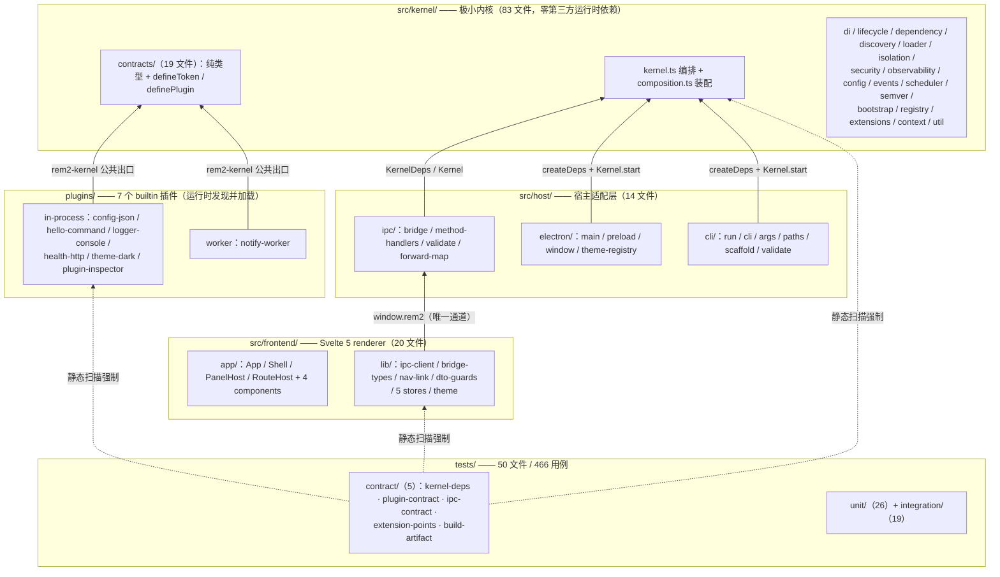
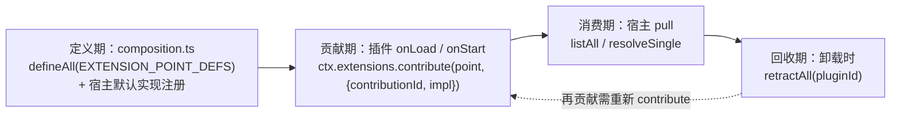
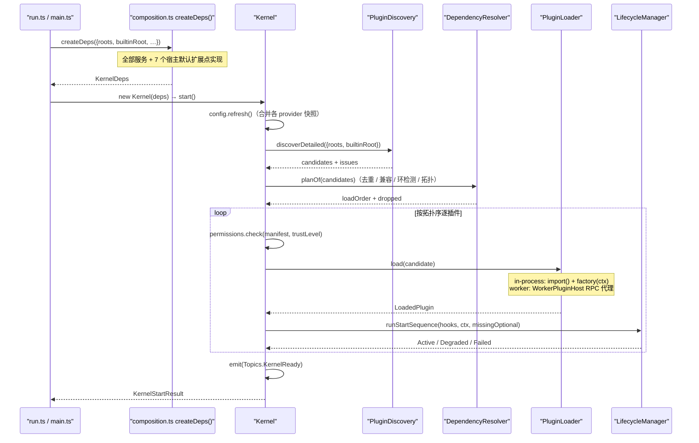
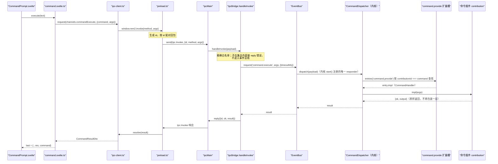
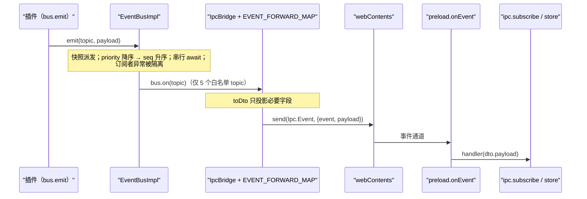

# 01 · 架构总览（权威）

> 本文描述**当前代码的真实行为**，是架构与边界的唯一权威来源。代码与本文冲突时以代码为准，并把偏差修回来（改文档或改代码，不静默留存）。
>
> **定位约定**：一律用「`文件.ts` → `符号名`」定位，不写行号。行号会随改动失效，符号名不会。
>
> **配套文档**：
>
> - [`02-plugin-api.md`](02-plugin-api.md) —— 插件作者要读的全部契约
> - [`03-frontend-ipc.md`](03-frontend-ipc.md) —— renderer、IPC 白名单、主题通路
> - [`04-development-guide.md`](04-development-guide.md) —— 命令、构建、验证、扩展与排障
>
> English: [`en/01-architecture-overview.md`](en/01-architecture-overview.md)

---

## 1. 分层与依赖方向



依赖方向恒为单向，**无反向边**：

```
frontend →（window.rem2）→ host/ipc → kernel
plugins  →（rem2-kernel 公共出口）→ kernel
host     →（相对路径 import）→ kernel
```

| 层                   | 硬约束                                                                                | 机器判据                                                                         |
| -------------------- | ------------------------------------------------------------------------------------- | -------------------------------------------------------------------------------- |
| kernel               | 零第三方运行时依赖；不得 import `host` / `frontend` / `plugins`                       | `tests/contract/kernel-deps.test.ts` R1 / R2（扫描文件数有下限，防静默失效）     |
| host（除 electron/） | 同样零第三方依赖（`host/electron/**` 允许 import `electron`）                         | 同上 R1，扫描时排除 `host/electron/**`                                           |
| frontend             | 不得 import 内核 / 宿主源码；唯一通道是 `window.rem2`                                 | `tests/contract/plugin-contract.test.ts` R6；白名单取自 `src/shared/`（见 §7.1） |
| plugins              | 只从 `rem2-kernel` / `node:*` / 相对路径导入；manifest `entry` 必须是 `.js` 或 `.mjs` | `tests/contract/plugin-contract.test.ts` R4 / R7                                 |
| `src/shared/**`      | 零 import（纯字面量 + 纯类型）                                                        | `tests/contract/ipc-contract.test.ts`                                            |

**一句话**：内核（83 文件）只做编排与契约；宿主（14 文件）把 Electron / CLI / IPC 适配到内核契约；前端（20 文件）经 `window.rem2` 消费 15 个白名单方法与 5 个白名单事件；全部业务与运维能力（命令、配置、日志、健康、主题、通知、检查器 UI）都是 `plugins/` 下的 7 个插件。

---

## 2. 目录与文件职责

### 2.1 全量目录树

行尾注释为该文件的**唯一职责**；★ 表示改动时必须同步的契约锚点。

```
rem2-kernel/
├── src/
│   ├── main.ts                        # ★ Forge 主进程入口转发壳：import './host/electron/main.js'
│   ├── preload.ts                     # ★ Forge preload 入口转发壳：import './host/electron/preload.js'
│   ├── declarations.d.ts              # renderer 侧 window.rem2 的全局类型声明
│   │
│   ├── kernel/                        # ═══ 极小内核（零第三方运行时依赖）═══
│   │   ├── index.ts                   # ★ 唯一公共出口：契约类型 + defineToken / definePlugin + 令牌 + 错误类
│   │   ├── kernel.ts                  #   编排层：start / reload / unloadPlugin / shutdown / health
│   │   ├── composition.ts             # ★ 装配：createDeps() 造全部服务 + 注入宿主默认扩展点实现
│   │   ├── define-plugin.ts           #   definePlugin()：唯一插件形态工厂
│   │   ├── state-machine.ts           #   逻辑状态机：TRANSITIONS 转移表
│   │   ├── topics.ts                  #   语义主题常量 Topics / TopicValue
│   │   ├── errors.ts                  #   全部错误类与稳定错误码
│   │   ├── version.ts                 #   KERNEL_VERSION / CONTRACT_VERSION / MANIFEST_FILENAME
│   │   │
│   │   ├── contracts/                 # ═══ 插件看得见的全部语言（纯类型 + 纯函数，零副作用）═══
│   │   │   ├── index.ts               #   桶文件，只 re-export
│   │   │   ├── manifest.ts            #   PluginManifest / Compatibility / ManifestContribution
│   │   │   ├── plugin.ts              #   PluginFactory / PluginFactoryHooks / PLUGIN_HOOK_NAMES
│   │   │   ├── lifecycle.ts           #   LifecyclePhase / StopReason / PhaseOutcome
│   │   │   ├── context.ts             #   PluginContext / PluginApi / ServicesView
│   │   │   ├── extension-point.ts     #   ExtensionPointId / Def / Contribution / ContributorView
│   │   │   ├── service-token.ts       #   ServiceToken 品牌化接口 + defineToken()
│   │   │   ├── kernel-tokens.ts       #   KernelTokens：16 个内核服务令牌
│   │   │   ├── plugins.ts             #   PluginStateT / PLUGIN_STATES / TERMINAL_STATES / PluginInfo
│   │   │   ├── ui.ts                  #   ThemeDefinition / PanelContribution / RouteContribution / ThemeRegistry
│   │   │   └── event-bus · config · logging · metrics · tracing · health · permission · container · service
│   │   │
│   │   ├── extensions/                # ═══ 能力的唯一挂载面 ═══
│   │   │   ├── definitions.ts         # ★ 12 个扩展点的声明式定义表（顺序即 list() 输出序）
│   │   │   ├── registry.ts            # ★ ExtensionPointRegistry：define / contribute / 枚举 / 按 pluginId 回收
│   │   │   ├── command-dispatcher.ts  #   CommandDispatcher：command.execute 的唯一分发者（直读 command.provide 槽）
│   │   │   ├── contrib-slot.ts        #   单例槽与多贡献槽的容器语义
│   │   │   ├── ports.ts               #   三个 *.replace 与 command.provide 的端口契约
│   │   │   └── ports-types.ts         #   端口侧类型（LoadedPlugin / PluginLoaderOptions）
│   │   │
│   │   ├── bootstrap/
│   │   │   ├── options.ts             #   KernelOptions + defaultKernelOptions()
│   │   │   └── register-core-services.ts # 15 个 KernelTokens 注册进 root 容器 + 8 项敏感服务能力门槛
│   │   │
│   │   ├── lifecycle/
│   │   │   ├── phases.ts              #   7 个生命周期阶段与钩子的映射表
│   │   │   ├── pipeline.ts            # ★ 物理执行管线（9 步），以数据表达，便于断言「顺序 == 契约」
│   │   │   ├── manager.ts             #   阶段驱动 + 超时 + 致命 / 非致命裁决
│   │   │   └── rollback.ts            #   致命失败的逆序回滚
│   │   │
│   │   ├── di/                        #   Container 实现 / Lifetime 归一 / ServiceRegistryFacade
│   │   ├── dependency/               #   依赖图、环检测、稳定拓扑排序、版本兼容解析
│   │   ├── discovery/                #   根目录扫描 + manifest 读取校验 + mtime 缓存 + JSON Schema
│   │   ├── loader/                   #   动态 import() + 入口沙箱 + 工厂断言 + 上下文组装
│   │   ├── isolation/                #   Worker 宿主 / 代理 / eval 引导 / 消息协议白名单
│   │   ├── security/                 #   能力守卫 + 权限管理 + 信任策略
│   │   ├── observability/            #   log / metrics / tracing / health 四服务 + sink 桥 + 空实现
│   │   ├── config/                   #   分层合并 + 快照 + 变更通知 + 内存 provider
│   │   ├── events/                   #   事件总线（桶索引 + 优先级定序）+ 主题匹配
│   │   ├── scheduler/                #   调度端口 + 串行默认实现
│   │   ├── semver/                   #   版本解析、比较、范围满足
│   │   ├── registry/                 #   已加载插件表 + 状态 + 健康（对外只读视图）
│   │   ├── context/                  #   PluginContext 组装 + 插件 API（export / useCapability）
│   │   └── util/                     #   deepMerge / disposable / id / timeout
│   │
│   ├── host/                          # ═══ 宿主适配层 ═══
│   │   ├── electron/
│   │   │   ├── main.ts                # ★ 主进程：createDeps() → Kernel → 注册白名单实现表 → 窗口
│   │   │   ├── preload.ts             # ★ 唯一契约边界：contextBridge 暴露 window.rem2
│   │   │   ├── window.ts              #   createWindow()：contextIsolation + sandbox + CSP（renderer 级沙箱；REM2_DISABLE_GPU=1 的 opt-in 路径会额外禁用进程沙箱，见 04 §6）
│   │   │   └── theme-registry.ts      #   宿主主题表（只依赖 kernel/contracts/ui，不 import 插件）
│   │   ├── ipc/
│   │   │   ├── bridge.ts              #   IpcBridge：双向收窄 + DTO 降维
│   │   │   ├── method-handlers.ts     # ★ Record<AllowedMethod, …> 宿主实现表（不 import electron）
│   │   │   ├── validate.ts            #   IPC 入参运行时校验（纯函数：panelIdOf / uiEventArgsOf / themeIdOf）
│   │   │   └── forward-map.ts         # ★ Record<AllowedEvent, …> 内核 topic → 对外事件降维
│   │   └── cli/
│   │       ├── run.ts                 #   `pnpm dev`：参数 → KernelOptions → start → 健康报告
│   │       ├── cli.ts                 #   `pnpm cli`：scaffold / validate / list / help
│   │       ├── args.ts                #   命令行参数解析
│   │       ├── paths.ts               # ★ projectRoot() / builtinPluginsRoot()：三种运行形态的路径解析
│   │       ├── scaffold-plugin.ts     #   插件骨架生成
│   │       └── validate-manifest.ts   #   manifest 校验命令
│   │
│   ├── frontend/                      # ═══ Svelte 5 前端（详见 03）═══
│   │   ├── entry-client.ts            #   renderer 入口：引入 global.css + mount(App)
│   │   ├── app/                       #   App / Shell / PanelHost / RouteHost / components / global.css
│   │   └── lib/                       #   ipc-client / bridge-types / nav-link / dto-guards / stores(.svelte.ts) / theme/vars.ts
│   │
│   └── shared/
│       └── ipc-contract.ts            # ★ 宿主与前端共用的方法名 / 事件名（唯一一份字符串，零 import）
│
├── plugins/                           # 插件源码单元（7 个，每个 4 件：package.json / tsconfig.json / plugin.json / src）
├── plugins-dist/                      # 插件构建产物（进 extraResource，git 忽略）
├── scripts/build-plugins.mjs          # esbuild 逐插件打包（构建期代码，刻意不进 src/）
├── tests/{unit,integration,contract}  # 3 层测试 + fixtures/ + helpers/
├── examples/config/app.config.json    # config-json 插件的示例配置
│
├── vite.shared.mts                    # ★ alias / ssr.noExternal 的单一来源（conditions 按环境分化）
├── vite.main.config.mts               #   主进程构建（target node20）
├── vite.preload.config.mts            #   preload 构建（产物名必须是 preload.cjs）
├── vite.renderer.config.mts           #   renderer 构建（唯一挂 svelte 插件的 config）
├── vitest.config.ts                   #   node 环境 + 限并发
├── tsconfig.json                      #   基线：kernel + host(cli/ipc) + 插件 + 测试
├── tsconfig.build.json                # ★ 唯一 noEmit:false 的配置（内核产物）
├── tsconfig.electron.json             #   主进程 + preload（DOM + node）
├── tsconfig.frontend.json             #   renderer（只要 DOM，types: []）
├── tsconfig.shell.json                #   转发壳（等价于 tsconfig.electron.json）
└── forge.config.mts                   #   asar + extraResource: ['plugins-dist'] + Fuses
```

### 2.2 内核子模块职责

> 「不负责什么」一栏比职责更重要 —— 它是架构的负空间。

| 模块                                              | 职责                                                                                        | 关键符号                                                              | 不负责什么                                     |
| ------------------------------------------------- | ------------------------------------------------------------------------------------------- | --------------------------------------------------------------------- | ---------------------------------------------- |
| `contracts/`                                      | 插件看得见的全部语言：纯类型 + 2 个纯函数工厂 + 16 个 `KernelTokens`                        | `defineToken`、`KernelTokens`、`PluginManifest`                       | 任何实现、任何 IO、任何副作用                  |
| `kernel.ts`                                       | 编排：start / reload / unloadPlugin / shutdown / health                                     | `Kernel`、`applyPluginState`                                          | 不 `new` 任何实现类（构造器只收 `KernelDeps`） |
| `composition.ts`                                  | 装配：`createDeps()` 造服务 + 注册宿主默认扩展点实现                                        | `createDeps`、`KernelDeps`、`CommandDispatcher`                       | 不做编排决策                                   |
| `extensions/`                                     | 12 个扩展点声明 + 贡献 / 枚举 / 按 pluginId 强制回收 + 3 个 `*.replace` 端口 + 命令唯一分发 | `EXTENSION_POINT_DEFS`、`ExtensionPointRegistry`、`CommandDispatcher` | 不提供任何扩展点的具体实现                     |
| `di/`                                             | `Container`：父引用藏模块私有 `WeakMap`、`exported` 显式导出、兄弟容器互访                  | `Container`                                                           | 不做能力判定（那是 `security/`）               |
| `dependency/`                                     | 版本兼容 + 去重 + 环检测 + 确定性拓扑排序                                                   | `DependencyResolver`                                                  | 不加载任何插件代码                             |
| `discovery/`                                      | 扫根目录、读并校验 `plugin.json`、mtime 缓存                                                | `PluginDiscovery`                                                     | 不 `import()` 入口                             |
| `lifecycle/`                                      | 物理管线（数据化步骤表）+ 阶段驱动 + 超时 + 回滚                                            | `START_PIPELINE` / `STOP_PIPELINE`、`LifecycleManager`                | 不决定加载顺序（那是 resolver）                |
| `loader/`                                         | 动态 `import()` + 工厂调用 + 容器 / 上下文组装 + Worker 代理                                | `PluginLoader`                                                        | 不发现、不解析                                 |
| `isolation/`                                      | Worker 宿主：RPC + 懒启动 + 崩溃即 Failed                                                   | `WorkerPluginHost`                                                    | **不是安全沙箱**（见 §9 D5）                   |
| `security/`                                       | 能力守卫 + 权限管理 + 信任策略                                                              | `CapabilityGuard`、`PermissionManager`、`trustLevelFor`               | 不做签名验证                                   |
| `observability/`                                  | log / metrics / tracing / health 四服务 + sink 扩展点桥                                     | `LogService`、`registerHostSinks`                                     | 不落地具体 sink（由插件贡献）                  |
| `config/`                                         | provider 分层 + 合并 + 变更通知，**不内置任何具体配置源**                                   | `ConfigService`                                                       | 不认识 JSON / env / remote（那些是插件）       |
| `events/`                                         | 事件总线：桶索引、priority 降序 → seq 升序、串行 await                                      | `EventBusImpl`                                                        | 不知道任何具体 topic 语义                      |
| `scheduler/` / `semver/`                          | 调度端口 + 串行实现；版本解析与范围满足                                                     | `SerialScheduler`、`satisfies`                                        | —                                              |
| `bootstrap/`                                      | 选项归一 + 把 15 个令牌注册进 root 容器 + 设 8 项能力门槛                                   | `registerCoreServices`、`defaultKernelOptions`                        | **不注入任何扩展点默认实现**                   |
| `registry/`                                       | 已加载插件表 + 状态 + 健康（只读视图）                                                      | `PluginsRegistry`                                                     | —                                              |
| `context/`                                        | 组装 `PluginContext`；插件 API 的导出与能力消费                                             | `createPluginContext`、`PluginApiImpl`                                | 插件 API 不持有父容器引用                      |
| `state-machine` / `topics` / `errors` / `version` | 12 状态转移表 / 语义主题常量 / 错误类 / 版本常量                                            | `TRANSITIONS`、`Topics`、`KernelError`                                | `index.ts` 不导出任何实现类                    |

### 2.3 宿主与前端职责

| 模块                                             | 职责                                                                                                 | 关键符号                                    | 不负责什么                                                              |
| ------------------------------------------------ | ---------------------------------------------------------------------------------------------------- | ------------------------------------------- | ----------------------------------------------------------------------- |
| `host/electron/main.ts`                          | 宿主入口：`createDeps` + `Kernel` + 注册实现表 + 窗口生命周期                                        | `startKernel`、`registerWhitelistedMethods` | 不认识任何具体插件 id；**不含任何方法名字符串**（实现表在 `host/ipc/`） |
| `host/ipc/method-handlers.ts` + `forward-map.ts` | 方法实现表（键由 `Record` 强制齐全，入参经 `validate.ts` 运行时校验）+ topic → 对外事件降维映射      | `METHOD_FACTORIES`、`EVENT_FORWARD_MAP`     | 不 import electron（可被 vitest 直接驱动）                              |
| `host/ipc/bridge.ts` + `shared/ipc-contract.ts`  | renderer 唯一通道：白名单精确匹配 + DTO 降维                                                         | `IpcBridge`、`channels` / `events`          | 不把 `bus.emit` 暴露给 renderer、不转发 `bus.on('*')`                   |
| `host/electron/preload.ts`                       | 唯一契约边界：`contextBridge` 暴露 `{invoke, onEvent}`                                               | `Rem2Bridge`                                | **不做白名单判定**（判定必须在主进程，renderer 不可信）                 |
| `host/electron/window.ts` / `theme-registry.ts`  | 窗口创建（CSP / sandbox / dev-vs-prod 加载）；内存主题表                                             | `createWindow`、`ThemeRegistryImpl`         | theme-registry 不 import 任何插件源码                                   |
| `host/cli/*`                                     | 终端内核引导（`pnpm dev` 主形态）；路径三形态解析；scaffold / validate / list                        | `run`、`builtinPluginsRoot`                 | 不依赖 Electron（内核是纯库，外壳是可选载体）                           |
| `frontend/app/**`                                | Shell 布局 + `PanelHost` / `RouteHost` 插槽 + 4 个 chrome 组件                                       | `App.svelte`、`PanelShell.svelte`           | **不出现任何插件 id**；chrome 由宿主渲染，插件只给描述数据              |
| `frontend/lib/**`                                | `window.rem2` 的类型化唯一封装 + DTO 投影与运行时校验（`dto-guards` / `nav-link`）+ 5 个 runes store | `ipc`、`bridge-types.ts`、`parsePanelData`  | 不 import 内核 / 宿主源码；白名单经 `src/shared/`                       |
| `plugins/**`                                     | 全部业务与运维能力：命令、配置源、日志 sink、健康端点、主题、通知、检查器面板                        | 各自 `export default definePlugin(...)`     | 不 import 第三方包；不深链内核实现                                      |

---

## 3. 生命周期：逻辑状态机 × 物理管线

两层模型，二者不冲突：**状态机描述插件的可观测认知，管线描述内核的实际动作**。

### 3.1 逻辑状态机（`state-machine.ts` → `TRANSITIONS`）

```
Registered → Resolved → Loaded → Initialized → Configured → Active ⇄ Degraded
     │           │         │          │             │            │
     ├→ Dropped  ├→ Failed ├→ Failed  ├→ Failed     ├→ Failed    ├→ Stopped
     └→ Failed   └→ Stopped└→ Stopped └→ Stopped    └→ Stopped   └→ Degraded

Failed → Stopped → Unloaded → Disposed
```

- 终止态：`Dropped`、`Disposed`（`TERMINAL_STATES`），不可再跃迁。
- 非法跃迁抛 `IllegalTransitionError`（`E_ILLEGAL_TRANSITION`），不静默纠正。

### 3.2 物理管线（`lifecycle/pipeline.ts` → `START_PIPELINE` / `STOP_PIPELINE`）

| 步  | 动作                                                            | 状态跃迁                         | 失败语义             |
| --- | --------------------------------------------------------------- | -------------------------------- | -------------------- |
| A   | `discover()` 扫描根目录                                         | —                                | —                    |
| B   | 读并校验 `plugin.json`                                          | → `Registered`                   | 非致命               |
| C   | `DependencyResolver.resolve(all)`（**整图批量计算**）           | `Registered → Resolved`          | 非致命→Dropped       |
| D   | 权限检查 → 入口解析 → `import()` → 工厂调用 → 建子容器          | `Resolved → Loaded`              | **致命**             |
| E   | `onDiscover` → `onLoad`                                         | `Loaded → Initialized`           | 致命 / 非致命按钩子  |
| F   | `onConfigure`（读配置快照）                                     | `Initialized → Configured`       | **致命**             |
| G   | `onStart`                                                       | `Configured → Active / Degraded` | **致命**             |
| H   | 健康汇总 + `KernelReady`                                        | —                                | —                    |
| I   | 卸载：先依赖者 → `onStop` → `onUnload` → `onDispose` → 强制回收 | 逐级至 `Disposed`                | 单钩子失败不阻断其余 |

**关键取舍**：依赖解析在逻辑序排第 5（`Registered → Resolved` 是插件的一次可观测跃迁），在物理序排第 2（必须先读 manifest 才有依赖图）。`pipeline.ts` 把顺序表达为**数据**，`tests/unit/lifecycle.test.ts` 直接断言「顺序 == 契约」，因此两层永远不会悄悄错位。

超时：`onStart` 受 `startTimeoutMs` 约束，`onStop` 受 `stopTimeoutMs` 约束，超时抛 `E_TIMEOUT` 并按致命 / 非致命裁决；`rollback.ts` 负责把已执行阶段逆序撤销。

---

## 4. 扩展点机制

扩展点是「一切皆插件」的唯一落地面：插件不直接调用其他插件，也不向内核注册能力，**只向扩展点槽贡献实现**。

### 4.1 12 个扩展点（`extensions/definitions.ts` → `EXTENSION_POINT_DEFS`）

| #   | id                  | 契约类型                 | 槽     | 冲突裁决    | capability         | 宿主默认实现                                        | 用途                                                          |
| --- | ------------------- | ------------------------ | ------ | ----------- | ------------------ | --------------------------------------------------- | ------------------------------------------------------------- |
| 1   | `log.sink`          | `LogSink`                | multi  | keep-first  | —                  | `NullLogSink`（`kernel.null`）                      | 日志输出目的地                                                |
| 2   | `metrics.sink`      | `MetricSink`             | multi  | keep-first  | —                  | `NoopMetricSink`（`kernel.noop`）                   | 指标导出                                                      |
| 3   | `trace.exporter`    | `TraceExporter`          | multi  | keep-first  | —                  | 内存缓冲 exporter（`kernel.buffered`）              | span 导出                                                     |
| 4   | `config.provider`   | `ConfigProvider`         | multi  | keep-first  | `config.provide`   | `ReadOnlyMemoryConfigProvider`（`kernel.defaults`） | 配置层（json / env / remote）                                 |
| 5   | `command.provide`   | `CommandHandler`         | multi  | reject-new  | `command.provide`  | ❌                                                  | 业务命令（由内核 `CommandDispatcher` 按 contributionId 消费） |
| 6   | `health.check`      | `HealthCheckFn`          | multi  | keep-first  | —                  | ❌                                                  | 插件健康自检                                                  |
| 7   | `ui.theme`          | `ThemeDefinition`        | multi  | reject-new  | `ui.theme`         | `ThemeRegistryImpl`（宿主注册，见 §4.3）            | 主题目录（light/dark 共存）                                   |
| 8   | `ui.panel`          | `PanelContribution`      | multi  | reject-new  | `ui.panel`         | ❌（无面板插件时槽为空，前端显式空态）              | 声明式面板描述                                                |
| 9   | `ui.route`          | `RouteContribution`      | multi  | replace-old | `ui.route`         | ❌                                                  | 声明式路由                                                    |
| 10  | `scheduler.replace` | `Scheduler`              | single | replace-old | `kernel.internals` | `SerialScheduler`（`kernel.serial`）                | 替换调度器                                                    |
| 11  | `resolver.replace`  | `DependencyResolverPort` | single | replace-old | `kernel.internals` | 内置 `DependencyResolver`（`kernel.builtin`）       | 替换依赖解析策略                                              |
| 12  | `loader.replace`    | `PluginLoaderPort`       | single | replace-old | `kernel.internals` | 内置 `PluginLoader`（`kernel.builtin`）             | 替换装载机制                                                  |

单例槽的 `conflict` 必须显式声明，契约测试会查；缺省即编译期报错（`ExtensionPointDef` 的字段是必填）。

### 4.2 四阶段



三条不变式（`extensions/registry.ts`）：

1. 未定义的 point id → `UnknownExtensionPointError`（不静默忽略）。
2. 扩展点声明了 `capability` 而插件未获授 → `CapabilityDeniedError`（**贡献本身也受能力约束**）。
3. 槽冲突按定义里的 `conflict` 裁决；`keep-first` 的拒绝记入 `issues` 而非抛错。

**回收由内核强制**：`retractAll(pluginId)` 在卸载链路里无条件执行。插件即使从不调 `retract`，其贡献也会被按 `pluginId` 清空 —— 与 DI 子容器的 `dispose` 同一思路：**回收不能依赖插件自觉**。为此 `MultiContributionSlot` 维护 `pluginId → 贡献` 的反向索引，这是机制能成立的前提。

### 4.3 宿主默认实现注入在哪

| 位置                                        | 内容                                                                                                                                                                         |
| ------------------------------------------- | ---------------------------------------------------------------------------------------------------------------------------------------------------------------------------- |
| `composition.ts` → `registerHostDefaults()` | `extension-sinks.ts` 提供 `log.sink` / `metrics.sink` / `trace.exporter` / `config.provider` 四个；内联注册 `scheduler.replace` / `resolver.replace` / `loader.replace` 三个 |
| `host/electron/main.ts` → `startKernel()`   | `ui.theme` 的宿主实现 `ThemeRegistryImpl`（依赖 Electron 窗口生命周期，内核零依赖前提下不能放内核）                                                                          |
| `bootstrap/register-core-services.ts`       | **不注入任何扩展点**，只注册 15 个 `KernelTokens` 与 8 项能力门槛                                                                                                            |

`KernelTokens` 共 16 个：15 个由内核注册（`bootstrap/register-core-services.ts`），`UiThemeRegistry` 由宿主在 `host/electron/main.ts` → `startKernel()` 里经 `registerInstance` 注册。

### 4.4 Worker 插件能贡献什么

`isolation/worker-protocol.ts` → `WORKER_ALLOWED_EXTENSION_POINTS` 只放行 `log.sink` / `metrics.sink` / `trace.exporter`，且贡献值必须可结构化克隆。贡献 UI 类扩展点会抛错 —— 进程边界决定了 Worker 里的对象无法被 renderer 消费。

---

## 5. 隔离与权限

| 层            | 机制                                                                                | 边界                                                                                          |
| ------------- | ----------------------------------------------------------------------------------- | --------------------------------------------------------------------------------------------- |
| 进程 / Worker | `worker_threads` 独立线程 + RPC 代理                                                | 崩溃 / 死循环 / `process.exit()` 不拖垮内核。**故障隔离，不是安全沙箱**                       |
| 容器          | 每插件一个 `Container` 子容器；父引用藏模块私有 `WeakMap`；插件拿不到 root 容器句柄 | 只能解析：自身注册项 + 兄弟插件显式导出的服务 + 父容器 `shareable` 且已导出的项               |
| 能力          | `CapabilityGuard` + `PermissionManager` + `TrustPolicy`                             | 三段式：manifest `requires` 声明 → 按 `trustLevel` 计算授权 → `resolve` / `contribute` 时校验 |

信任分级：`builtin` = trusted，其余 = sandboxed（`security/trust-policy.ts` → `trustLevelFor`）。签名验证明确不做。

**Worker 内可用 / 不可用**：

| 设施                                                         | in-process | worker                                                  |
| ------------------------------------------------------------ | ---------- | ------------------------------------------------------- |
| `ctx.log` / `ctx.metrics`                                    | ✅         | ✅ RPC                                                  |
| `ctx.config`                                                 | ✅         | ✅ get / has 走 RPC；`onDidChange` 由内核 push 全量快照 |
| `ctx.events`（emit / on / request）                          | ✅         | ✅ RPC（`respond` 不可用）                              |
| `ctx.permissions`                                            | ✅         | ✅ init 时真实快照                                      |
| `ctx.resolvePath`                                            | ✅         | ✅                                                      |
| `ctx.services` / `ctx.api` / `ctx.plugins` / `ctx.container` | ✅         | ❌ 调用即抛错                                           |
| `ctx.extensions`                                             | ✅         | ⚠️ 仅 §4.4 三类                                         |

---

## 6. 调用链路

### 6.1 启动（CLI 与 Electron 同构）



### 6.2 命令（renderer → 内核 → 插件 → 原路回传）



宿主**不实现** `command.execute`（`method-handlers.ts` 里该键的值是 `null`）：分发只走内核 `CommandDispatcher` —— 它在 `start()` 开头注册（早于任何插件 `onStart` 的 respond，`pickResponder` 按 seq 取最小者，插件侧 respond 被确定性遮蔽），直接读 `command.provide` 扩展槽，**结构上不可能递归**。**插件不要再直接 `respond` `Topics.CommandExecute`**（即使写了也被 dispatcher 遮蔽）；把命令贡献进 `command.provide` 槽即可，示例见 [`02-plugin-api.md`](02-plugin-api.md) §8。

### 6.3 事件（插件 → 总线 → DTO 降维 → renderer）



### 6.4 卸载与级联

```
unloadPlugin(pluginId)
  ├─ 未加载 → 幂等返回
  ├─ 硬依赖本插件的插件 → 递归 unload（reason: 'dependency-failed'）
  ├─ runStopSequence: onStop → onUnload → onDispose（幂等，单钩子失败不阻断其余）
  ├─ extensions.retractAll(pluginId)
  ├─ health.unregisterCheck + permissions.unregister
  ├─ rootContainer.unmountChildContainer(child) → child.dispose()
  ├─ applyPluginState('Stopped') → emit(Topics.PluginStateChanged, {pluginId, state})
  │    （贡献已先回收：前端收到事件再重拉，必然看到回收后的新列表，无竞态）
  ├─ registry.remove(pluginId)
  └─ emit(Topics.PluginUnloaded, {pluginId, reason})
```

---

## 7. 数据通路

### 7.1 四类数据

| 数据     | 产生                                                                                                                          | 经过谁                                                                                                                                        | 消费                                                                                                   |
| -------- | ----------------------------------------------------------------------------------------------------------------------------- | --------------------------------------------------------------------------------------------------------------------------------------------- | ------------------------------------------------------------------------------------------------------ |
| **配置** | `config-json` 插件（`JsonConfigProvider`，priority 10）+ 内核只读默认层 `{app:{name:'rem2-kernel'}}` + `initialConfig` 可写层 | `ConfigService.refresh()` 按 priority 升序 deepMerge 成快照；`get()` 惰性刷新                                                                 | 插件 `onConfigure` 期 `ctx.config.get(…)`；Worker 插件拿 init 快照 + 变更推送。**配置不外泄 renderer** |
| **命令** | `CommandPrompt.svelte` 输入                                                                                                   | store → `ipc.request` → preload → `IpcBridge`（白名单）→ `bus.request(Topics.CommandExecute)`                                                 | 内核 `CommandDispatcher` 读 `command.provide` 槽 → 命令插件 handler → `{ok, output}` 原路回传          |
| **事件** | 插件 `bus.emit`                                                                                                               | `EventBusImpl` → `EVENT_FORWARD_MAP`（5 个白名单 topic）→ `toDto` → `Ipc.Event`                                                               | renderer `ipc.subscribe`                                                                               |
| **主题** | `theme-dark` 插件贡献 `ui.theme`（light / dark 两套 token）                                                                   | 扩展点槽 →（`method-handlers.ts` → `syncThemeFromExtension()` **pull 同步**）→ 宿主 `ThemeRegistryImpl`（目录 + 激活态）→ `ui.theme.list/set` | renderer `theme` store → `theme/vars.ts` → CSS 变量 + `color-scheme`                                   |

`initialConfig` 内存层 priority = 1000，高于所有插件 provider —— 插件 `set()` 永远写内存层。这是有意的「宿主配置优先」语义。

### 7.2 IPC 边界：DTO 降维

内核的 `PluginInfo` / `LoadedPlugin` / `HealthReport` 含 container 句柄、permissions、绝对路径，透传即把内核内部结构与宿主机路径泄漏给不可信的 renderer。因此内核 → 宿主方向只做**显式投影**：

- `EVENT_FORWARD_MAP` 每条带 `toDto`，只取必要字段（如 `plugin.state-changed` 只投影 `{pluginId, state}`）。
- `health.report` 在 `method-handlers.ts` 里手工裁剪为 `{status, plugins:[{id,state,status,message?}]}`。
- 前端 `bridge-types.ts` 是 DTO 的显式白名单。

代价：每个方法 / 事件都要手写投影，内核加字段不会自动传导到前端。收益：泄漏面收敛为 **20 方法 + 6 事件**两个穷举集合，且两者与内核 `Topics` 真值由契约测试锚定。方法与事件清单见 [`03-frontend-ipc.md`](03-frontend-ipc.md) §3。

### 7.3 IPC 契约的单一来源

```
src/shared/ipc-contract.ts        ← 唯一一份字符串（channels / events，语义名 → 对外真名）
        │
        ├─ host/ipc/method-handlers.ts   Record<AllowedMethod, MethodFactory | null>  键 = [channels.x]
        ├─ host/ipc/forward-map.ts       Record<AllowedEvent, {topic: TopicValue, toDto}>  键 = [events.x]
        ├─ host/electron/preload.ts      通道常量 Ipc.Invoke / Ipc.Event
        └─ frontend/lib/ipc-client.ts    方法 / 事件参数类型即 AllowedMethod / AllowedEvent
```

- `src/shared/` 是**中立层**：零 import，宿主与前端都只依赖它，彼此不依赖。因此 renderer 不会经它碰到 Node / Electron 代码。
- 「漏抄一个方法」= `Record` 缺键 = **编译错误**，不是运行期静默。
- 类型挡不住的（键集合是否与白名单完全相等、topic 是否为 `Topics` 真值、有无重复）由 `tests/contract/ipc-contract.test.ts` 与 `plugin-contract.test.ts` 断言。

---

## 8. 构建与产物

### 8.1 三条产线

| 产线   | 输入                                                              | 执行                                        | 输出                                                                                       |
| ------ | ----------------------------------------------------------------- | ------------------------------------------- | ------------------------------------------------------------------------------------------ |
| 内核库 | `src/kernel/**`                                                   | `tsc -p tsconfig.build.json`                | `dist/kernel/**`（`.js` + `.d.ts` + `.map`）；`exports["."]` 指向此处                      |
| 插件   | `plugins/<id>/src/index.ts`                                       | `node scripts/build-plugins.mjs`（esbuild） | `plugins-dist/<id>/dist/index.js`（ESM bundle，node20）+ `plugin.json` + `package.json`    |
| 外壳   | `src/main.ts` / `src/preload.ts` / `src/frontend/entry-client.ts` | `electron-forge`（VitePlugin）              | `.vite/build/main.cjs`、`.vite/build/preload.cjs`、`.vite/renderer/main_window/index.html` |

`pnpm build` = `build:kernel` + `build:plugins`；`predev` / `premake` 都挂了 `build`。

### 8.2 插件进包与运行时定位

```
plugins-dist/ ──extraResource──▶ resources/plugins-dist/（asar 之外）
                                        │
                        builtinPluginsRoot()  ← host/cli/paths.ts
                                        │
                    KernelOptions.builtinRoot → discovery 扫描 → loader import()
```

- asar 保持 `true`；插件落在 asar **外面**，`import()` 只需普通文件路径。
- `extraResource` 接受目录列表，目标名取路径末段 ⇒ 装出来是 `resources/plugins-dist/`，不是 `rem2-plugins/`。
- `builtinPluginsRoot()` 优先 `plugins-dist/`（已构建），回退 `plugins/`（便于手工调试）。**manifest 的 `entry` 恒为 `dist/index.js`**，所以根目录指错会让所有插件以「模块解析失败」Failed，报错与真因相距很远。
- `paths.ts` 的 `moduleDir()` 依次尝试 `__dirname`（CJS）→ `import.meta.url`（ESM，判空）→ `process.cwd()`：Electron 主进程被 forge 打成 CJS，`import.meta.url` 是 `undefined`，不判空会崩在启动。

### 8.3 dev 与 prod 的差异

| 维度          | dev（`pnpm dev` / `electron-forge start`）                                     | prod（`pnpm make`）                                                                              |
| ------------- | ------------------------------------------------------------------------------ | ------------------------------------------------------------------------------------------------ |
| 内核运行      | `tsx` 直跑 TS（`predev` 仍会先 build）                                         | 全部预编译（`premake` 保证）                                                                     |
| 插件根        | `plugins-dist/`（回退 `plugins/`）                                             | `resources/plugins-dist/`                                                                        |
| renderer 加载 | Vite dev server（`MAIN_WINDOW_VITE_DEV_SERVER_URL`）                           | `loadFile(.vite/renderer/main_window/index.html)`                                                |
| 解析条件      | Node 侧 `['node','import','module']`；renderer `['browser','import','module']` | 同左                                                                                             |
| 安全开关      | 开发态宽松                                                                     | Fuses 关 RunAsNode / EnableNodeOptionsEnvironmentVariable / NodeCliInspect / OnlyLoadAppFromAsar |

`MAIN_WINDOW_VITE_DEV_SERVER_URL` / `MAIN_WINDOW_VITE_NAME` 是 Forge 经 Vite `define` 注入的**裸标识符**。带 `process.env.` 前缀不会被替换，运行期恒为 `undefined`，窗口永远走 `file://` 分支。常量名由渲染进程名大写化而来（本项目 `main_window`），改渲染进程名必须同步改这两个常量。

---

## 9. 关键设计决策

**D1 · 内核只做 7 件事**
Bootstrap / Discovery / Load·Unload / Lifecycle 编排 / 依赖解析 / 核心契约 / 最小共享设施。验收判据：**新增任何能力都不需要改 `src/kernel/**`**。连调度器、依赖解析器、装载器本身都能被插件替换。
代价：DI + 生命周期 + 扩展点的基础设施复杂度全部压给内核；插件间协作必须显式化（事件或 `api.export`），没有隐式全局。

**D2 · 插件预编译，不做运行期转译**
Fuses 封死 `NODE_OPTIONS=--import=tsx` 通道后，运行期转译在打包态是死代码；`entry` 统一指向 `dist/index.js` 让 dev 与 prod 同形态。代价：改完插件源码要 rebuild。

**D3 · 唯一 `definePlugin(manifest, setup)` 形态**
class 导出、已实例化单例、命名导出各有硬伤（tree-shaking、loader 断言、ESM 对齐）。内联 manifest 挂在工厂上，仅用于与 `plugin.json` 比对漂移（`ManifestMismatchError`）；权威来源始终是 `plugin.json`。
注意顺序：`defineProperty` 必须在 `Object.freeze` 之前，反过来会在**内核真正加载插件时**才抛「object is not extensible」。

**D4 · `ServiceToken` 是品牌化 interface + 纯函数工厂**
class 会在 bundle 里引入原型链，且 `static create` 依赖模块级状态；品牌化 interface 让任意副本的令牌行为一致。代价：没有运行期 instanceof 保护，防伪造只发生在编译期。

**D5 · Worker 隔离是故障隔离，不是安全沙箱**
`worker_threads` 不提供 V8 沙箱，Worker 内代码仍有完整 Node 能力。把目标收窄为「单插件故障不拖垮内核」才诚实。真正的安全边界是内核侧 `CapabilityGuard` + RPC 白名单。

**D6 · IPC 白名单精确匹配**
20 方法 + 6 事件穷举为 `Set<string>`（前缀匹配等于把整个命名空间交出去）。判定在主进程，preload 只透传。代价：新增一个 IPC 方法要动两个文件（契约 + 实现表），漏了就是编译错误。

**D7 · DTO 降维，不透传内核对象**
泄漏面收敛为两个穷举集合；代价是手写投影、内核加字段不自动到前端。

**D8 · 生命周期两层模型**
逻辑状态机 × 物理管线，见 §3。代价：两处表要同步，由测试断言兜底。

**D9 · DI 父引用藏模块私有 `WeakMap`**
TS `private` 只是编译期约束，运行期字段可枚举可读写，插件能 `(ctx.container as any).parentContainer` 拿到 root 容器绕过能力守卫。把「越界访问防护」落到运行期不可达，而不是类型承诺。

---

## 10. 扩展流程

### 10.1 新增插件

| 步骤 | 动作                               | 位置                                                                  |
| ---- | ---------------------------------- | --------------------------------------------------------------------- |
| 1    | 生成骨架                           | `pnpm cli scaffold <plugin-id>`                                       |
| 2    | 写 `definePlugin(manifest, setup)` | `plugins/<id>/src/index.ts`                                           |
| 3    | 声明依赖                           | `plugin.json` → `dependencies`（硬）/ `optionalDependencies`（软）    |
| 4    | 声明能力                           | `plugin.json` → `requires`                                            |
| 5    | 声明贡献                           | `plugin.json` → `contributes`（静态声明，与运行期 `contribute` 对齐） |
| 6    | 构建 + 校验                        | `pnpm build:plugins` → `pnpm cli validate plugins/<id>/plugin.json`   |

**不需要改内核、宿主、前端任何文件**。若发现必须改，说明该能力没被建模成扩展点。

### 10.2 新增扩展点

| 步骤 | 动作                                                                                                                    |
| ---- | ----------------------------------------------------------------------------------------------------------------------- |
| 1    | `contracts/extension-point.ts` → `ExtensionPointId` 联合加字面量                                                        |
| 2    | `extensions/definitions.ts` 加一条 `ExtensionPointDef`（`multi` / `hasHostDefault` / `conflict` / `capability` 全必填） |
| 3    | 若引入新端口：`extensions/ports.ts` 加接口                                                                              |
| 4    | 若 `hasHostDefault`：`composition.ts` → `registerHostDefault`                                                           |
| 5    | 若需能力：`contracts/permission.ts` 加常量 + `security/trust-policy.ts` 给出各信任级别处置                              |
| 6    | **同步 `tests/contract/extension-points.test.ts` 的 `EXPECTED_IDS`**（期望值是写死的字面量，不同步即红）                |

### 10.3 新增一个 IPC 方法

1. `src/shared/ipc-contract.ts` → `channels` 加一条（唯一一份字符串）。
2. `host/ipc/method-handlers.ts` → 加实现（**漏了 = 编译错误**）。
3. 若新增事件：`events` 加一条 + `host/ipc/forward-map.ts` 加一条（**漏了 = 编译错误**）。
4. 前端在 `ipc-client` 的方法类型上自动获得新字面量，调用处拼错即编译报错。

命令类方法必须把实现写成 `null`（由插件直接 respond），否则宿主会与插件争抢同一个 topic。

---

## 11. 已知限制与未接线

| #   | 现象                                                                                                                               | 性质                                                                                                  |
| --- | ---------------------------------------------------------------------------------------------------------------------------------- | ----------------------------------------------------------------------------------------------------- |
| L1  | `*.replace` 三个扩展点只支持启动期替换                                                                                             | 运行期替换会让 `SerialScheduler` 丢 in-flight 任务，未设计                                            |
| L2  | Windows 上仅 squirrel maker 可用（已验证：产出 `Setup.exe`，包内 `resources/plugins-dist/` 齐全）；deb/rpm maker 依赖 Linux 工具链 | 平台限制；`out/` 残留被占用文件时 packager 清理会被本机 safe-delete shim 阻断，清空 `out/` 后重跑即可 |

---

## 12. 契约测试：边界的机器判据

| 文件                                      | 断言                                                                                                                                          |
| ----------------------------------------- | --------------------------------------------------------------------------------------------------------------------------------------------- |
| `tests/contract/kernel-deps.test.ts`      | R1 内核与 host（除 electron）零第三方 import；R2 内核不得反向 import；R5 `dependencies` 恒为 `{}`；含提取器自检元测试（防止「违例为空」恒真） |
| `tests/contract/plugin-contract.test.ts`  | R4 插件只从 `rem2-kernel` / `node:*` / 相对路径导入；R6 前端不碰内核与宿主源码；R7 `entry` 是 `.js` / `.mjs`；IPC 事件名与 `Topics` 真值一致  |
| `tests/contract/ipc-contract.test.ts`     | `src/shared` 零 import；方法与事件键集合与白名单完全相等；无重复                                                                              |
| `tests/contract/extension-points.test.ts` | 12 个扩展点 id 逐条与写死的 `EXPECTED_IDS` 一致；单例槽必须有显式 `conflict`                                                                  |
| `tests/contract/build-artifact.test.ts`   | renderer 产物是浏览器版 svelte（sourcemap 含 `index-client.js`、不含 `index-server.js`）                                                      |

写契约测试的两条要求：

1. **判据必须能失败**。断言「违例为空」在提取器坏掉时也成立，所以要配元测试证明提取器在已知输入上确实提得出来。
2. **前提必须复现**。注册时序、加载顺序这类前提不进测试，护栏就抓不到真实缺陷。
