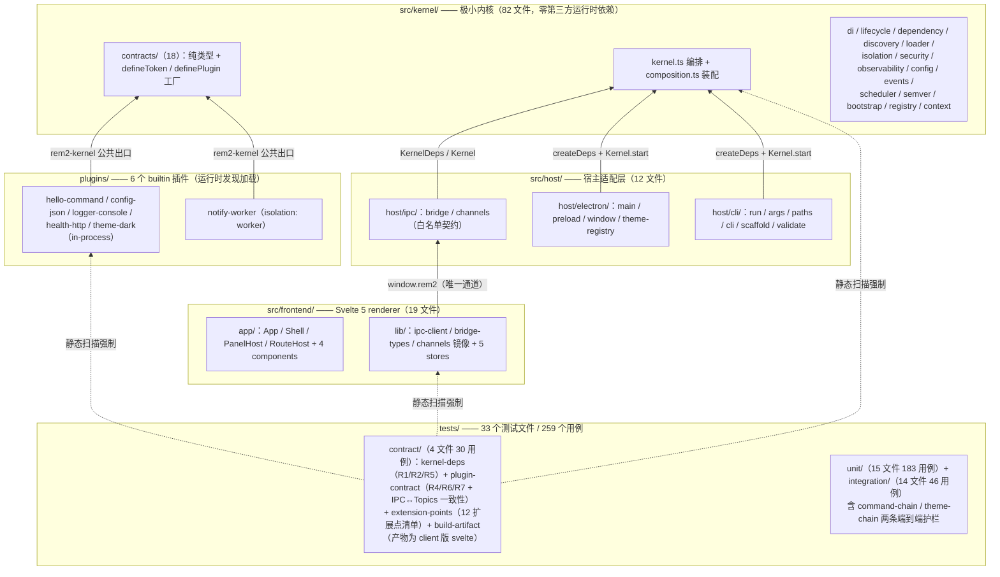
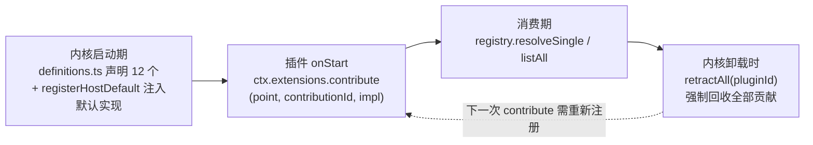
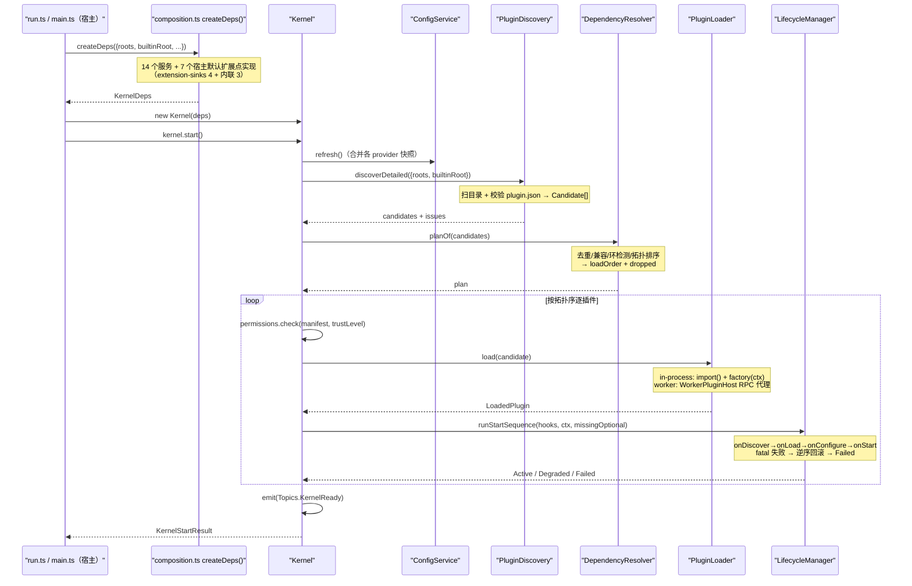
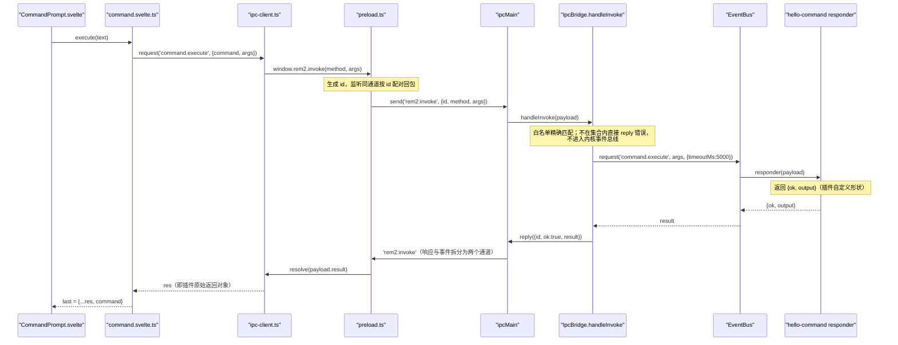
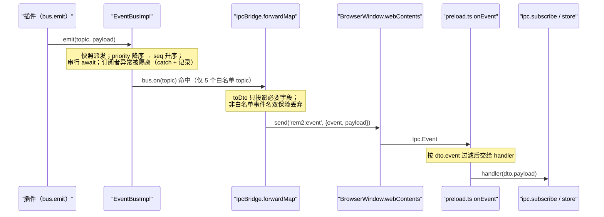
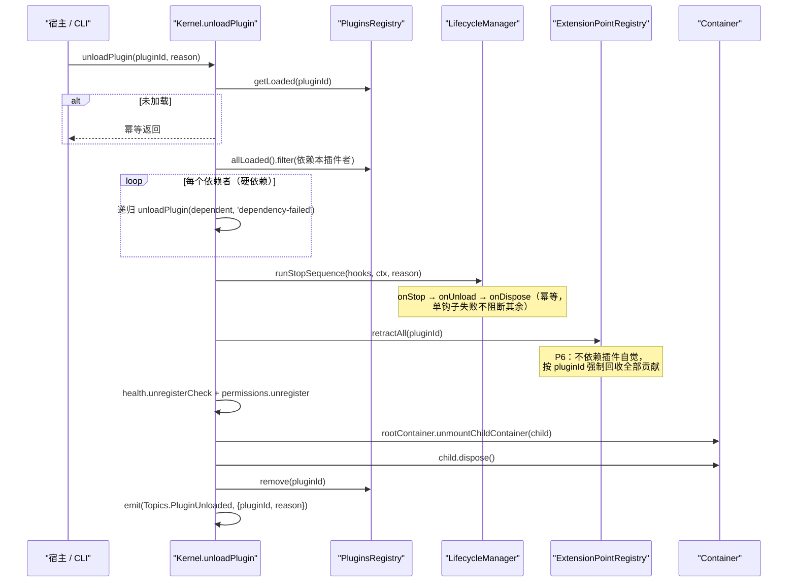
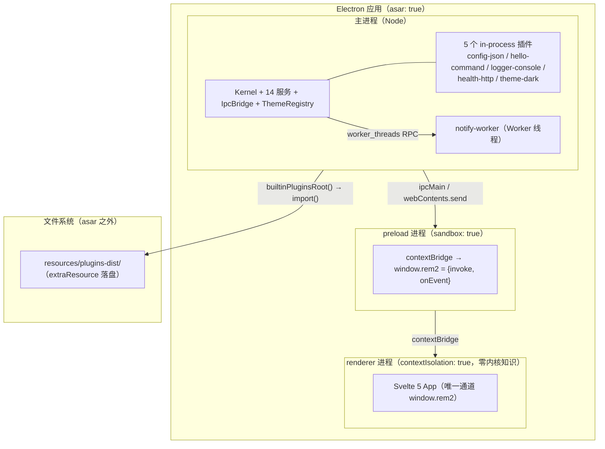

# 01 · rem2 整体架构（现行设计文档）

> 本文是**当前架构的权威描述**，以代码为准。
>
> **引用约定**：本文优先用「`文件.ts` → `符号名`」定位（抗代码漂移）。部分章节仍带 `文件:行号`，那是**撰写时的快照，仅作快速跳转用**，代码一改即失效 —— **以符号名为准**。
> 若发现行号与代码不符，说明代码变了：多数情况是「文档该更新」，但也可能是「代码引入了偏差」，两者都值得一查。
>
> **测试现状**（实测）：`tests/` 共 **33 个文件 / 259 个用例** —— contract 4 文件 30 用例、unit 15 文件 183 用例、integration 14 文件 46 用例。
>
> **配套文档**：
> - `02-plugin-api.md` —— 插件作者入口（现行 API）
> - `docs/README.md` —— 文档索引与阅读路径
> - `03-target-architecture.md` 是目标设计、`05-architecture-skeleton.md` 是落地说明，与真实代码的差异在 §8 如实记录，不静默"修正"。

---

## 1. 整体架构



**依赖方向恒为单向，无反向边**：

```
frontend →（window.rem2）→ host/ipc → kernel
plugins  →（rem2-kernel 公共出口）→ kernel
host     →（相对路径 import）→ kernel
```

**分层理由与硬约束**（均由契约测试静态断言，不是口头约定）：

| 层 | 硬约束 | 机器判据 |
| --- | --- | --- |
| kernel | 零第三方运行时依赖；不得 import `host`/`frontend`/`plugins` | `tests/contract/kernel-deps.test.ts:137`（R1，扫描文件数 >30 防静默失效）、`:168`（R2）、`:158`（R5，`dependencies` 恒空） |
| host（除 electron/） | 同样零第三方依赖（electron 允许 import `electron`） | 同上 R1，排除 `host/electron/**`（`:129-134`） |
| frontend | 不得 import 内核 / 宿主源码；唯一通道是 `window.rem2` | `tests/contract/plugin-contract.test.ts` R6；镜像白名单由契约测试断言两侧一致（`src/frontend/lib/channels.ts:1-8`） |
| plugins | 只从 `rem2-kernel` / `node:*` / 相对路径导入；manifest entry 必须是构建产物（.js/.mjs） | `tests/contract/plugin-contract.test.ts` R4-1/R4-2/R7 |

**一句话概括**：内核（82 文件）只做编排与契约，宿主（12 文件）把 Electron/CLI/IPC 世界适配到内核契约上，前端（19 文件）经 `window.rem2` 消费 8 个白名单方法与 5 个白名单事件，全部业务与运维能力（日志、配置、命令、健康、主题、通知）都是 `plugins/` 下的 6 个插件。

---

## 2. 核心模块职责划分

> 划边界比列职责更重要：下表「不负责什么」一栏是架构的负空间。

### 2.1 内核子模块（`src/kernel/**`）

| 模块 | 职责 | 关键导出 | 不负责什么 |
| --- | --- | --- | --- |
| `contracts/`（18 文件） | 插件看得见的全部语言：纯类型 + 两个纯函数工厂 + `KernelTokens`（17 个） | `defineToken`（`service-token.ts:38`）、`KernelTokens`（`kernel-tokens.ts:12`） | 任何实现、任何 IO、任何副作用 |
| `kernel.ts` | 编排：start / reload / unloadPlugin / shutdown / health | `Kernel` 类（`kernel.ts:32`） | 不 `new` 任何实现类（构造器只收 `KernelDeps`，`:52-56`） |
| `composition.ts` | 装配：`createDeps()` 造 14 个服务 + 注册宿主默认扩展点实现 | `createDeps`（`composition.ts:79`）、`KernelDeps`（`:54`） | 不做编排决策 |
| `extensions/`（5） | 12 个扩展点声明表 + 注册表（贡献/枚举/按 pluginId 强制回收）+ 3 个 `*.replace` 端口契约 | `EXTENSION_POINT_DEFS`（`definitions.ts:33`）、`ExtensionPointRegistry`（`registry.ts:47`） | 不提供任何扩展点的具体实现 |
| `di/`（3） | `Container`：父引用藏模块私有 `WeakMap`（`container.ts:64`）、`exported` 显式导出、`mountedChildren` 兄弟互访 | `Container`（`container.ts:74`） | 不做能力判定（那是 `security/` 的 guard） |
| `dependency/`（4） | 版本兼容 + 去重 + 环检测 + 确定性拓扑排序 | `DependencyResolver`（`resolver.ts:63`） | 不加载任何插件代码 |
| `discovery/`（4+1 schema） | 扫根目录、读并校验 `plugin.json`、mtime 缓存 | `PluginDiscovery`（`discovery.ts:43`） | 不 `import()` 入口 |
| `lifecycle/`（4） | 物理执行管线（数据化步骤表）+ 阶段驱动 + 超时 + 回滚 | `START_PIPELINE`/`STOP_PIPELINE`（`pipeline.ts:43`/`:110`）、`LifecycleManager`（`manager.ts:51`） | 不决定加载顺序（那是 resolver） |
| `loader/`（3） | 动态 `import()` + 工厂调用 + 容器/上下文组装 + Worker 代理 | `PluginLoader`（`loader.ts:53`） | 不发现、不解析 |
| `isolation/`（4） | Worker 宿主：RPC + 懒启动 + 崩溃即 Failed | `WorkerPluginHost`（`worker-host.ts:77`） | **不是安全沙箱**（见 §7 决策 5） |
| `security/`（3） | 能力守卫 + 权限管理 + 信任策略（builtin=trusted，其余 sandboxed） | `CapabilityGuard`、`PermissionManager`、`trustLevelFor`（`trust-policy.ts:48`） | 不做签名验证（本期明确不做，`trust-policy.ts:3-5`） |
| `observability/` | log/metrics/tracing/health 四服务 + sink 扩展点桥 | `LogService` 等、`registerHostSinks`（`extension-sinks.ts:40`） | 不落地具体 sink（由插件贡献） |
| `config/` | provider 分层 + 合并 + 变更通知，**不内置任何具体配置源** | `ConfigService`（`config-service.ts:36`） | 不认识 JSON/env/remote（那些是插件） |
| `events/`（3） | 事件总线：桶索引、priority 降序→seq 升序、串行 await | `EventBusImpl`（`event-bus.ts:65`） | 不知道任何具体 topic 语义（常量在 `topics.ts`） |
| `scheduler/` | 调度接口 + 串行默认实现（可经 `scheduler.replace` 替换） | `SerialScheduler` | — |
| `semver/` | 版本解析与范围满足 | `satisfies` | — |
| `bootstrap/`（2） | 选项归一 + 把 15 个 `KernelTokens` 注册进 root 容器并设 8 项能力门槛 | `registerCoreServices`（`register-core-services.ts:51`）、`defaultKernelOptions` | **不注入任何扩展点默认实现**（易误判处，见 §8-D3） |
| `registry/` | 已加载插件表 + 状态 + 健康（对外只读视图） | `PluginsRegistry` | — |
| `context/`（2） | 组装 `PluginContext`；插件 API 的导出/能力消费 | `createPluginContext`（`plugin-context.ts:48`）、`PluginApiImpl`（`plugin-api.ts:24`） | 插件 API 不持有父容器引用（挂载由内核完成，`plugin-api.ts:14-22`） |
| `state-machine.ts` / `topics.ts` / `errors.ts` / `version.ts` / `index.ts` | 12 状态转移表 / 语义主题常量 / 全部错误类 / 版本常量 / 唯一公共出口 | `TRANSITIONS`（`state-machine.ts:15`）、`Topics`、`Kernel` 版本 | `index.ts` 不导出任何实现类（`index.ts:9-10` 注释） |

### 2.2 宿主与前端（`src/host/**`、`src/frontend/**`）

| 模块 | 职责 | 关键导出 | 不负责什么 |
| --- | --- | --- | --- |
| `host/electron/main.ts` | 宿主入口：`createDeps` + `Kernel` + 8 个白名单 responder + 事件转发映射 + 窗口生命周期 | `startKernel`（`main.ts:156`）、`EVENT_FORWARD_MAP`（`:57`） | 不是权威（"宿主不是权威"，`:1-2` 注释）；不认识任何具体插件 id |
| `host/ipc/bridge.ts` + `channels.ts` | renderer 与内核的唯一通道；白名单精确匹配 + DTO 降维 | `IpcBridge`（`bridge.ts:38`）、`ALLOWED_METHODS`/`ALLOWED_EVENTS`（`channels.ts:24`/`:38`） | 不把 `bus.emit` 暴露给 renderer、不转发 `bus.on('*')`（`bridge.ts:8-11`） |
| `host/electron/preload.ts` | 唯一契约边界：`contextBridge` 暴露 `{invoke, onEvent}` 2 个方法 | `Rem2Bridge`（`preload.ts:14`） | **不做白名单判定**（判定必须在主进程，renderer 不可信，`:7`） |
| `host/electron/window.ts` / `theme-registry.ts` | 窗口创建（CSP/sandbox/dev-vs-prod 加载）；内存主题注册表 | `createWindow`（`window.ts:30`）、`ThemeRegistryImpl` | theme-registry 不 import 任何插件源码（类型只来自内核契约，`theme-registry.ts:5-7`） |
| `host/cli/run.ts` + 其余 5 个 | 终端内核引导（`pnpm dev` 主形态）；路径三形态解析；scaffold/validate/list | `run`（`run.ts:18`）、`builtinPluginsRoot`（`paths.ts:96`） | 不依赖 Electron（内核是纯库，外壳是可选载体，`run.ts:5-6`） |
| `frontend/app/**` | Shell 布局 + PanelHost/RouteHost 插槽 + 4 个 chrome 组件 | `App.svelte` 等 | **不出现任何插件 id**（`PanelHost.svelte:4-6` 注释）；chrome 由宿主渲染，插件只提供描述数据 |
| `frontend/lib/**` | `window.rem2` 的类型化唯一封装 + DTO 投影 + 5 个 runes store + channels 镜像 | `ipc`（`ipc-client.ts:34`）、`channels`（`channels.ts:11`） | 不 import 内核/宿主源码（契约测试 R6） |
| `plugins/**`（6 个） | 一切业务与运维能力：命令、配置源、日志 sink、健康端点、主题、通知 | 各自 `export default definePlugin(...)` | 不 import 第三方包（契约测试 R4）；不深链内核实现（R4-2） |

### 2.3 扩展点机制（「一切皆插件」的落地面）

> 这是本文档的核心机制，单独说明「谁定义 / 谁贡献 / 谁消费 / 谁回收」。

**12 个扩展点**（`kernel/extensions/definitions.ts` → `EXTENSION_POINT_DEFS`）：

| 分类 | 扩展点 | 单例/多贡献 | 冲突裁决 |
| --- | --- | --- | --- |
| 可观测性 | `log.sink` · `metrics.sink` · `trace.exporter` | multi | — |
| 配置 | `config.provider` | multi | — |
| 命令 | `command.provide` | multi | 同 id → 抛 `ExtensionConflictError` |
| 健康 | `health.check` | multi | — |
| UI | `ui.theme`（单例激活主题）· `ui.panel` · `ui.route` | theme 单例 / panel·route multi | theme `keep-first` / panel `reject-new` / route `replace-old` |
| 内核可替换 | `scheduler.replace` · `resolver.replace` · `loader.replace` | 单例 | `replace-old` |

**四阶段生命周期**：



**三条不变式**（`kernel/extensions/registry.ts` → `ExtensionPointRegistry`）：

1. 未知 point id → 抛 `UnknownExtensionPointError`（不静默忽略）
2. 扩展点声明了 `capability` 而插件未获授 → 抛 `CapabilityDeniedError`（贡献本身也受能力约束）
3. 单例槽冲突 → 按定义里的 `conflict` 显式裁决；`keep-first` 的拒绝记入 `issues` 而非抛错

**关键设计：回收由内核强制**（`retractAll(pluginId)`，P6）。插件即使漏调 `retract`，卸载时其全部贡献也会被按 `pluginId` 清空 —— 这与 DI 子容器的 `dispose` 是同一思路：**回收不能依赖插件自觉**。

**宿主默认实现的注入位置**（易误判处，见 §8-A3）：
- 7 个在 `composition.ts` → `registerHostDefaults()`（`extension-sinks.ts` 提供 log/metrics/trace/config 4 个 sink，加内联的 scheduler/resolver/loader 三个替换口）
- `ui.theme` 的宿主实现在 `host/electron/main.ts`（`ThemeRegistryImpl`，需 Electron 侧状态）
- `register-core-services.ts` **不注入任何扩展点**，它只注册 15 个 `KernelTokens` 与能力门槛

---

## 3. 模块间交互关系与调用链路

### 3.1 启动链路（CLI 与 Electron 同构）



物理序的关键点：**依赖解析在物理上排第 2**（必须先读 manifest 才知道依赖图），尽管逻辑状态机里它排第 5（`pipeline.ts:1-20`；`state-machine.ts:1-10`）。

### 3.2 命令链路（renderer → 内核 → 插件 → 原路回传）



注意两点历史修复（§8-D 的 E2/E3）：宿主曾注册 `respond('command.execute', () => request(Topics.CommandExecute))` 造成自递归（`host/electron/main.ts` → `respondToWhitelistedMethods` 处已删除该转发，现由命令插件直接 respond）；DTO 字段名曾不匹配（插件返回 `{ok,output}`，前端读 `res.result`），现由 `frontend/lib/bridge-types.ts` → `CommandResultDto` 与 `frontend/lib/stores/command.svelte.ts` → `execute` 的注释固化契约。

### 3.3 事件链路（插件 → 总线 → DTO 降维 → renderer）



### 3.4 插件卸载 / 级联链路



---

## 4. 数据流向

### 4.1 四类数据全路径

| 数据 | 产生 | 经过谁 | 消费 |
| --- | --- | --- | --- |
| **配置** | `config-json` 插件（JsonConfigProvider，priority 10）+ 内核默认只读内存层 `{app:{name:'rem2'}}`（`composition.ts:146-149`）+ `initialConfig` 可写内存层（`:246-248`） | `ConfigService.refresh()` 按 priority 升序 deepMerge 成快照（`config-service.ts:103-125`）；`get()` 惰性刷新（`:140`、`:215-222`） | 插件 `onConfigure` 期间 `ctx.config.get(...)`；Worker 插件拿 init 快照 + 变更推送（`worker-host.ts:156-172`）。**配置不外泄 renderer**——白名单里没有配置通道 |
| **命令** | `CommandPrompt.svelte` 输入 | store → `ipc.request` → preload → `IpcBridge`（白名单）→ `bus.request('command.execute')` | `hello-command` 的 responder（`plugins/hello-command/src/index.ts:86-99`）→ `{ok, output}` 原路回传 |
| **事件** | 插件 `bus.emit`（如 `Topics.CommandResult`） | `EventBusImpl`（桶索引 + 确定性排序）→ `EVENT_FORWARD_MAP`（5 个白名单 topic，现位于 `host/ipc/forward-map.ts`）→ `toDto` 降维 → `rem2:event` | renderer `ipc.subscribe`（如 `App.svelte:27-29` 订阅 `ui.theme.changed`） |
| **主题** | `theme-dark` 插件贡献 `ui.theme` 扩展点（单例槽 keep-first，`plugins/theme-dark/src/index.ts:38-41`） | `ui.theme` 扩展点槽 →（`host/electron/main.ts` → `syncThemeFromExtension()` **pull 同步**，2026-10-16 接通，见 §8-D E4）→ 宿主 `ThemeRegistryImpl` 服务 → `ui.theme.list/set` responder | renderer `theme` store → `theme/vars.ts` → CSS 变量（`applyTheme`，CSP 安全的 CSSOM 写入） |

### 4.2 IPC 边界的 DTO 降维：为什么内核对象不能直接外泄

内核的 `PluginInfo` / `LoadedPlugin` / `HealthReport` 含 **container 句柄、permissions、绝对路径**等内部字段——透传即把内核内部结构与宿主机路径泄漏给不可信的 renderer（`main.ts:52-56` 注释明说"绝不能外泄"）。因此内核→宿主方向只做**显式投影**：

- `EVENT_FORWARD_MAP` 每条带 `toDto`，只取必要字段。例如 `plugin.state-changed` 只投影 `{pluginId, state}`（`main.ts:66-70`）；`health.report` responder 手工裁剪为 `{status, plugins:[{id,state,status,message?}]}`（`main.ts:141-152`）。
- 前端侧 `bridge-types.ts` 是 DTO 的显式白名单（`bridge-types.ts:1-9` 注释：内核加字段不会自动泄漏到 renderer）。
- `IpcBridge.bind` 对映射表里的非白名单事件名还有一次双保险丢弃（`bridge.ts:73-78`）。

代价：每个事件/方法要手写 `toDto`，内核演进不会自动传导到前端；收益：泄漏面收敛为 8 方法 + 5 事件两个穷举集合。

---

## 5. 关键技术栈

| 技术 | 版本 / 配置来源 | 选型理由 |
| --- | --- | --- |
| TypeScript 6 strict | `package.json:82`；`tsconfig.json`（strict/noUnused*） | 契约即代码：`contracts/` 是纯类型层，编译期挡住大部分插件误用 |
| NodeNext + ESM（源码 `.js` 后缀指 `.ts`） | `tsconfig.json:8-9` | 与 Node 原生 ESM、`import()` 加载插件、esbuild ESM 产物三者对齐 |
| Vite 8（含 rolldown） | `package.json:83`；`vite.shared.mts` | 三个 vite config 共享 alias/conditions 单一来源，消除漂移（`vite.shared.mts:1-14`） |
| Vitest 3 | `package.json:84`；`vitest.config.ts` | node 环境、threads pool、显式限 `maxWorkers` 保证 Windows 下确定性（`vitest.config.ts:20-28`） |
| oxlint + oxfmt | `package.json:78-79` |  lint/format 一体，零配置负担 |
| Electron 44.5.1 + electron-forge 8 | `package.json:63-77` | 桌面外壳只是**可选载体**；`sandbox:true` + `contextIsolation:true`（`window.ts:37-41`）让 renderer 无 Node 能力 |
| Svelte 5.57.1 + @sveltejs/vite-plugin-svelte 6 | `package.json:72,80` | **CSP 兼容**：`$state`/`$derived` 编译为普通 JS，不需要 `unsafe-eval`（`index.html:8-9`；`vite.renderer.config.mts:1-5`）；store 用 `.svelte.ts` + `$state` class（`panels.svelte.ts:12-16`） |
| esbuild 0.28 | `scripts/build-plugins.mjs:85-97` | 插件预编译：bundle + ESM + target node20，dev 与打包态同形态 |
| tsx | `package.json:81`；`pnpm dev` | 开发态直跑 TS 内核（主形态无需构建） |
| pnpm 12 workspace | `package.json:20`；`pnpm-workspace.yaml` | 插件各自独立 package.json/tsconfig |

### 三个"为什么"

1. **为什么 `dependencies` 恒为 `{}`**（`package.json:61`）：内核零第三方运行时依赖是硬红线，由 `kernel-deps.test.ts` R1/R5 静态断言（扫描 >30 个文件防静默失效，且带提取器自检元测试，`:188-230`）。第三方只进 devDependencies（构建/测试工具链）。代价：semver、DI、事件总线全部自研；收益：内核可审计、可移植、无供应链风险面。
2. **为什么插件必须预编译**：① 运行期转译需要 `tsx`/`esbuild-register` 在产物里存活，而 forge Fuses 已封死 `NODE_OPTIONS=--import=tsx` 通道（`main.ts:5-6` 注释；`forge.config.mts:52`）；② manifest `entry` 唯一指向 `dist/index.js`（`paths.ts:88-95`：指向 `plugins/` 会因开发态无 `dist/` 而全部 Failed 且报错误导读）；③ 预编译让 dev 与打包态同形态、加载期零编译。代价：插件开发多一步 `pnpm build:plugins`。
3. **为什么 Svelte 5 + runes**：CSP 干净（无需 `unsafe-eval`，Electron 不再打印安全告警）；`$state` class store 把响应式收敛在 `.svelte.ts` 文件里（文件名是编译期约定，`panels.svelte.ts:1-6`）。代价：runes 学习曲线 + `.svelte.ts` 后缀约定。

---

## 6. 部署拓扑

### 6.1 进程 / 线程视图



### 6.2 文件落盘布局

```
源码
  src/kernel/** ──tsc -p tsconfig.build.json──▶ dist/kernel/**（.js + .d.ts + .map）
                                            （package.json exports["."] 指向此处）
  plugins/<id>/src/index.ts ──esbuild（scripts/build-plugins.mjs）──▶ plugins-dist/<id>/
                                            ├─ dist/index.js（ESM bundle, node20）
                                            ├─ plugin.json（内核发现的事实来源）
                                            └─ package.json（{type:module} 最小包）
  src/main.ts / src/preload.ts（转发壳）──forge VitePlugin──▶ .vite/build/main.cjs / preload.cjs
  src/frontend/entry-client.ts ──vite.renderer.config.mts──▶ .vite/renderer/main_window/index.html

打包（electron-forge package）
  .vite/build + .vite/renderer ──▶ app.asar（OnlyLoadAppFromAsar=true）
  plugins-dist ──extraResource──▶ resources/plugins-dist/（★ asar 之外）
```

运行时定位：`builtinPluginsRoot()`（`paths.ts:96-100`）优先级 `plugins-dist/`（已构建）> `plugins/`（未构建，便于手工调试）；路径解析兼容 ESM / CJS bundle（`import.meta.url` 被编译为 `undefined` 时改用 `__dirname`）/ cwd 三种形态（`paths.ts:30-48`，早期缺陷：把 `fileURLToPath(undefined)` 写默认参数会导致 Electron 启动即崩）。

### 6.3 dev 与 prod 的差异

| 维度 | dev（`pnpm dev` / `electron-forge start`） | prod（`pnpm make`） |
| --- | --- | --- |
| 内核运行 | `tsx` 直跑 TS，无需构建（`package.json:37`；`predev` 仍会 build） | 全部预编译；`premake` 钩子保证先 build |
| 插件根 | `plugins-dist/`（或回退 `plugins/`） | `resources/plugins-dist/`（asar 外） |
| renderer 加载 | Vite dev server（`MAIN_WINDOW_VITE_DEV_SERVER_URL`，`window.ts:47-48`） | `loadFile(.vite/renderer/main_window/index.html)`（`window.ts:50-52`） |
| 解析条件 | Node 侧 `['node','import','module']`；renderer 侧显式 `['browser','import','module']`（`vite.renderer.config.mts:23`） | 同左（条件集按目标环境分化，见 §8-E1） |
| 安全开关 | 开发态宽松 | Fuses 关 RunAsNode / EnableNodeOptionsEnvironmentVariable / NodeCliInspect / OnlyLoadAppFromAsar 等（`forge.config.mts:48-56`） |

---

## 7. 关键设计决策与权衡

**D1 · 一切皆插件的边界划在哪 —— 内核只做 7 件事**
Bootstrap 引导 / Discovery 发现 / Load·Unload / Lifecycle 编排 / 依赖解析 / 核心抽象与契约 / 最小共享设施（README 职责表；验收判据："新增任何能力都不需要修改 `src/kernel/**`"）。连日志落地、配置源、调度器、解析器本身都是插件可替换的（`scheduler.replace` 等 3 个扩展点，`definitions.ts:102-125`）。
备选：胖内核 + 扩展 API（常见"宿主+扩展"形态）。为什么这么选：内核不持有业务能力，演进发生在插件侧。代价：DI + 生命周期 + 扩展点的基础设施复杂度全部压给内核本身；插件间协作必须显式化（events 或 `api.export` 服务导出，无隐式全局）。

**D2 · 插件预编译而非运行期转译**
备选：`tsx`/`esbuild-register` 运行期编译（重构前旧架构的做法，`main.ts:5-6` 注释记录了删除理由）。为什么：Fuses 封死 `NODE_OPTIONS` 通道后运行期转译在打包态是死代码；entry 唯一指向 `dist/index.js` 使 dev/prod 同形态。代价：插件开发多一步构建；无 JIT 便利。

**D3 · 唯一 `definePlugin` 形态 vs 多形态兼容**
`definePlugin(manifest, factory)` 是唯一入口（`define-plugin.ts:20-47`）；`plugin-factory.ts` 已从 4 种形态猜测收敛为 1 种（`loader.ts:1-5` 注释：class / 已实例化单例 / 命名导出都各有硬伤）。为什么：tree-shaking 友好、loader 只需约 10 行断言、与 esbuild ESM 对齐；内联 manifest 挂在工厂上供漂移比对（`define-plugin.ts:41-44`；`loader.ts:111-114` 的 `ManifestMismatchError`）。代价：旧形态插件无法直接用；"先 freeze 再挂属性会抛错"这类顺序陷阱被注释固化（`define-plugin.ts:36-40`）。

**D4 · 品牌化 `ServiceToken` interface vs class**
`ServiceToken<T>` 是带 `unique symbol` 品牌的 interface + `defineToken()` 纯函数（`service-token.ts:9-49`）。为什么：class 会在 bundle 里引入原型链与构造器，且 `static create` 依赖模块级状态；品牌化 interface 让任意副本的令牌行为完全一致。代价：没有运行期 instanceof 保护，防伪造只发生在编译期。

**D5 · Worker 隔离是故障隔离而非安全沙箱**
`worker-host.ts:10-19` 诚实声明：Worker 内代码仍有完整 Node 能力；Worker 崩溃/死循环/`process.exit()` 不会拖垮内核（exit/error → 插件置 Failed）。真正的安全边界是内核侧 CapabilityGuard + RPC 白名单（只代理 log/events/metrics/config.get，`worker-host.ts:297-378`；`services/api/plugins` 在 Worker 内抛错，`:17-18`）。为什么：`worker_threads` 不提供 V8 沙箱，把隔离目标收窄为"故障隔离"才诚实。代价：恶意插件在 Worker 内仍可为恶；换来的是单插件故障不影响内核与其他插件（`tests/integration/worker-isolation.test.ts` 覆盖）。

**D6 · IPC 白名单精确匹配 vs 前缀匹配**
8 方法 + 5 事件穷举为 `Set<string>`（`channels.ts:5-8` 注释：前缀匹配等于把整个 `command:` 命名空间交出去）；`IpcBridge.handleInvoke` 不在集合内直接 reply 错误、**不进入内核事件总线**（`bridge.ts:98-106`）。为什么：renderer 不可信，判定必须在主进程（preload 只透传，`preload.ts:7`）。代价：加一个方法要改三处（宿主 channels + 前端镜像 + responder），漂移由契约测试兜底（`frontend/lib/channels.ts:1-8`）。

**D7 · DTO 降维 vs 直接透传内核对象**
内核 → renderer 只经 `host/ipc/forward-map.ts` → `EVENT_FORWARD_MAP` 的 `toDto` 显式投影，配合 `frontend/lib/bridge-types.ts` 的 DTO 白名单。为什么：`PluginInfo`/`HealthReport` 含 container、permissions、绝对路径，透传即泄漏。代价：手写 toDto、内核加字段不自动到前端；曾因字段名不匹配产生"静默错误"（§8-D E3）。

**D8 ·（附加）生命周期两层模型：逻辑状态机 × 物理执行管线**
12 状态转移表（`state-machine.ts:15-30`）描述插件的可观测认知；物理管线（`pipeline.ts:43-135`）把内核实际动作表达为**数据**（阶段 + 钩子 + 状态跃迁 + fatal 标志），由 `LifecycleManager` 统一驱动。为什么：依赖解析在逻辑序排第 5、物理序排第 2（必须先有 manifest 才有依赖图），两层分离消解了"文档顺序 vs 执行顺序"的长期混淆。代价：两处表要同步，由测试断言"顺序 == 契约"（`pipeline.ts:137-140` 的 `PRE_IMPORT_STEPS`）。

**D9 ·（附加）DI 父引用藏模块私有 `WeakMap`**
`Container` 的父引用放在模块私有 `WeakMap` 而非 `private` 字段（`container.ts:56-64`）：TS `private` 只是编译期约束，运行期该字段可枚举可读写，插件可 `(ctx.container as any).parentContainer` 拿到 root 容器、绕过 CapabilityGuard。`shareable` 默认 false、`exported` 显式导出、`mountedChildren` 支持兄弟插件互访（`container.ts:264-287`）。为什么：把"越界访问防护"落到运行期不可达，而不是类型承诺。代价：容器调试略绕；`resolve()` 需内部向上委派。

---

## 8. 已知限制与「文档 vs 代码」差异清单

### A. 与 `docs/03` 目标设计 / 任务书假设的差异（以代码为准）

| # | 文档/假设 | 磁盘实际 | 证据 |
| --- | --- | --- | --- |
| A1 | 设计假设插件资源落盘 `resources/rem2-plugins/` | 实际落盘 **`resources/plugins-dist/`**（`extraResource` 接受目录列表，目标名取路径末段） | `forge.config.mts:12-14`；`docs/05` §6 亦有记录 |
| A2 | `KernelTokens.UiPanelHost` 作为面板宿主读取入口 | 已定义但**全仓库无注册、无消费**（预留死令牌） | `kernel-tokens.ts:79-84`；grep 仅命中定义处 |
| A3 | 宿主默认扩展点实现由 `register-core-services.ts` 注入 | **不在那里**。`register-core-services.ts` 只注册 15 个 `KernelTokens` 实例 + 8 项敏感服务能力门槛（`:51-103`）。8 个有默认实现的扩展点中：7 个在 `composition.ts` 注入（`extension-sinks.ts` 4 个：log.sink/metrics.sink/trace.exporter/config.provider；内联 3 个：scheduler/resolver/loader.replace，`composition.ts:210-225`），第 8 个 `ui.theme` 的宿主默认实现是 `ThemeRegistryImpl`，在 `host/electron/main.ts`（`themeRegistry` 声明 + 内核启动前注册）以**服务**形式注入（依赖 Electron 窗口生命周期，内核零依赖原则下不可能放内核） | `register-core-services.ts` 头注释；`composition.ts` → `registerHostDefaults`；`main.ts` → `startKernel` |
| A4 | `ui.panel` 声明 `hasHostDefault: true` | 代码中**无任何 `registerHostDefault('ui.panel', …)`**，`hasHostDefault` 是空声明；且无 builtin 插件贡献 `ui.panel`/`ui.route`，renderer 的 PanelHost/RouteHost 恒为空态 | `definitions.ts:86-93`；`main.ts:93-95`（listAll 返回 []）；`PanelHost.svelte:16` |
| A5 | `host/ipc/topics.ts`（docs/03 目标树） | 未建；topic 常量统一在 `src/kernel/topics.ts` | `topics.ts:7-32`；`docs/05` §6 #1 |
| A6 | `host/theme-registry.ts`（host 根下） | 实际在 `host/electron/theme-registry.ts` | `docs/05` §6 #2 |

### B. 已声明但未接线的数据路径（现状即如此，非回归）

| # | 现象 | 证据 |
| --- | --- | --- |
| B2 | `Topics.UiThemeRegistered` 定义但从未 emit / consume | `topics.ts` → `UiThemeRegistered`；grep 无其他命中 |
| B3 | `command.provide` 扩展点贡献（`hello-command`）无消费方：实际命令分发走 EventBus responder（`bus.request`），宿主 responder 不读该槽 | `host/electron/main.ts` → `respondToWhitelistedMethods` 内无 `command.provide` 读取 |
| B4 | `pnpm make` 尚未执行，`resources/plugins-dist/` 实际落盘只经代码推演，未真机验证 | `docs/05` §8.4 |

> **B1「主题链路未接线」已修复**（2026-10-16），详见 §8-D 的 E4。

### C. 契约镜像的脆弱点

**已加固**：2026-10-16 把 `EVENT_FORWARD_MAP` 从 `host/electron/main.ts`（import electron，测试环境碰不到）抽到 **`host/ipc/forward-map.ts`**（纯数据），使测试能直接断言三方一致性（`tests/contract/plugin-contract.test.ts` 新增 4 条判据）：

- 每个 topic 必须是 `Topics` 里的真值
- 每个 event 必须在 `ALLOWED_EVENTS` 内
- **无遗漏**：白名单每个事件都有转发表条目（否则 renderer 永远收不到）
- 无重复 topic / event

剩余脆弱点：前端 `frontend/lib/channels.ts` 仍是宿主白名单的**手抄镜像**（刻意不 import 宿主源码，契约测试 R6 禁止），加方法仍需三处同步（宿主 channels + 前端镜像 + responder）。

**事件分隔符双风格**：`notify-worker` 订阅 `'command:result'`（冒号），内核 topic 是 `'command.result'`（点）。两者当前**能**匹配，因为 pattern 匹配器把 `:` 与 `.` 都视为段分隔符（`events/pattern.ts`）—— 这是"靠巧合正确"，同一语义两套风格，是新插件作者的陷阱。

### D. 已修复的真实缺陷（设计验证记录）

这一组缺陷有共同模式：**生产者注册了，消费者没接**，或**跨层字符串不一致**。类型检查全程 0 错误但数据是错的。

| # | 症状 | 根因 | 修复 |
| --- | --- | --- | --- |
| E1 | renderer 白屏：`mount(...) is not available on the server` | `resolve.conditions` 在 Vite 8 是**整体替换**而非合并（`mergeWithDefaultsRecursively`），renderer 因此丢掉 `browser`；且 `node` 按 Node 规范**隐含 `worker`**，svelte 的 exports 先命中 `worker` 键 → `index-server.js` | 条件集按目标环境分化：`KERNEL_RESOLVE` 只留 alias，`NODE_CONDITIONS` 只给 main/preload，renderer 显式 `['browser','import','module']`（`vite.shared.mts` / `vite.renderer.config.mts`）。守卫：`tests/contract/build-artifact.test.ts` 经 sourcemap 断言产物是 client 版 |
| E2 | 输入 `hello` → `RangeError: Maximum call stack size exceeded` | 宿主 `respond('command.execute', () => request(Topics.CommandExecute))`，而 `Topics.CommandExecute` 的值**就是** `'command.execute'` → request 命中同一个 responder。触发前提：宿主在 `kernel.start()` **之前**注册（seq 更小，`pickResponder` 优先选它） | 删除宿主转发层，由命令插件直接 respond。无命令插件时 `request` 抛 `NoResponderError` 明确报错。守卫：`tests/integration/command-chain.test.ts` 含一条**按真实时序复现自递归**的护栏 |
| E3 | UI 只显示 `ok`，看不到 output；**console 无任何报错** | 三层字段名错位：插件返回 `{ok,output}`，桥 `reply({ok, result})`，preload `resolve(payload.result)` → 前端拿到 `{ok,output}`，store 却读 `res.result`（该字段不存在，恒 `undefined`） | DTO 与真实返回对齐为 `{ok, output?, error?}`（`bridge-types.ts` → `CommandResultDto`）；store 直接 `{...res, command}` |
| E4 | 主题数据进了扩展点就断了：`ui.theme.list` 恒 `[]`、`ui.theme.set` 恒失败 | `theme-dark` 贡献进 `ui.theme` 单例槽，但宿主 responder 读的是 `ThemeRegistryImpl` 的**独立内存**，两侧无任何代码连通 | 宿主新增 `syncThemeFromExtension()`，用 **pull 模型**（每次读时同步）：扩展点槽是单一真相源，注册表退化为缓存；插件卸载时内核按 pluginId 强制回收（P6），下次 pull 自然为空，**无需监听 unload**。守卫：`tests/integration/theme-chain.test.ts` |

### E. 结构性教训

这四例指向同一个根因：**契约靠约定而非机制**。

| 缺口 | 现状 | 建议 |
| --- | --- | --- |
| 扩展点槽无「必须有消费者」断言 | B2/B3 长期存在却无人察觉 | 为关键扩展点加「启动后 N 秒内仍无读取」的可观测告警 |
| 跨层字符串无真值锚定 | E1/E2 均因字符串手抄漂移 | 已部分解决：`EVENT_FORWARD_MAP` 抽为纯数据 + 断言 topic 是 `Topics` 真值 |
| DTO 无上游形状校验 | E3 静默失败 | 同上；DTO 应有对应的契约测试断言真实返回形状 |
| 分隔符双风格 | `:` vs `.` 靠 pattern 匹配器巧合等价 | 在 `Topics` 注释或 scaffold 模板中统一为 `.` |

---

## 9. 已知疑点与维护提示

1. **「声明未接线」仍集中在 UI 面**：`UiThemeRegistered`（B2）与 `command.provide`（B3）无消费方。`ui.theme` 已于 2026-10-16 接线（E4），但 `ui.panel`/`ui.route` 仍无 builtin 插件贡献，renderer 的 PanelHost/RouteHost 恒为空态。共同模式是「扩展点契约先行、宿主消费端后置」—— 读者容易高估 UI 链路完成度。
2. **事件分隔符双风格**（`:` vs `.`）能工作纯属 pattern 匹配器的等价处理（C 节），建议在 `Topics` 注释或 `scaffold` 模板中统一。
3. **`initialConfig` 可写内存层 priority=1000** 高于所有插件 provider —— 插件 `set()` 永远写内存层而非插件自己的层，这是有意设计（宿主配置优先）但代码中未见注释明说。
4. **`pnpm make` 从未成功执行**，是整条交付链唯一的未验证环节。

---

## 10. 扩展流程（新增能力要改哪几处）

> 这一节回答「我想加一个插件 / 加一个扩展点 / 加一个 IPC 方法，分别要动哪些地方」。
> 它是本文档最常被实际使用的部分，故单列。

### 10.1 新增一个插件

| 步骤 | 动作 | 位置 |
| --- | --- | --- |
| 1 | 生成骨架 | `pnpm cli scaffold <plugin-id>` → 产出 `package.json` / `tsconfig.json` / `plugin.json` / `src/index.ts` |
| 2 | 写 `definePlugin(manifest, setup)` | `plugins/<id>/src/index.ts` |
| 3 | 若依赖别的插件，在 `plugin.json` 声明 | `dependencies`（硬，缺失即 Failed）/ `optionalDependencies`（软，缺失即 Degraded） |
| 4 | 声明能力 | `plugin.json` → `capabilities`（与扩展点的 `capability` 对应） |
| 5 | 构建 | `pnpm build:plugins` → `plugins-dist/<id>/dist/index.js` |
| 6 | 校验 | `pnpm cli validate plugins/<id>/plugin.json` |

**不需要**改内核任何文件 —— 这是 D1 决策的验收标准。

### 10.2 新增一个扩展点

| 步骤 | 动作 | 位置 |
| --- | --- | --- |
| 1 | 定义契约类型 | `kernel/contracts/`（若不复用现有形状） |
| 2 | 加定义项 | `kernel/extensions/definitions.ts` → `EXTENSION_POINT_DEFS`，并在 `ExtensionContributionMap` 登记类型映射 |
| 3 | 注入宿主默认实现（可选） | `composition.ts` → `registerHostDefault`，或 `host/electron/main.ts`（需 Electron 上下文的） |
| 4 | 让插件能贡献 | `PluginContext.extensions`（`ExtensionContributorView`，已在 contracts 中定义，无需改动） |
| 5 | **加断言** | `tests/contract/extension-points.test.ts` 的 `EXPECTED_IDS` 必须同步（**否则测试变红** —— 这是设计好的强制点） |
| 6 | 若要经 IPC 暴露给前端 | ① `host/ipc/channels.ts` → `ALLOWED_METHODS` ② `host/ipc/forward-map.ts` → `EVENT_FORWARD_MAP` ③ `host/electron/main.ts` → responder ④ `frontend/lib/channels.ts` 镜像 —— **四处** |

> ⚠️ 第 6 步的「四处同步」是 D6 决策的已知代价。契约测试的第三判据（`plugin-contract.test.ts` → topic 必须是 `Topics` 真值、event 必须在白名单内、无遗漏）只能防「抄错」，防不了「漏抄」—— 漏抄会导致 renderer 永远收不到。

### 10.3 新增一个 IPC 方法

同 10.2 第 6 步。若是**命令类**（经事件总线分发），方法名必须等于内核 `Topics.CommandExecute` 的真值，否则会「无响应者」或自递归（见 §8-D E2）。
