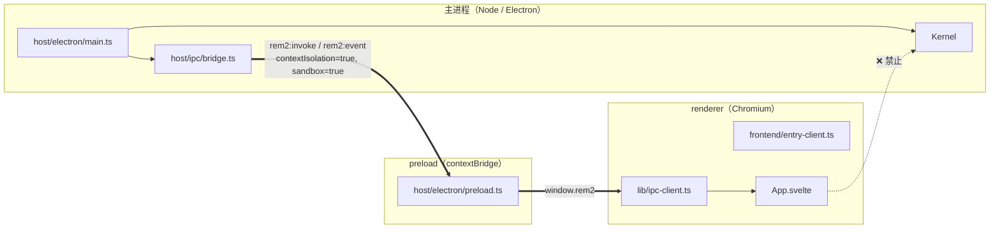
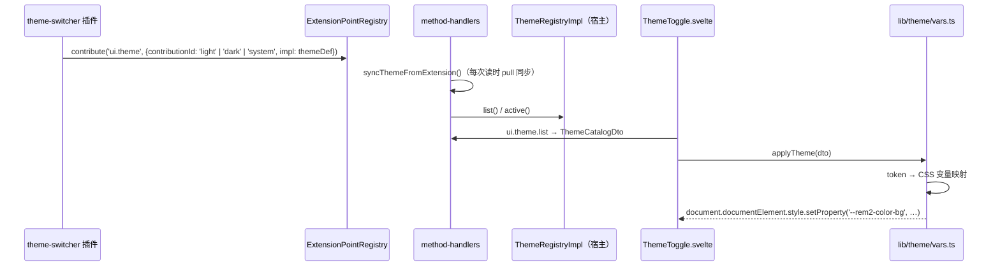

# 03 · 前端与 IPC 契约

> renderer 是唯一运行 Svelte 的地方，**不得 import 内核或宿主源码**；它与内核的唯一通道是 `window.rem2`。
>
> 配套：[`01-architecture-overview.md`](01-architecture-overview.md) §7（数据通路与 DTO 降维）、[`04-development-guide.md`](04-development-guide.md)（构建与调试）。
>
> English: [`en/03-frontend-ipc.md`](en/03-frontend-ipc.md)

---

## 1. 进程与构建边界



| 规则 | 内容                                | 强制方式                                                                                                    |
| ---- | ----------------------------------- | ----------------------------------------------------------------------------------------------------------- |
| B1   | renderer 是**唯一**跑 Svelte 的地方 | 只有 `vite.renderer.config.mts` 挂 `@sveltejs/vite-plugin-svelte`                                           |
| B2   | preload 是**唯一**契约边界          | `contextIsolation: true` + `sandbox: true`；`window.rem2` 是 renderer 能看到的唯一全局                      |
| B3   | renderer **不得**直接 import 内核   | `tests/contract/plugin-contract.test.ts` R6 扫描 `src/frontend/**`，命中 `rem2-kernel` 或 `src/kernel` 即红 |
| B4   | 主进程是内核的**宿主**，不是权威    | 宿主默认实现只经扩展点注册；`main.ts` 不 import 任何插件源码、不含任何插件 id                               |

`window.rem2` 的形状（`preload.ts` → `Rem2Bridge`）只有两个方法：

```ts
interface Rem2Bridge {
  invoke(method: string, args?: unknown): Promise<unknown>
  onEvent(event: string, handler: (payload: unknown) => void): () => void
}
```

---

## 2. 前端目录与职责

```
src/frontend/
├── entry-client.ts              # 渲染进程入口：import './app/global.css' + mount(App)；只做挂载
├── app/
│   ├── App.svelte               # 首屏编排：四个 store 并行 load，订阅主题 / 插件状态事件；$effect 决议激活面板
│   ├── Shell.svelte             # 布局：左导航（RouteHost）+ 主区（PanelHost）+ 底栏（HealthBadge）
│   ├── PanelHost.svelte         # ★ ui.panel 插槽：渲染面板列表、维护激活态（error / notice / loading 显式优先级）
│   ├── RouteHost.svelte         # ★ ui.route 插槽：由路由声明派生导航项（顶部显式 error 行）
│   ├── components/
│   │   ├── PanelShell.svelte    # 单面板 chrome：表格 / JSON 渲染 + 刷新（通知插件 + 本地回取 + 消费推送）
│   │   ├── ThemeToggle.svelte   # light/dark 切换：目录含双模式时才渲染，发 ui.theme.set
│   │   ├── HealthBadge.svelte   # 健康徽标：读 health 报告
│   │   ├── PluginManager.svelte # 宿主常驻插件管理：列表 / 详情 / 本地与远程安装 / 更新 / 启停 / 卸载 / 确认
│   │   └── CommandPrompt.svelte # 命令输入与结果展示
│   └── global.css               # 全局样式 + 主题变量的 fallback 默认值
└── lib/
    ├── ipc-client.ts            # window.rem2 的类型化唯一封装（方法 / 事件参数是白名单联合类型）
    ├── bridge-types.ts          # DTO：Panel / Route / PanelTable / Theme / ThemeCatalog / Health / CommandResult / PluginStateChanged
    ├── nav-link.ts              # 纯函数：route + panels + panelsReady → 激活面板决议（含 notice）
    ├── dto-guards.ts            # 纯函数：面板 / 路由列表运行时校验 + 面板数据分类（table / form / json / empty / invalid）
    ├── stores/                  # Svelte 5 runes；文件名必须以 .svelte.ts 结尾
    │   └── panels · routes · theme · health · command · plugins（各一个 .svelte.ts）
    └── theme/vars.ts            # ThemeDto → CSS 变量映射（--rem2-*）
```

**为什么 store 必须是 `.svelte.ts`**：Svelte 5 的 `$state` / `$derived` 需要编译器识别。写在 `.ts` 里语法合法、运行时静默失去响应式 —— 不报错，只是不更新。

**插槽语义**：`PanelHost` / `RouteHost` 里**不出现任何插件 id**。所有内容由 `ui.panel` / `ui.route` 扩展点的贡献数据驱动：前端写一次，插件决定内容。

**`index.html` 不得有内联样式**。`<body style="background:…">` 会压过 `global.css` 的 `body { background: var(--rem2-color-background) }`，表现为「文字、边框跟着主题变，底色不变」——只在多主题下暴露。

---

## 3. IPC 契约

### 3.1 通道

```ts
// src/shared/ipc-contract.ts
export const Ipc = {
  Invoke: 'rem2:invoke', // renderer → main：请求（带 id，主进程按 id 回包）
  Event: 'rem2:event', // main → renderer：事件推送（无 id）
} as const
```

响应与事件拆成两个通道，前端 `subscribe` 只需监听一个 channel。请求 / 响应配对沿用 id 匹配（preload 内完成），不依赖 `ipcRenderer.invoke` 的自动配对。

### 3.2 方法白名单（21 个，穷举）

| #   | method（`channels.*`）     | payload                         | 响应                                       | 宿主落点                                                                                          |
| --- | -------------------------- | ------------------------------- | ------------------------------------------ | ------------------------------------------------------------------------------------------------- |
| 1   | `ui.panel.list`            | —                               | `PanelDto[]`                               | `kernel.extensions.listAll('ui.panel')`                                                           |
| 2   | `ui.panel.data`            | `{ panelId }`                   | `unknown`（由插件定义）                    | 按面板声明的 `command` 走 `bus.request`                                                           |
| 3   | `ui.route.list`            | —                               | `RouteDto[]`                               | `kernel.extensions.listAll('ui.route')`                                                           |
| 4   | `ui.theme.list`            | —                               | `ThemeCatalogDto`（`{themes, activeId?}`） | `ThemeRegistry.list()` + `.active()`（读前 pull 同步扩展点）                                      |
| 5   | `ui.theme.set`             | `{ themeId }`                   | `{ ok }`                                   | `ThemeRegistry.activate()`；**仅激活项真变化时** emit                                             |
| 6   | `ui.event`                 | `{ panelId, kind, payload? }`   | `{ ok }`                                   | 路由到面板声明的 `command`                                                                        |
| 7   | `command.execute`          | `{ command, args? }`            | `CommandResultDto`                         | **`null`** —— 分发在内核 `CommandDispatcher`（读 `command.provide` 槽），宿主不实现               |
| 8   | `health.report`            | —                               | `HealthDto`                                | `kernel.health()` + 裁剪                                                                          |
| 9   | `plugin.list`              | —                               | `PluginListDto`                            | `LocalPluginManager.list()`；扫描安装目录 + 运行态 + 禁用意图                                     |
| 10  | `plugin.detail`            | `{ pluginId }`                  | `PluginDetailDto`                          | `LocalPluginManager.detail()`（含 `origin`）                                                      |
| 11  | `plugin.install.directory` | —                               | `PluginOperationResultDto`                 | 主进程原生目录选择 → 校验 → 暂存复制 → 原子提交；默认禁用                                         |
| 12  | `plugin.enable`            | `{ pluginId }`                  | `PluginOperationResultDto`                 | 持久启用意图（含已安装的硬依赖闭包）→ `Kernel.enablePlugin()`（含依赖拓扑）                       |
| 13  | `plugin.permission.grant` | `{ pluginId, capabilities }`    | `PluginOperationResultDto`                 | 仅 user 来源且能力必须在 manifest `requires` 内 → 原子写 `plugin-grants.json`；下次启动生效       |
| 14  | `plugin.disable`           | `{ pluginId }`                  | `PluginOperationResultDto`                 | 级联禁用已加载依赖者 → 持久禁用意图；运行中的插件需重启插件服务才停止                             |
| 15  | `plugin.uninstall`         | `{ pluginId }`                  | `PluginOperationResultDto`                 | 仅 user 来源；停止、保留 config/data、精确删除                                                    |
| 16  | `plugin.restart`           | —                               | `PluginOperationResultDto`                 | `Kernel.restartPlugins()`：停全部插件 → 按禁用集重新发现/解析/启动；内核与主进程不动              |
| 17  | `plugin.remote.inspect`    | `{ url, operationId? }`         | `PluginRemoteInspectionDto`                | 解析发布元数据 → 下载（可取消/带进度）→ 摘要校验 → 临时解压 → manifest/依赖预检；**不写插件目录** |
| 18  | `plugin.install.remote`    | `{ operationId, url, sha256? }` | `PluginOperationResultDto`                 | 复用 inspect 缓存 → 可信摘要校验 → 暂存 → 原子 rename → 写禁用意图 + provenance                   |
| 19  | `plugin.download.cancel`   | `{ operationId }`               | `{ ok: true, cancelled }`                  | `LocalPluginManager.cancelDownload()`：按 operationId 中止 `AbortController`；重复取消幂等        |
| 20  | `plugin.update.check`      | `{ pluginId? }`                 | `PluginUpdateCheckDto`                     | 按 provenance 的发布源解析最新 release，与已安装版本比较；`hasUpdate` 为假表示无更新              |
| 21  | `plugin.update.install`    | `{ operationId, pluginId }`     | `PluginOperationResultDto`                 | 下载/校验/解压 → 依赖预检 → 备份旧目录 → 安装新版本 → 保留 config/data → 必要时重启；失败回滚     |

### 3.3 事件白名单（6 个）

| #   | event（`events.*`）        | topic（内核 `Topics`）          | payload                                               | 用途                                              |
| --- | -------------------------- | ------------------------------- | ----------------------------------------------------- | ------------------------------------------------- |
| 1   | `ui.theme.changed`         | `Topics.UiThemeChanged`         | `ThemeDto`                                            | 主题切换后重算 CSS 变量                           |
| 2   | `plugin.state-changed`     | `Topics.PluginStateChanged`     | `{ pluginId, state }`                                 | 插件启停反映到 UI                                 |
| 3   | `panel.data-changed`       | `Topics.PanelDataChanged`       | `{ panelId, data }`                                   | 插件主动推送面板数据刷新                          |
| 4   | `command.result`           | `Topics.CommandResult`          | `CommandResultDto`                                    | 命令执行结果                                      |
| 5   | `kernel.ready`             | `Topics.KernelReady`            | `{ loadOrder, started, degraded, failed }`            | 首屏可用性                                        |
| 6   | `plugin.download.progress` | `Topics.PluginDownloadProgress` | `{ operationId, phase, receivedBytes?, totalBytes? }` | 远程下载/校验进度；renderer 按 `operationId` 过滤 |

### 3.4 明确禁止的能力

| 禁止                                                   | 理由                                                                           |
| ------------------------------------------------------ | ------------------------------------------------------------------------------ |
| 任意 `bus.request(method)` 直通                        | 前缀匹配等于交出整个命名空间；判定必须是 20 个方法名的精确集合                 |
| 读配置（任何 `config.*`）                              | 配置可能含敏感值。面板需要配置时，由插件在 `ui.panel.data` 的响应里决定给什么  |
| 读内核服务（`services.*` / `kernel.*`）                | renderer 只与 DTO 打交道，不与内核对象图打交道                                 |
| 任意生命周期方法（`plugin.start` / `stop` / `unload`） | 生命周期是内核 / 宿主特权；只允许 §3.2 中受参数校验与依赖保护的管理方法        |
| 订阅任意内核事件                                       | 只允许 §3.3 的 6 个；内核其余 topic（如 `config.changed`）含内部状态，不得外泄 |
| 收到插件侧原始事件（如 `ui.theme.registered`）         | 只认 DTO 化后的语义事件                                                        |

**强制点**：`IpcBridge.handleInvoke` 在 `bus.request` **之前**做 `allowedMethods.has(method)`（`Set` 精确匹配）。不在集合内 → 直接 reply `{ok:false,error}`，**不进入事件总线**。

### 3.5 DTO

```ts
// src/frontend/lib/bridge-types.ts —— 每个类型注释标注它投影自哪个内核契约
interface PanelDto {
  panelId
  title
  icon
  region: 'main' | 'side'
  order: number
  command: string
}
interface RouteDto {
  path
  title
  panelId
  commandPrefix: string
  order: number
}
interface PanelTableDto {
  kind: 'table'
  columns: string[]
  rows: Array<Array<string | number>>
}
interface ThemeDto {
  id
  mode: 'light' | 'dark'
  colors
  fonts
  spacing
}
interface ThemeCatalogDto {
  themes: ThemeDto[]
  activeId?: string
}
interface HealthDto {
  status: 'healthy' | 'degraded' | 'unhealthy'
  plugins: Array<{ id; state; status; message? }>
}
interface CommandResultDto {
  command: string
  ok: boolean
  output?: string
  error?: string
}
interface PluginDetailDto {
  id
  name
  version
  description?
  source: 'builtin' | 'user' | 'workspace'
  state: PluginRuntimeStateDto // 含管理态 'Disabled'
  enabled: boolean
  builtin: boolean
  error?
  entry
  author?
  homepage?
  tags: string[]
  dependencies: Record<string, string>
  optionalDependencies: Record<string, string>
  requires: string[]
  compatibility: { minKernel; maxKernel?; contractVersion }
  canUninstall: boolean
  restartRequired: boolean
  origin?: { kind: 'directory' | 'remote'; url?; sha256?; publishedAt? }
}
interface PluginRemoteInspectionDto {
  url
  downloadUrl
  id
  name
  version
  description?
  requires: string[]
  dependencies: Record<string, string>
  optionalDependencies: Record<string, string>
  compatibility: { minKernel; maxKernel?; contractVersion }
  publishedAt?
  notes?
  sha256? // 仅来自发布元数据，绝不来自下载实体
  size?
}
interface PluginUpdateDto {
  pluginId
  currentVersion
  latestVersion
  hasUpdate: boolean
  url
  publishedAt?
  notes?
  sha256?
}
interface PluginUpdateCheckDto {
  updates: PluginUpdateDto[]
}
interface PluginDownloadProgressDto {
  operationId
  phase: 'downloading' | 'verifying' | 'extracting' | 'installing'
  receivedBytes?
  totalBytes?
}
interface PluginListDto {
  plugins: PluginDetailDto[]
  issues: string[]
}
interface PluginOperationResultDto {
  ok: true
  changed: boolean
  restartRequired: boolean
  plugin?: PluginDetailDto
  message?: string
}
```

插件管理 DTO **不含** `rootDir`、绝对路径、container、permissions 或原始 manifest；renderer 侧再由 `parsePluginList` / `parsePluginOperation` / `parsePluginInspection` / `parsePluginUpdateCheck` / `parseDownloadProgress` 逐字段校验。`origin`、检查结果与更新条目都是严格对象：任一字段类型不符即丢弃（列表项计入 issues，单个对象直接抛错），不会渲染半截数据。管理错误在 `IpcResponse.errorCode` 中携带稳定代码，preload 将其挂到 `Error.code`；远程操作的 `operationId` 由 renderer 生成，进度事件按它过滤，取消也按它定位。

DTO 是**显式投影白名单**，不是「内核类型改个名字」。`CommandResultDto` 的字段名必须与命令插件真实返回一致：`IpcBridge` 把插件返回值原样放进 `reply.result`，preload 解包 `payload.result`，所以前端 `invoke` 拿到的就是插件原始返回对象（`{ok, output}`）。字段名写错时类型不报错、UI 空白、console 干净 —— 这是本项目最典型的静默缺陷形态。

`command` 字段由前端 store 补上（`command.svelte.ts` → `{...res, command}`），不要求插件返回。

**面板数据契约**：`PanelTableDto` / `PanelFormDto` 是两种结构化形状（`dto-guards.ts` → `parsePanelData` 在 renderer 侧做运行时分类与校验）：table → 表格；form → 渲染 `select` / `color` 字段，变更通过 `ui.event {kind:'change', payload:{fieldId,value}}` 回传；`undefined` / `null` → 空态；其余 → 美化 JSON；序列化超过 **32KB** → `invalid` 显式报错；声明 `kind` 但形状不符 → `invalid` 并说明原因。插件返回的 `{ok:false,error}` 会原样传到 `PanelShell`，不再被宿主改写成成功。列表类数据（`ui.panel.list` / `ui.route.list`）同样逐条目校验：坏条目丢弃并计入 `panels.issues`，整个载荷非数组则抛错走 store 的 error 态。

---

## 4. store ↔ 事件桥

| 方向                | 允许                                  | 实现                                                                 |
| ------------------- | ------------------------------------- | -------------------------------------------------------------------- |
| 内核 → renderer     | ✅ 单向推送，且只推 §3.3 的 6 个事件  | `IpcBridge` 订阅 topic → `toDto` → `Ipc.Event`                       |
| renderer → 内核     | ✅ 单向请求，且只走 §3.2 的 20 个方法 | `ipc.request`                                                        |
| renderer ↔ 内核总线 | ❌ **不代理**                         | 代理总线等于让 renderer 能 `emit` / 订阅任意 topic，能力守卫全部失效 |

两条红线：

1. 不把 `bus.emit` 暴露给 renderer —— 事件总线是插件间协作通道，renderer 不是插件。
2. 不转发 `bus.on('*')` —— 等于泄露全部内部 topic。

### 4.1 订阅生命周期

`ipc.subscribe` 返回退订函数，必须在 `onMount` / `$effect` 的返回值里透出。`ipc-client.ts` 内部维护活跃订阅计数（`subscriptionCount()`），避免组件销毁而清理未跑时 `rem2:event` 监听泄漏。

### 4.2 首屏模式

```svelte
onMount(() => {
  void panels.load()
  void routes.load()
  void theme.load()
  void health.load()

  const offTheme = ipc.subscribe(events.themeChanged, (p) => theme.applyRemote(p as ThemeDto))
  // 任何插件状态变化都可能新增（Active）或回收（Stopped / Failed）贡献：
  // 无条件重拉三份列表，按状态集过滤会漏掉晚到的 Active。
  const offPluginState = ipc.subscribe(events.pluginStateChanged, () => {
    void panels.load()
    void routes.load()
    void health.load()
  })
  return () => { offTheme(); offPluginState() }
})

// 路由是激活面板的唯一真相源；四路 load 并行到达，任一路后到都重触发决议。
$effect(() => {
  const res = resolveActivePanel(routes.active, panels.items, !panels.loading)
  panels.applyResolution(res)
})
```

四类数据**并行拉取、各自降级为空**：任一路失败不阻塞渲染，错误记录在各自 store 里。`resolveActivePanel`（`lib/nav-link.ts`，纯函数）把「路由 → 面板」的决议显式化：路由无面板关联 → notice；面板不在列表且列表仍在飞 → 静默等待（防闪烁）；面板不在列表且列表就绪 → notice。

**面板数据刷新三路径**（`PanelShell.svelte`）：① 刷新按钮先 `ui.event` 通知插件（失败静默）并立即本地回取；② 插件 emit `panel.data-changed` 推送，`PanelShell` 按 panelId 匹配后原地更新；③ 切换面板时 `$effect` 重取。

---

## 5. 主题通路



三条不变量：

1. **`ui.theme` 是 multi 槽＝主题目录**，不是「单例激活主题」。`ThemeDefinition` 带 `mode: 'light' | 'dark' | 'system'`；`followSystem` 项由宿主按 OS 当前明暗物化为 light/dark 调色板，同时保留 `system` 作为激活 id。
2. **激活态归宿主**（`ThemeRegistryImpl.active()`）。`ui.theme.list` 返回 `{themes, activeId}` —— 目录与激活项一起给，前端不得自行推断（两边各猜一次，最终生效的取决于谁后猜）。
3. **`ui.theme.set` 只在激活项真变化时 emit**。否则前端 `setActive`（先本地应用再请求）会触发 `set → emit → set` 无限回环。

**pull 模型**：扩展点槽是单一真相源，`ThemeRegistry` 退化为缓存，每次读时同步。插件卸载时内核按 `pluginId` 强制回收贡献，下次 pull 自然为空 —— 不需要监听卸载事件。

**宿主推来的主题走 `applyRemote()`，不回写主进程**：它只更新本地状态与 CSS 变量。

### 5.1 token → CSS 变量

```ts
// lib/theme/vars.ts
const COLOR_KEYS = [
  'background',
  'surface',
  'text',
  'textMuted',
  'accent',
  'border',
] as const
const FONT_KEYS = ['ui', 'mono'] as const
const SPACING_KEYS = ['xs', 'sm', 'md', 'lg'] as const
// → [['--rem2-color-background', '#0f1115'], ['--rem2-font-ui', '…'], ['--rem2-space-md', '16px'], …]
```

`global.css` 为每个变量写 fallback（编译期常量），变量未注入时页面仍可读。

---

## 6. 构建配置

### 6.1 `vite.shared.mts`：共享什么、不共享什么

| 项                | 值                                                  | 理由                                                                                                      |
| ----------------- | --------------------------------------------------- | --------------------------------------------------------------------------------------------------------- |
| `resolve.alias`   | `{ 'rem2-kernel': <abs>/src/kernel/index.ts }`      | 让 Vite 把内核当源码处理，`.js` → `.ts` 由 Vite 内建回退                                                  |
| `ssr.noExternal`  | `['rem2-kernel']`                                   | **关键**。默认会 externalize 裸包名，主进程产物留下 `require('rem2-kernel')`，打包态解析到 `.ts` 入口即炸 |
| `build.target`    | `node20`（main / preload）· `chrome120`（renderer） | 与 `engines.node`、Electron 44 的 Chromium 对齐                                                           |
| `build.sourcemap` | `true`                                              | 与 `tsconfig.json` 的 `sourceMap` 一致；契约测试靠 sourcemap 判定产物是浏览器版 svelte                    |

**`resolve.conditions` 不共享，必须按目标环境分化**：

| 目标           | `resolve.conditions`              |
| -------------- | --------------------------------- |
| main / preload | `['node', 'import', 'module']`    |
| renderer       | `['browser', 'import', 'module']` |

原因：Vite 8 的 `resolve.conditions` 是**整体替换**默认集，不是合并。而 svelte 的 `exports["."]` 是 `{ worker: index-server, browser: index-client, default: index-server }` —— `worker` 排在 `browser` 之前，且 Node 规范下 `node` 条件隐含 `worker`。把 `['node', …]` 放进共享段会让 renderer 丢掉 `browser`、命中 `worker` → 解析到 `index-server.js` → `mount()` 抛 `lifecycle_function_unavailable` → **构建成功但白屏**。

这类缺陷只存在于「浏览器条件 × 打包产物」的交叉点：`tsc` 无线索，vitest（`environment: 'node'`）也是对的。判据必须用**模块图事实**：`tests/contract/build-artifact.test.ts` 断言 sourcemap 含 `index-client.js`、不含 `index-server.js`。

### 6.2 三个 config 的必备项

| 配置                       | 必备                                                                                                 |
| -------------------------- | ---------------------------------------------------------------------------------------------------- |
| `vite.main.config.mts`     | `external: ['electron']`；共享 alias / `ssr.noExternal`；`define` 不用自加（forge 注入）             |
| `vite.preload.config.mts`  | `external: ['electron']`；`target: node20`；输出 **CJS**，文件名必须是 `preload.cjs`（主进程硬编码） |
| `vite.renderer.config.mts` | `plugins: [svelte()]`（唯一挂 svelte 的 config）；`conditions` 显式含 `browser`；`input: index.html` |

### 6.3 Forge 注入的编译期常量

| 常量                              | 用法                                                              |
| --------------------------------- | ----------------------------------------------------------------- |
| `MAIN_WINDOW_VITE_DEV_SERVER_URL` | dev 分支加载 Vite dev server                                      |
| `MAIN_WINDOW_VITE_NAME`           | prod 分支 `path.join(__dirname, '../renderer/<name>/index.html')` |

两者都是**裸标识符替换**：写成 `process.env.MAIN_WINDOW_…` 不会被替换，运行期恒 `undefined`，窗口永远走 `file://`。常量名由渲染进程名大写化而来（本项目 `main_window`），改渲染进程名必须同步改这两处。

---

## 7. CSP

`index.html` 的 CSP（meta 形式）：

```
script-src 'self';                      ← 无 'unsafe-eval'
style-src  'self' 'unsafe-inline';
connect-src 'self' ws://localhost:* ws://127.0.0.1:* http://localhost:* http://127.0.0.1:*;
object-src 'none'; base-uri 'none';
```

| 操作                                   | 是否被拦  | 说明                                                                      |
| -------------------------------------- | --------- | ------------------------------------------------------------------------- |
| `style.setProperty('--x', v)`（CSSOM） | ✅ 不拦   | CSP 管 `<style>` 块与 `style` 属性解析，不管 CSSOM 写入                   |
| Svelte 编译产物                        | ✅ 允许   | 组件 scoped `<style>` 编译进 CSS 文件由 `<link>` 加载（`'self'`）         |
| `$state` / `$derived`                  | ✅ 允许   | 编译为普通 JS，**不需要 `eval`**                                          |
| HMR WebSocket                          | ✅ 已放行 | `connect-src` 显式列了 `ws://localhost:*`（CSP 的 `'self'` 不覆盖 ws://） |

`style-src` 需要 `'unsafe-inline'`；`script-src` 不要加 `'unsafe-eval'` —— 加了 Electron 会打印 "Insecure Content-Security-Policy" 告警，且那不只是噪音。meta 形式下 `frame-ancestors` / `form-action` 会被忽略，别写。

---

## 8. 已知限制

| #   | 限制                                                              | 影响                                                                                       |
| --- | ----------------------------------------------------------------- | ------------------------------------------------------------------------------------------ |
| F1  | ~~`ui.panel.data` 的数据形状由插件自定，内核不校验~~ **已正式化** | `dto-guards.ts` → `parsePanelData`：table / form / json / empty / invalid 分类 + 32KB 上限 |
| F2  | `bridge-types.ts` 手写 DTO，内核契约改了前端不会自动报错          | 靠注释标注来源 + 赋值处类型对齐；`ui.*` 的 `impl` 类型来自内核契约                         |
| F3  | `preload.cjs` 文件名是隐式契约（主进程硬编码）                    | 改名 → 窗口以「preload 加载失败」报错，不提示是文件名问题                                  |
| F4  | runes 写在 `.ts` 里不生效且不报错                                 | 只能靠 `.svelte.ts` 目录约定                                                               |
| F5  | ~~`ui.panel` / `ui.route` 无 builtin 贡献~~ **已解决**            | `plugin-inspector` 贡献 `/plugins` 路由 + 检查器面板                                       |
| F6  | 插件安装不提供安全沙箱，仅做路径 / 依赖 / 生命周期保护            | 只应安装可信插件，详见 `05-plugin-management.md`                                           |
| F7  | 管理页多窗口不共享目录变更事件                                    | 启停使用现有状态事件；安装 / 卸载需各窗口主动 Refresh                                      |
| F8  | 远程安装只接受 HTTPS + 主机 allowlist 内的 ZIP 资产               | 无 registry、无 tar.gz、无签名验证；SHA-256 只证明完整性，不证明发布者身份                 |
| F9  | 更新检查每次按钮点击都会请求发布 API，无缓存与节流                | GitHub 未认证请求有速率限制；多插件同源检查会叠加请求                                      |
