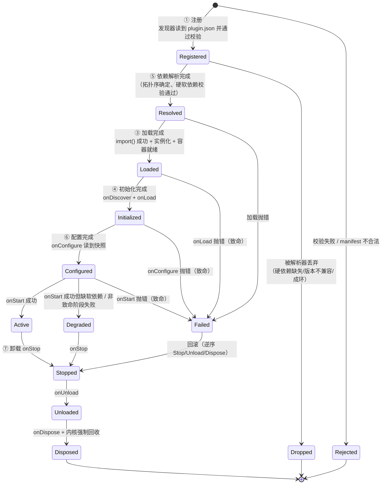
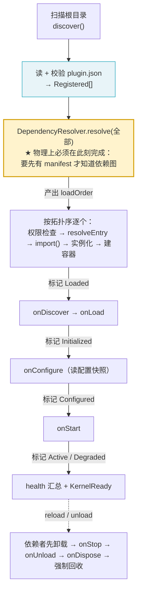

# 03 · 目标架构设计

> 核心理念：**极小内核 + 一切皆插件**
> 上游：`09-prd-arch-refactor.md`（需求锚点）、`08-current-state-diagnosis.md`（现状与 24 条优化项）、`07-form-evaluation.md`（形式裁决）
> 本文是 P0-3 主交付。约束：允许破坏式变更、不写业务实现、中文、注释克制。

---

## 1. 设计原则（7 条，每条可机器/人工验证）

| # | 原则 | 验证方式 |
| --- | --- | --- |
| **P1** | **依赖单向，无环**：`frontend → 不依赖` / `host → kernel` / `kernel → 不依赖 host,frontend,plugins` / `plugins → kernel 公共出口`。任何反向 import 即违规 | `tests/contract/**` 静态扫描（§9.2 给出规则） |
| **P2** | **内核零第三方运行时依赖**：`src/kernel/**` 只允许 `node:*` 与相对路径；`package.json` `dependencies` 恒为 `{}` | `tests/contract/kernel-deps.test.ts`（保留并强化） |
| **P3** | **一切皆插件 = 一切经扩展点注册表**：任何「宿主提供的可替换能力」必须在 `ExtensionPointRegistry` 有显式声明；不允许旁路注册（删除 `api.registerCapability`） | `docs/03 §7` 清单与 `src/kernel/extensions/definitions.ts` 导出一一对应（PRD A7） |
| **P4** | **单一形态，不存在双态代码路径**：插件入口、主题、配置在 dev 与打包态走**同一条**代码路径；「dev 能跑 prod 炸」的结构性成因必须在架构上消除 | 产物 ↔ 路径映射表（`07-form-evaluation.md` §5）；不存在任何 `if (isDev)` 分支决定「用不用某个能力」 |
| **P5** | **拒绝而非静默降级**：能力未授予 → `CapabilityDeniedError`；扩展点冲突 → 显式裁决并记 `issues`；provider 加载失败 → 记失败 + 上报。绝不用默认值糊过去 | 每个降级点都有对应的 error/issue 记录；`docs/07F1` 的教训不得复现 |
| **P6** | **回收由内核强制，不依赖插件自觉**：卸载/重载时内核必须回收容器挂载、权限登记、健康检查、扩展点贡献、Worker 线程。插件漏调 `api.unexport()` 不得泄漏 | `teardownPlugin()` 是唯一回收入口；扩展点贡献按 `pluginId` 索引可整体删除 |
| **P7** | **契约即类型，扩展点即注册表**：插件与内核的交互面只有 `PluginContext` + `PluginApi` + `definePlugin()`；能力贡献只能通过已声明的扩展点 id | `src/kernel/index.ts` 只导出契约类型 + 工厂 + 令牌 + 错误类 + 版本常量 |

---

## 2. 目标目录树（完整到文件级）

```
rem2/
├── src/
│   ├── kernel/                                # 极小内核：零第三方运行时依赖（P2 红线）
│   │   ├── contracts/                         # ★ 插件唯一可引用的「语言」。纯类型 + 2 个纯函数工厂
│   │   │   ├── index.ts                       #   桶文件：只 re-export，不含逻辑
│   │   │   ├── manifest.ts                    #   PluginManifest / Compatibility / Isolation
│   │   │   ├── plugin.ts                      #   Plugin / PluginFactory / definePlugin 的类型侧
│   │   │   ├── lifecycle.ts                   #   LifecyclePhase / StopReason / PhaseOutcome
│   │   │   ├── context.ts                     #   PluginContext / PluginApi / ServicesView
│   │   │   ├── service-token.ts               #   ServiceToken 品牌化字符串 + defineToken（§11 §3.3 裁决）
│   │   │   ├── kernel-tokens.ts               #   KernelTokens（内核服务令牌集合）
│   │   │   ├── extension-point.ts             #   ExtensionPointId / ExtensionPointDef / Contribution
│   │   │   ├── event-bus.ts                   #   EventBus / EventHandler / Unsubscribe
│   │   │   ├── config.ts                      #   ConfigAccess / ConfigProvider / ConfigLayer
│   │   │   ├── logging.ts                     #   Logger / LogEntry / LogSink / LOG_LEVEL_ORDER
│   │   │   ├── metrics.ts                     #   MetricsApi / MetricSink / KERNEL_METRICS
│   │   │   ├── tracing.ts                     #   Tracer / TraceExporter
│   │   │   ├── health.ts                      #   HealthReport / HealthCheckFn
│   │   │   ├── permission.ts                  #   Capability / TrustLevel / PermissionSet
│   │   │   ├── plugins.ts                     #   PluginInfo / PluginsRegistryView / PluginStateT
│   │   │   ├── container.ts                   #   Container / ServiceRegistry 契约（不含实现）
│   │   │   └── service.ts                     #   ServiceDescriptor / ServiceFactory / Lifetime
│   │   │
│   │   ├── extensions/                        # ★★ 新增：扩展点注册表（P3 唯一挂载面）
│   │   │   ├── registry.ts                    #   ExtensionPointRegistry 实现（注册/枚举/回收/冲突裁决）
│   │   │   ├── definitions.ts                 #   11 个扩展点的声明式定义表（§7）
│   │   │   └── contrib-slot.ts                #   ContributionSlot：单例槽 / 多贡献槽的容器语义
│   │   │
│   │   ├── define-plugin.ts                   #   definePlugin() 运行时工厂（唯一插件形态入口）
│   │   │
│   │   ├── state-machine.ts                   #   7 段生命周期的状态转移表（对外状态机，§4）
│   │   ├── kernel.ts                          #   编排层：只做编排，服务由 composition 注入
│   │   ├── composition.ts                     #   默认服务装配（替代 kernel.ts 构造函数里的 14 个 new）
│   │   ├── bootstrap/
│   │   │   ├── options.ts                     #   KernelOptions（删除死配置 bootstrap）
│   │   │   └── register-core-services.ts      #   14 个 KernelTokens 的注册 + 能力门槛声明
│   │   │
│   │   ├── lifecycle/
│   │   │   ├── phases.ts                      #   PHASES 有序表（7 段）
│   │   │   ├── manager.ts                     #   阶段驱动 + 超时 + 致命/非致命裁决
│   │   │   ├── pipeline.ts                    #   ★ 新增：物理执行管线（逻辑状态机与物理序的映射，§4.3）
│   │   │   └── rollback.ts                    #   致命失败逆序回滚
│   │   │
│   │   ├── registry/
│   │   │   └── plugins-registry.ts            #   已加载插件表 + 状态 + 健康
│   │   │
│   │   ├── di/
│   │   │   ├── container.ts                   #   Container 实现（保持 token.id 索引）
│   │   │   ├── lifetime.ts                    #   Lifetime 归一
│   │   │   └── service-registry.ts            #   ServiceRegistryFacade
│   │   │
│   │   ├── dependency/
│   │   │   ├── resolver.ts                    #   依赖解析（去重/兼容/环检测/拓扑）
│   │   │   ├── graph.ts  cycles.ts  topo-sort.ts
│   │   ├── discovery/
│   │   │   ├── discovery.ts                   #   根目录扫描 + manifest 读取 + 排序
│   │   │   ├── candidate.ts
│   │   │   └── manifest-validator.ts          #   校验器（新增 entry 形态校验：只允许 .js/.mjs）
│   │   ├── loader/
│   │   │   ├── loader.ts                      #   动态 import + 实例化 + 容器/上下文组装
│   │   │   ├── module-resolver.ts             #   ★ entry 解析：补全列表去掉 .ts
│   │   │   └── plugin-factory.ts              #   ★ 只接受 definePlugin 工厂函数（1 种形态）
│   │   │
│   │   ├── isolation/
│   │   │   ├── worker-host.ts                 #   Worker 侧宿主（RPC + 白名单派发）
│   │   │   ├── worker-plugin-proxy.ts         #   内核侧代理（对插件实例的 RPC 包装）
│   │   │   ├── worker-bootstrap.ts            #   eval 引导源码（保持无路径知识）
│   │   │   └── worker-protocol.ts             #   ★ 新增：消息类型的单一来源（供 bootstrap 字符串引用）
│   │   │
│   │   ├── security/
│   │   │   ├── capability-guard.ts            #   能力代理（resolve / assertCapability 两级）
│   │   │   ├── permission-manager.ts
│   │   │   └── trust-policy.ts
│   │   │
│   │   ├── observability/
│   │   │   ├── log-service.ts  metrics-service.ts  tracing-service.ts  health-service.ts
│   │   │   ├── extension-sinks.ts             #   ★ 新增：log/metrics/trace 三个 sink 的扩展点桥
│   │   │   └── null-sink.ts / noop-metrics-sink.ts
│   │   ├── config/config-service.ts  memory-provider.ts
│   │   ├── events/event-bus.ts                #   ★ 桶索引 + 订阅期定序（去掉每次 emit 的 sort）
│   │   │   ├── pattern.ts  priority.ts
│   │   ├── scheduler/serial-scheduler.ts
│   │   ├── semver/semver.ts  range.ts
│   │   ├── context/plugin-context.ts  plugin-api.ts
│   │   ├── util/deep-merge.ts  disposable.ts  id.ts  timeout.ts
│   │   ├── topics.ts                          #   内核语义主题常量（13 个）
│   │   ├── errors.ts                          #   错误类（含 ExtensionConflictError 新增）
│   │   ├── version.ts                         #   KERNEL_VERSION / CONTRACT_VERSION / MANIFEST_FILENAME
│   │   └── index.ts                           # ★ 唯一公共出口：只导出契约 + 工厂 + 令牌 + 错误 + 版本
│   │
│   ├── host/                                  # ★ 新增：宿主适配层（electron / cli / ipc）
│   │   ├── electron/
│   │   │   ├── main.ts                        #   Electron 主进程（内核的宿主，非权威）
│   │   │   ├── preload.ts                     #   ★ 唯一契约边界：contextBridge 暴露 window.rem2
│   │   │   └── window.ts                      #   createWindow()（含 CSP 注入）
│   │   ├── ipc/
│   │   │   ├── channels.ts                    #   ★ 通道契约与白名单（renderer 能做的事的上限）
│   │   │   ├── bridge.ts                      #   IpcBridge（由 runtime/ipc 迁入并扩展）
│   │   │   └── topics.ts
│   │   ├── theme-registry.ts                  #   宿主侧主题注册表实现（依赖 kernel 契约，不依赖插件）
│   │   └── cli/
│   │       ├── run.ts  args.ts  paths.ts      #   由 runtime/bootstrap 迁入
│   │       ├── cli.ts  scaffold-plugin.ts  validate-manifest.ts
│   │
│   └── frontend/                              # ★ 新增：Svelte 前端（唯一跑 Svelte 的地方）
│       ├── entry-client.ts                    #   渲染进程入口（挂载 App）
│       ├── app/
│       │   ├── App.svelte                     #   根组件
│       │   ├── Shell.svelte                   #   布局骨架（标题栏/侧栏/主区）
│       │   ├── PanelHost.svelte               #   ★ 面板插槽宿主：渲染 ui.panel 扩展点贡献
│       │   └── RouteHost.svelte               #   路由插槽宿主：渲染 ui.route 扩展点贡献
│       └── lib/
│           ├── ipc-client.ts                  #   window.rem2 的类型化封装（唯一 IPC 出口）
│           ├── bridge-types.ts                #   DTO：与 kernel 契约对齐的 renderer 侧类型
│           ├── stores/                        #   Svelte 5 runes 状态（插件列表/主题/健康/命令结果）
│           └── theme/vars.ts                  #   主题 token → CSS 变量映射
│
├── plugins/<plugin-id>/                       # 插件单元（形态已统一）
│   ├── package.json                           #   type: module + esbuild build
│   ├── tsconfig.json                          #   独立 tsconfig（只 paths 一条）
│   ├── plugin.json                            #   entry: dist/index.js（唯一形态）
│   ├── src/index.ts                           #   export default definePlugin(...)
│   └── dist/index.js                          #   构建产物（进 extraResource）
│
├── plugins-dist/                             # ★ 构建聚合目录（进包）
│   └── <plugin-id>/{plugin.json, dist/index.js}
│
├── tests/{unit,integration,contract}/
├── vite.shared.mts                            # ★ alias / ssr.noExternal 单一来源（conditions 按环境分化）
├── vite.main.config.mts  vite.preload.config.mts  vite.renderer.config.mts
├── tsconfig.json  tsconfig.build.json  tsconfig.shell.json
└── forge.config.mts
```

**每个新目录一句话职责**

| 目录 | 职责 |
| --- | --- |
| `kernel/extensions/` | 唯一的能力挂载面：声明有哪些扩展点、谁贡献、冲突怎么裁 |
| `kernel/contracts/` | 插件看得见的全部语言；只有类型与纯函数，零副作用 |
| `host/` | 内核之外的适配层：把 Electron / CLI / IPC 的世界适配到内核契约上 |
| `host/ipc/` | renderer 与内核之间**唯一**的通道契约与白名单 |
| `frontend/` | Svelte 前端；只经 `window.rem2` 与内核通信，不认识内核 |
| `plugins-dist/` | 插件构建产物的聚合目录，是唯一进包的东西 |

---

## 3. 插件定义

### 3.1 什么算插件

**定义**：一个插件 = 一个包含 `plugin.json`（必填）+ 一个可被 `import()` 的 JS 入口（必填）的目录。

**形态裁决：唯一形态 = `export default definePlugin(manifest, setup)` 工厂函数。**

```ts
// 唯一允许的形态
export default definePlugin(
  { id: 'com.rem2.hello-command', name: 'Hello', version: '1.0.0' },
  (ctx) => {
    // onLoad: 内存态准备
    return {
      async onLoad() {},
      async onConfigure() {},
      async onStart() {},
      async onStop(reason) {},
      async onUnload() {},
      async onDispose() {},
    };
  },
);
```

**为什么裁决成工厂函数**（参考文档未展开，这里给出完整论证）：

| 候选形态 | 裁决 | 理由 |
| --- | --- | --- |
| **工厂函数** `definePlugin(m, setup)` | ✅ **采纳** | ① **tree-shaking 友好**：setup 是闭包，未贡献的扩展点不进产物；② **天然避开 `instantiatePlugin` 的 4 种猜测**（`plugin-factory.ts:44-65` 猜 class/instance/named/双层 default），loader 只需断言 `typeof mod.default === 'function'`；③ 与 esbuild `--bundle --format=esm` 天然对齐（E4 实测：`default` 是 `function`）；④ manifest 由插件作者在 `definePlugin` 首参声明，与 `plugin.json` 形成**双写**，loader 校验 id 一致（复用现有 `ManifestMismatchError`） |
| class + 无参构造 | ❌ | 状态只能存在实例字段，`onStop` 后实例被丢弃，状态无处可取；`instantiatePlugin` 需要 `new` 分支 |
| 已实例化单例 | ❌ | 模块被 import 的时刻就产生副作用（此时还没有 ctx），无法参与生命周期 |
| 命名导出 `plugin` | ❌ | 与 `default` 并存时产生优先级歧义 |

**收益**：`plugin-factory.ts` 从 90 行猜测逻辑变成 ~10 行断言（对应 `09` 的 O22）；worker bootstrap 里那份**不一致的重复实现**（`worker-bootstrap.ts:170-175`，只猜 3 种）可以直接调用同一段逻辑。

### 3.2 manifest 字段表

```jsonc
{
  // ── 必填 ──
  "id": "com.rem2.hello-command",     // 唯一 id，reverse-DNS；与 definePlugin 首参.id 必须一致
  "name": "Hello Command",             // 展示名
  "version": "1.0.0",                  // semver
  "entry": "dist/index.js",            // ★ 唯一形态：只能是构建产物（.js/.mjs），dev 与 prod 同值
  "compatibility": {
    "minKernel": "^1.0.0",             // semver range
    "maxKernel": "^2.0.0",             // 可选，含上界
    "contractVersion": "1"             // major 不同即不兼容
  },

  // ── 选填：依赖 ──
  "dependencies":         { "com.rem2.logger-console": "^1.0.0" },  // 硬依赖，参与拓扑排序，缺失/不满足 → Failed
  "optionalDependencies": { "com.rem2.config-json": "^1.0.0" },      // 软依赖，缺失 → Degraded

  // ── 选填：扩展点贡献（替代旧的裸 capabilities 字符串）──
  "contributes": [
    { "point": "command.provide", "id": "hello",  "capability": "command.provide" },
    { "point": "log.sink",        "id": "console" }
  ],

  // ── 选填：能力声明（只声明「我需要什么」，不是「我提供什么」）──
  "requires": ["fs.read"],

  // ── 选填：隔离 ──
  "isolation": "in-process",           // 'in-process' | 'worker'

  // ── 选填：元信息 ──
  "author": "…", "description": "…", "icon": "…", "tags": ["…"], "homepage": "…",
  "configSchema": { }                  // 插件级配置 schema，内核不解释，原样透传给插件
}
```

**字段级变更说明**

| 变更 | 理由 |
| --- | --- |
| `entry` 只允许 `.js` / `.mjs` | `07-form-evaluation.md` §5.1：消除 dev/prod 双形态 |
| **新增** `contributes` | 替代 `capabilities` 作为「我提供什么」的表达。`capabilities` 语义含混（既像"我要什么"又像"我给什么"），拆成 `contributes`（提供）+ `requires`（需要） |
| **保留** `requires`（原 `capabilities`） | `PermissionManager.check()` 的输入，保持原语义：声明需要的能力 |
| `isolation` 语义不变 | 但 `worker` 下的**可用能力**收窄（§6.2） |

### 3.3 `ServiceToken` 目标形态（承接 `07-form-evaluation.md` §3）

```ts
// contracts/service-token.ts
declare const TOKEN_BRAND: unique symbol;

export interface ServiceDescriptor<T> {
  readonly id: string;
  readonly describe: string;
  readonly capability?: string;
  readonly __type?: T;
}

export interface ServiceToken<T> extends ServiceDescriptor<T> {
  readonly [TOKEN_BRAND]: true;
}

/** 纯函数工厂：无模块级状态、无原型方法 → bundle 出的任意副本行为完全一致。 */
export function defineToken<T>(d: ServiceDescriptor<T>): ServiceToken<T> {
  return { id: d.id, describe: d.describe, capability: d.capability } as ServiceToken<T>;
}
```

---

## 4. 生命周期：逻辑阶段 vs 物理执行序

### 4.1 用户需求的 7 段与一处真实张力

用户点名 7 段：**注册 → 发现 → 加载 → 初始化 → 依赖解析 → 配置 → 卸载**。

张力：**「依赖解析」在物理上必须发生在「加载」之前**——必须先读 `plugin.json` 才能知道有哪些插件、它们声明了什么依赖、谁先谁后，才能决定加载顺序。但用户把它排在第 5 段（在「加载」之后）。

这不是用户的笔误，而是**两种不同的视角**：
- **逻辑视角**（对外可观测的状态机）：描述「一个插件从被发现到能干活，中间经历了哪些**可被观察的阶段**」。
- **物理视角**（内核内部的执行管线）：描述「内核实际按什么顺序**调用代码**」。

依赖解析对**每个插件自身**是一次可观测的状态跃迁（`Pending → Resolved`），所以它在逻辑状态机里有独立位置；但它对**内核**是一次**批量**计算（一次解析所有插件的图），发生在任何插件代码被加载之前。

### 4.2 两层模型

**外层：逻辑状态机（对外承诺的 7 段 + 3 个终态）**



**内层：物理执行管线（内核真实调用顺序）**



### 4.3 用户 7 段 → 两层模型的映射表

| 用户 7 段 | 逻辑状态机 | 物理管线位置 | 内核代码落点 | 说明 |
| --- | --- | --- | --- | --- |
| ① **注册** | `Registered` | 步骤 A/B | `discovery/discovery.ts` + `manifest-validator.ts` | 「注册」= 被发现器登记进候选表并通过校验。此阶段不碰插件代码 |
| ② **发现** | （与①同一动作的两面） | 步骤 A | `discovery/discovery.ts:discoverDetailed` | 用户把「注册/发现」分列两段；实现上是一次扫描的两个动作：**扫描 = 发现，校验通过 = 注册** |
| ③ **加载** | `Resolved → Loaded` | 步骤 D | `loader/loader.ts:load` | 物理上是 `import()` + 实例化 + 建容器。**必须晚于依赖解析** |
| ④ **初始化** | `Loaded → Initialized` | 步骤 E | `lifecycle/manager.ts:onDiscover + onLoad` | 内存态准备，禁副作用 |
| ⑤ **依赖解析** | `Registered → Resolved`（或 `Dropped`） | 步骤 C（**物理上早于③**） | `dependency/resolver.ts:resolve` | **关键取舍**：逻辑上它是「插件从被登记到可被加载之间的一个可观测跃迁」；物理上它是内核的一次批量计算，发生在任何插件代码被加载之前。因此状态机里它占据一个位置，而管线里它提前执行——**两者不矛盾，因为状态机描述的是「插件的认知」，管线描述的是「内核的动作」** |
| ⑥ **配置** | `Initialized → Configured` | 步骤 F | `onConfigure` + `config/config-service.ts` | 配置快照必须在插件 `onConfigure` 前就绪，故 `config.refresh()` 在管线最前（现状 `kernel.ts:285` 已如此） |
| ⑦ **卸载** | `Active → Stopped → Unloaded → Disposed` | 步骤 I | `lifecycle/manager.ts:runStopSequence` + `kernel.ts:teardownPluginArtifacts` | 拆成三态（Stop/Unload/Dispose）以便「停运行时」「清内存态」「最终释放」各自幂等 |

**诚实说明**：用户把「依赖解析」排在「配置」之后（作为第 5 段），本模型把它放在 ①之后（作为第 5 个**状态跃迁**）。我保留用户的编号顺序（①注册 ②发现 ③加载 ④初始化 ⑤依赖解析 ⑥配置 ⑦卸载），但明确标注：**⑤在逻辑序里排第 5、在物理序里排第 2**。这不影响任何对外可观测行为——插件永远只在 `Configured` 之后才被 `import`。

### 4.4 状态定义单一来源（承接 `09` 的 O10）

```ts
// contracts/plugins.ts
export const PLUGIN_STATES = [
  'Registered', 'Resolved', 'Dropped', 'Loaded', 'Initialized',
  'Configured', 'Active', 'Degraded', 'Failed', 'Stopped', 'Unloaded', 'Disposed',
] as const;
export type PluginStateT = (typeof PLUGIN_STATES)[number];
```

- 删除 `types.ts` 的 `PluginState` **真 enum**（真 enum 是运行期对象 → 会给 bundle 引入运行期值，参考文档 §五① 已警告；且它与 `PublicPluginState` 构成双源）。
- `kernel.ts:656-666` 的手工 `Record<PluginState, LifecyclePhase>` 改为 `satisfies Record<PluginStateT, LifecyclePhase>` —— 新增状态时 TS 报错，编译期穷尽。

---

## 5. 契约定义（TS 接口草案）

```ts
// ── contracts/plugin.ts ──
export type PluginFactoryHooks = {
  onDiscover?(ctx: PluginContext): Promise<void> | void;
  onLoad?(ctx: PluginContext): Promise<void> | void;
  onConfigure?(ctx: PluginContext): Promise<void> | void;
  onStart?(ctx: PluginContext): Promise<void> | void;
  onStop?(ctx: PluginContext, reason: StopReason): Promise<void> | void;
  onUnload?(ctx: PluginContext): Promise<void> | void;
  onDispose?(ctx: PluginContext): Promise<void> | void;
  onHealthCheck?(): Promise<HealthStatus> | HealthStatus;
};

/** 插件工厂：manifest 与 setup 在 import 期即确定，无副作用。 */
export type PluginFactory = (
  ctx: PluginContext,
) => PluginFactoryHooks;

// ── contracts/context.ts ──
export interface PluginContext {
  readonly pluginId: string;
  readonly manifest: Readonly<PluginManifest>;
  readonly phase: LifecyclePhase;          // 只读，反映逻辑状态机当前位置
  readonly container: Container;           // 本插件子容器；父引用不可达（P6/P1）
  readonly services: ServicesView;        // register / resolve（经 CapabilityGuard）/ list
  readonly events: EventBus;
  readonly config: ConfigAccess;           // 只读 + onDidChange
  readonly log: Logger;                    // 插件作用域
  readonly metrics: MetricsApi;
  readonly permissions: PermissionSet;     // 只读快照
  readonly extensions: ExtensionContributorView;  // ★ 新增：唯一的贡献入口（替代 registerCapability）
  readonly plugins: PluginsRegistryView;
  resolvePath(relative: string): string;  // 解析到插件 rootDir 内部，越界抛 EntryEscapeError
}

export interface PluginApi {
  export<T>(token: ServiceToken<T>, opts?: { capability?: string }): void;
  unexport<T>(token: ServiceToken<T>): void;
  useCapability<T>(token: ServiceToken<T>): T;
  /** @deprecated 已删除：能力贡献走 ctx.extensions（见 extensions/registry.ts） */
}
// ── contracts/extension-point.ts ──
export interface ExtensionPointDef<T> {
  readonly id: ExtensionPointId;
  readonly describe: string;
  /** 多贡献 or 单例。单例由内核在注册时裁决冲突。 */
  readonly multi: boolean;
  /** 宿主是否提供默认实现（启动前注册，pluginId='kernel'）。 */
  readonly hasHostDefault: boolean;
  /** 冲突裁决策略（仅 single 槽有意义）。 */
  readonly conflict: 'reject-new' | 'replace-old' | 'keep-first';
  /** 声明该扩展点需要的能力（插件贡献时必须被授予）。 */
  readonly capability?: string;
  readonly __type?: T;
}

export interface ExtensionContributorView {
  /** 贡献一个扩展点。未知 point id → 抛 UnknownExtensionPointError。 */
  contribute<T>(point: ExtensionPointId, contribution: ExtensionContribution<T>): void;
  /** 撤回本插件的某项贡献（通常不需要——卸载时内核强制回收全部）。 */
  retract(point: ExtensionPointId, contributionId: string): void;
}

export interface ExtensionContribution<T> {
  readonly contributionId: string;   // 槽内唯一（single 槽用于裁决；multi 槽用于回收与列表）
  readonly impl: T;
}

// ── define-plugin.ts ──
export function definePlugin(
  manifest: PluginManifestInit,
  setup: (ctx: PluginContext) => PluginFactoryHooks,
): PluginFactory;
```

**`definePlugin` 的运行期行为**（骨架级，仅签名与校验）：

```ts
export function definePlugin(manifest, setup) {
  return Object.freeze(function rem2Plugin(ctx) {
    if (typeof setup !== 'function') {
      throw new TypeError(`插件 ${manifest.id} 的 setup 必须是函数`);
    }
    return setup(ctx);
  }) as PluginFactory;
}
```

校验 `manifest.id` 非空 → 否则抛 `ManifestError`；`entry` 是否为 `.js`/`.mjs` 由 `manifest-validator` 在**注册阶段**校验（loader 不再补全 `.ts`）。

---

## 6. 隔离与权限机制

### 6.1 三层隔离

| 层 | 机制 | 边界 |
| --- | --- | --- |
| **进程/Worker 层** | `worker_threads` 独立线程 | 崩溃 / 死循环 / `process.exit()` 不拖垮内核。**注意：这是故障隔离，不是安全沙箱**（Worker 内仍有完整 Node 能力）—— `worker-host.ts:10-12` 的自述诚实保留 |
| **容器层** | 每插件一个 `Container` 子容器；父引用藏模块私有 `WeakMap`（`container.ts:65PARENTS`）；插件**拿不到** root 容器句柄 | 插件只能解析：自身注册项 + 显式导出的兄弟插件服务 + 父容器 shareable/explicitly-exported 的项 |
| **能力层** | `CapabilityGuard` + `PermissionManager` + `TrustPolicy` | 三段式：① manifest `requires` 声明 → ② 按 `trustLevel` 计算授权 → ③ `resolve` 时强制校验 |

### 6.2 Worker 与 in-process 各自能拿到什么

| 能力 | in-process | worker | 说明 |
| --- | --- | --- | --- |
| `ctx.log` | ✅ 直接对象 | ✅ RPC `log.<level>` | |
| `ctx.config`（get / has / getOrThrow / onDidChange） | ✅ | ✅ get/has 走 RPC + 快照；**onDidChange 返回空函数**（`worker-bootstrap.ts:67-70`，配置变更靠内核 push 全量快照） | |
| `ctx.events`（emit / request / on / once） | ✅ | ✅ 全部走 RPC | |
| `ctx.metrics` | ✅ | ✅ 三种计数器走 RPC | |
| `ctx.permissions`（只读快照） | ✅ | ✅ init 时快照 + 后续更新缺失（现状 `worker-host.ts:150-153` 传空 granted/denied → **需修复**：应传 `facilities` 里真实的权限集） | |
| `ctx.services`（register / resolve） | ✅（resolve 经 guard） | ❌ 抛错 | Worker 插件的服务导出**不可能被别的插件消费**（跨线程无法传引用） |
| `ctx.api`（export / useCapability） | ✅ | ❌ 抛错 | 同上 |
| `ctx.extensions`（贡献扩展点） | ✅ | ⚠️ **仅允许贡献 `log.sink` / `metrics.sink` / `trace.exporter` 三类**（值必须可结构化克隆）；贡献 UI 类扩展点抛错 | 目标形态新增约束：UI 面板从 Worker 贡献没有意义（进程边界） |
| `ctx.plugins`（探测其他插件） | ✅ | ❌ 抛错 | 改走事件总线协作 |
| `ctx.resolvePath` | ✅ | ✅（Worker 内自己 `path.resolve`） | |

> 表中标 ❌ 的项在现状代码里已是抛错（`worker-bootstrap.ts:144-165`），本轮把它们**写成契约声明**而非运行时 `unsupported()` 闭包，让「不可用」在类型层面可见。

### 6.3 入口沙箱

| 机制 | 现状 | 目标 |
| --- | --- | --- |
| 入口不得逃逸插件 rootDir | ✅ `assertInsideRoot`（`module-resolver.ts:77-87`） | 保留；`resolvePath()` 同样受此约束 |
| entry 只能是构建产物 | ❌ 补全列表含 `.ts` | manifest-validator 拒绝非 `.js`/`.mjs` |
| 清单漂移检测 | ✅ `instance.manifest.id !== candidate.manifest.id` → `ManifestMismatchError`（`loader.ts:118-123`） | 保留；因形态收敛为工厂函数，改为校验工厂首参携带的 manifest |
| 第三方依赖 | 契约测试禁止插件 import 非 `rem2-kernel`/`node:`/相对路径的包 | 保留。若未来放开，需在 esbuild 里显式 `--external` 声明而非静默打进产物 |

### 6.4 卸载回收（P6 的落点）

```ts
// kernel.ts —— 唯一回收入口，插件漏调 api.unexport() 也不泄漏
private teardownPluginArtifacts(loaded: LoadedPlugin): void {
  const pluginId = loaded.manifest.id;
  this.extensions.retractAll(pluginId);        // ★ 新增：回收全部扩展点贡献
  this.healthService.unregisterCheck(pluginId);
  this.permissions.unregister(pluginId);       // 含 guard.unregisterPermissions
  const container = loaded.container as DiContainer;
  this.rootContainer.unmountChildContainer(container);
  container.dispose();                          // 级联 dispose 子容器与 disposable 服务
}
```

---

## 7. 扩展点清单（P3 / P0-4 骨架落点）

**新增 `ui.panel` 与 `ui.route` 是为 Svelte 前端做的架构决策**，理由见 §7.1。

### 7.1 为什么必须新增 ui.panel / ui.route

现状 `theme-dark` 插件的 UI 消费路径是**外壳硬编码**的：`electron-shell/main.ts:19` 直接 import 插件源码拿 `ThemeRegistryToken`，`:94` 在内核启动前手动 `registerInstance`，`:98` 手动 `declareServiceCapability`。这产生三个问题：

1. 外壳与插件静态耦合（`09` 的 X1/O2）——每加一个 UI 插件都要改外壳源码；
2. 「UI 由插件提供」只做到了「主题数据」，**「界面」本身没有插件化路径**；
3. Svelte 前端落地时，插件的 UI 贡献无标准通道可走。

因此必须把「界面贡献」提升为两个显式扩展点：

- **`ui.panel`**：插件贡献一个**声明式面板描述**（id / 标题 / 图标 / 区域 / 排序权重 / `command` 数据源），前端 `PanelHost.svelte` 负责渲染外壳 chrome（边框、标题栏、拖拽、状态），插件**不提供 Svelte 组件**。
- **`ui.route`**：插件贡献一条**路由声明**（path / 标题 / 对应 panel id / 命令前缀），前端 `RouteHost.svelte` 维护导航。

**为什么不让插件直接提供 Svelte 组件**：那要求插件侧独立跑 Svelte 编译 + 组件产物在 renderer 侧被动态 import。这会引入：新构建链（插件也要接 `@sveltejs/vite-plugin-svelte`）、CSP 下的动态 import 白名单、组件版本与前端框架版本耦合、插件崩溃影响 renderer。三条都与「极小内核 + 骨架阶段」冲突。声明式描述 + 宿主渲染 chrome 是**在骨架阶段唯一能落地又不埋雷**的选择。未来若需自定义组件，可新增 `ui.component` 扩展点，届时再评估。

### 7.2 扩展点全表

| # | `id` | 契约类型 | 单例/多贡献 | 宿主默认实现 | 冲突裁决 | 需要的 capability | 用途 |
| --- | --- | --- | --- | --- | --- | --- | --- |
| 1 | `log.sink` | `LogSink` | **multi** | ✅ `NullLogSink`（保证 dispatch 有承接者） | — | — | 日志输出目的地（console / file / remote） |
| 2 | `metrics.sink` | `MetricSink` | **multi** | ✅ `NoopMetricSink` | — | — | 指标导出 |
| 3 | `trace.exporter` | `TraceExporter` | **multi** | ✅（内存缓冲，无 exporter 时 span 仅缓冲后丢弃） | — | — | span 导出（otlp / console） |
| 4 | `config.provider` | `ConfigProvider` | **multi** | ✅ `ReadOnlyMemoryConfigProvider`（`{app:{name:'rem2'}}`）+ `MemoryConfigProvider`（`initialConfig`） | — | `config.provide` | 配置层（json / env / remote） |
| 5 | `command.provide` | `CommandHandler` | **multi**（按 command 名去重） | ❌ | 同 command id 后注册者 → `ExtensionConflictError`，该插件 `Degraded` | `command.provide` | 业务命令 |
| 6 | `health.check` | `HealthCheckFn` | **multi**（按 pluginId） | ❌ | — | — | 插件健康自检（现状是 `HealthService.registerCheck`，改为经扩展点） |
| 7 | `ui.theme` | `ThemeDefinition` | **single**（当前激活主题） | ✅ `ThemeRegistry`（内存表，默认无主题） | `keep-first`（首个生效，后续贡献被拒并记 issue） | `ui.theme` | 主题 token（`colors`/`fonts`/`spacing`） |
| 8 | **`ui.panel`** | `PanelContribution` | **multi** | ✅ 内置「无面板」占位（不算贡献） | 同 panel id → `reject-new` | `ui.panel` | ★ 声明式 UI 面板描述 |
| 9 | **`ui.route`** | `RouteContribution` | **multi** | ❌ | 同 path → `replace-old`（导航语义需要后写覆盖） | `ui.route` | ★ 声明式路由 |
| 10 | `scheduler.replace` | `Scheduler` | **single** | ✅ `SerialScheduler` | `replace-old`（后注册者替换内核默认；需 `kernel.internals`） | `kernel.internals` | 替换内核调度器（并行/分队列） |
| 11 | `resolver.replace` | `DependencyResolverPort` | **single** | ✅ 内置 `DependencyResolver` | `replace-old`（需 `kernel.internals`） | `kernel.internals` | 替换依赖解析策略 |
| 12 | `loader.replace` | `PluginLoaderPort` | **single** | ✅ 内置 `PluginLoader` | `replace-old`（需 `kernel.internals`） | `kernel.internals` | 替换装载机制（如从注册中心拉取） |

> 前 11 项覆盖 PRD 点名清单；第 12 项 `loader.replace` 是我补的——`KernelTokens.Loader` 已在 `register-core-services.ts:68` 注册且带 `kernel.internals` 门槛（`:92-95`），但它没有对应的扩展点声明，属于 P3 的漏项。

### 7.3 `ExtensionPointRegistry` 规格

```ts
// extensions/registry.ts
export class ExtensionPointRegistry {
  /** 注册一个扩展点定义。启动期一次性调用（definitions.ts）。 */
  define<T>(def: ExtensionPointDef<T>): void;

  /** 宿主贡献（pluginId = 'kernel'），启动期调用。 */
  registerHostDefault<T>(point: ExtensionPointId, contribution: ExtensionContribution<T>): void;

  /**
   * 插件贡献。
   * 流程：① point 已定义？② capability 已授予？③ single 槽冲突裁决？
   * 任一不满足 → 抛 UnknownExtensionPointError / ExtensionConflictError / CapabilityDeniedError（P5：不静默）
   */
  contribute<T>(pluginId: string, point: ExtensionPointId, c: ExtensionContribution<T>): void;

  /** 取出：single → 生效的那一个；multi → 只读数组快照。 */
  resolve<T>(point: ExtensionPointId): T | readonly T[];

  /** 枚举：给 health / CLI / 前端用。 */
  list(): Array<{ point: ExtensionPointId; multi: boolean; contributions: string[] }>;

  /** ★ P6 强制回收：卸载插件时撤回其全部贡献。 */
  retractAll(pluginId: string): void;
}
```

**冲突裁决的实现要求**：`single` 槽用 `Map<pointId, Contribution>`（后注册按 `conflict` 策略决定覆盖或抛错）；`multi` 槽用 `Map<pointId, Contribution[]>`，且**必须能按 `pluginId` 反查**（`Map<pluginId, Set<pointId>>`），否则 `retractAll` 无法实现 —— 这是骨架阶段最容易漏的一处。

---

## 8. 主干 vs 插件职责划分

| 关注点 | **主干（kernel + host）** | **插件** |
| --- | --- | --- |
| 插件发现 / 清单校验 | ✅ 唯一实现方 | ❌ |
| 依赖解析 / 拓扑排序 | ✅ 唯一实现方 | ❌ |
| 生命周期驱动 / 回滚 / 超时 | ✅ 唯一实现方 | ❌ 只实现钩子 |
| 隔离与权限判定 | ✅ 唯一实现方 | ❌ 只**声明**需要什么 |
| 容器 / 服务导出 | ✅ 提供机制 | ✅ 在自己的容器内注册、决定导出什么 |
| 扩展点注册表 | ✅ 定义点、裁决冲突、回收 | ✅ 只贡献实现 |
| 日志 / 指标 / trace 产生 | ✅ 产生 | ✅ 决定**输出到哪**（sink） |
| 配置 | ✅ 分层合并与快照 | ✅ 提供配置层；读自己的配置 |
| 健康 | ✅ 聚合与对外报告 | ✅ 提供自己的检查函数 |
| 命令 | ✅ 路由（`bus.request`） | ✅ 实现具体命令 |
| **UI 外观（主题 token / 面板描述 / 路由声明）** | ✅ 提供渲染 chrome 与插槽；提供默认主题 | ✅ **贡献描述数据**（不提供组件） |
| **UI 具体渲染** | ✅ 前端 `src/frontend/` | ❌（骨架阶段；未来 `ui.component` 扩展点再放开） |
| 持久化落盘位置 | ✅ 决定路径（`ctx.resolvePath` 限定在插件 rootDir 内） | ✅ 在自己的目录内写 |
| 第三方依赖 | ❌ 内核零依赖 | ⚠️ 契约测试禁止；若放开必须显式声明 |

**红线（明确不属于任何一方的责任）**：

1. 插件**不得** import 宿主源码（现状 X1：`electron-shell/main.ts:19`）
2. 插件**不得** import 内核实现层（只能 `rem2-kernel` 公共出口；靠删掉 `rem2-kernel/*` 通配强制）
3. 插件**不得**绕过扩展点注册表提供能力（`api.registerCapability` 删除）
4. 宿主**不得**为具体插件写代码（`main.ts` 里的 ThemeRegistry 特判必须变成通用注册表）

---

## 9. 扩展流程

### 9.1 新增一个插件（checklist）

| # | 步骤 | 改哪些文件 |
| --- | --- | --- |
| 1 | `pnpm cli scaffold <id>` 生成骨架 | `src/host/cli/scaffold-plugin.ts`（**必须已按新骨架对齐**，见 `13` 的 T06） |
| 2 | 补 `package.json`（`type: module` + esbuild build）或复用 workspace 默认 | `plugins/<id>/package.json` |
| 3 | 补 `tsconfig.json`（只 `paths` 一条，无 `/*` 通配） | `plugins/<id>/tsconfig.json` |
| 4 | `plugin.json`：`entry: "dist/index.js"` + `requires` + `contributes` | `plugins/<id>/plugin.json` |
| 5 | 源码 `export default definePlugin({...}, (ctx) => ({...}))` | `plugins/<id>/src/index.ts` |
| 6 | **无需**改内核/外壳/前端任何文件 | — |

**第 6 步是本设计的核心承诺**：只要用的是已声明的扩展点，新增插件对主干零改动。若第 6 步需要改代码，说明该能力没有被建模成扩展点（应补扩展点，而非开特例）。

### 9.2 新增一个扩展点（checklist）

| # | 步骤 | 改哪些文件 |
| --- | --- | --- |
| 1 | 在 `contracts/extension-point.ts` 增加 id 字面量到 `ExtensionPointId` 联合 | `src/kernel/contracts/extension-point.ts` |
| 2 | 在 `extensions/definitions.ts` 增加一条 `ExtensionPointDef`（含 multi / hasHostDefault / conflict / capability） | `src/kernel/extensions/definitions.ts` |
| 3 | 若 `hasHostDefault`：在 `composition.ts` 里创建并 `registerHostDefault` | `src/kernel/composition.ts` |
| 4 | 若 `single`：确认冲突裁决策略已被显式指定（不允许隐式默认） | `extensions/definitions.ts` |
| 5 | 若需 capability：在 `contracts/permission.ts` 加能力常量，并在 `security/trust-policy.ts` 的 `defaults`/`warnOn` 里给出各信任级别的处置 | `contracts/permission.ts`、`security/trust-policy.ts` |
| 6 | 若需 UI：前端加插槽渲染（`PanelHost.svelte` / `RouteHost.svelte`）+ `host/ipc/channels.ts` 加一条受控读取通道 | `src/frontend/app/*`、`src/host/ipc/channels.ts` |
| 7 | 更新 `docs/03 §7.2` 表格（PRD A7 要求清单与代码导出一一对应） | `docs/03-target-architecture.md` |

**契约测试强制**（`tests/contract/`，改造自现有两个文件）：

| 规则 | 扫描对象 | 断言 |
| --- | --- | --- |
| **R1 内核零第三方** | `src/kernel/**` + `src/host/**`（除 `host/electron/**`） | 所有 import 为 `node:*` 或相对路径 |
| **R2 依赖单向** | `src/kernel/**` | 不得出现 `../host/`、`../frontend/`、`../../plugins/` |
| **R3 宿主不依赖插件** | `src/host/**`、`src/frontend/**` | 不得出现 `plugins/` 或 `../../plugins/` |
| **R4 插件只走公共出口** | `plugins/*/src/**` | import 只允许 `rem2-kernel` / `node:*` / 相对路径；**不得含 `rem2-kernel/`**（通配已删，这条变成类型级强制） |
| **R5 dependencies 为空** | `package.json` | `dependencies` 为 `{}` |
| **R6 扩展点清单一致** | `extensions/definitions.ts` 的导出 vs `docs/03 §7.2` | 逐 id 比对（PRD A7） |
| **R7 manifest 形态** | `plugins/*/plugin.json` | `entry` 以 `.js`/`.mjs` 结尾 |
| **R8 前端不碰内核** | `src/frontend/**` | 不得 import `src/kernel` 或 `rem2-kernel` |

---

## 10. 类图（`docs/class-diagram-v2.mermaid`）

见独立文件。图的核心变化相对 `docs/class-diagram.mermaid`：
- 新增 `ExtensionPointRegistry` / `ExtensionPointDef` / `ExtensionContribution` / `ExtensionContributorView`
- 新增 `PanelContribution` / `RouteContribution` / `ThemeDefinition`（从插件源码上移到内核契约）
- `PluginApiImpl` 删掉 `capabilities` Map 与 `registerCapability`
- `ServiceToken` 从类变品牌化接口
- `Kernel` 不再直接 `new` 14 个服务，改为持有 `KernelDeps`
- `src/electron-shell` → `src/host/electron`，`src/runtime` → `src/host/{cli,ipc}`

---

## 11. 时序图（`docs/sequence-diagram-v2.mermaid`）

见独立文件。含 5 条主链路：启动、命令、事件、配置、卸载。

---

## 12. 不清楚 / 需确认

1. **`ui.panel` 采用「声明式描述 + 宿主渲染 chrome」是我的裁决**，非 PRD 指定。若用户希望插件能提供真正的自定义 Svelte 组件，需追加 `ui.component` 扩展点 + 插件侧 Svelte 构建链 + renderer 侧组件注册表，工作量显著大于骨架阶段。**这一条建议在开工前与用户确认**。
2. **`scheduler.replace` / `resolver.replace` / `loader.replace` 的替换时机**：本设计假设在 `Started` 之前由引导插件替换（现状 `KernelOptions.bootstrap` 是死配置，`09` 的 O23）。若要支持运行期替换，`SerialScheduler` 的 in-flight 任务迁移与 `DependencyResolver` 的幂等性都需额外设计。建议骨架阶段只支持启动期替换。
3. **Worker 插件的 `ctx.permissions` 快照**：现状 `worker-host.ts:150-153` 硬编码 `granted: []`，导致 Worker 插件永远认为「无权限」。这是**现存缺陷**，不是设计选择。修复需要 Kernel 把 `permissions.get(pluginId)` 透传给 `workerFacilities`。本轮建议一并修（改 1 处），但不在 PRD 的 P0 列表内，需确认是否纳入。
4. **`examples/` 目录**：`runtime/bootstrap/paths.ts:107` 引用了 `examplesDir()`，但仓库中无 `examples/` 目录。是历史残留还是待建？若是残留，`host/cli/paths.ts` 中该函数应删除。