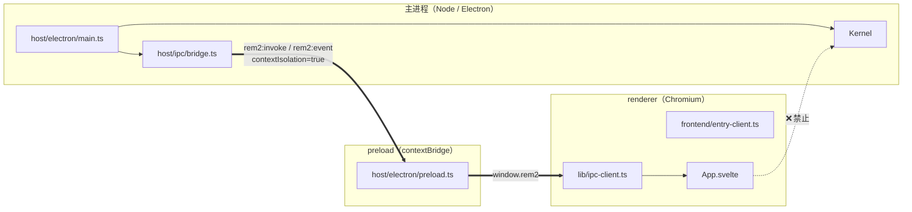
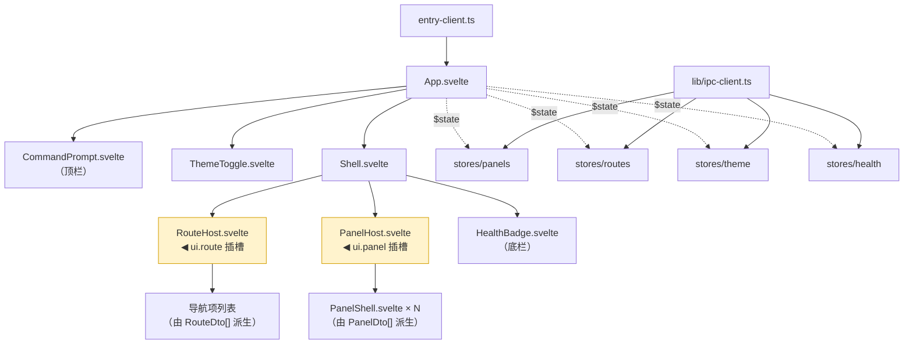
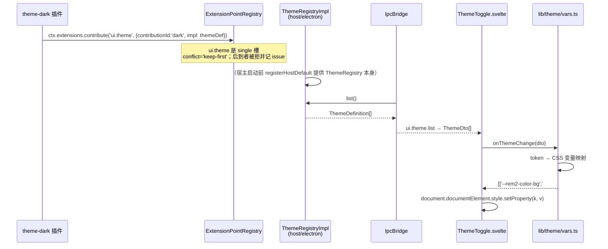

# 04 · Svelte 接入设计

> 对应 PRD **P0-5**。前置：`03-target-architecture.md` §7 的 `ui.panel` / `ui.route` 扩展点裁决。
> 约束：renderer 是唯一跑 Svelte 的地方；renderer **不得** import 内核；不实现前端业务界面。

---

## 1. 进程与构建边界



| 规则 | 说明 | 强制方式 |
| --- | --- | --- |
| **B1** | renderer 是**唯一**跑 Svelte 的地方 | vite.renderer.config 是唯一挂 svelte 插件的 config |
| **B2** | preload 是**唯一**契约边界 | `contextIsolation: true` + `sandbox: true`；`window.rem2` 是 renderer 能看到的唯一全局 |
| **B3** | renderer **不得**直接 import 内核 | 契约测试 R8（`11` §9.2）扫描 `src/frontend/**` 不得出现 `rem2-kernel` 或 `src/kernel` |
| **B4** | 主进程是内核的**宿主**，不是权威 | 主进程可注册默认扩展点实现（如 `ThemeRegistryImpl`），但只能通过 `ExtensionPointRegistry`，不得 import 任何插件源码（契约测试 R3） |

---

## 2. 目录树

```
src/frontend/
├── entry-client.ts              # 渲染进程入口：import './app/global.css' + new App({target})；只做挂载
├── app/
│   ├── App.svelte               # 根组件：初始化 store → 拉取首屏数据 → 渲染 Shell
│   ├── Shell.svelte             # 布局骨架：标题栏 / 左侧导航 / 主内容区 / 状态栏
│   ├── PanelHost.svelte         # ★ ui.panel 插槽：渲染 PanelShell 列表；处理 panel 激活/排序
│   ├── RouteHost.svelte         # ★ ui.route 插槽：由 route 声明派生导航项，处理导航事件
│   ├── components/
│   │   ├── PanelShell.svelte    # 单个面板的 chrome（标题栏 + 内容区 + 空态）；不关心内容语义
│   │   ├── ThemeToggle.svelte   # 主题切换按钮：读 theme 列表，发 `ui.theme.set`
│   │   ├── HealthBadge.svelte   # 健康状态徽标：读 health 报告
│   │   └── CommandPrompt.svelte # 命令输入框：调 `command.*`（骨架：仅结构，无业务）
│   └── global.css               # 全局样式与 CSS 变量默认值（fallback，供变量注入前使用）
└── lib/
    ├── ipc-client.ts            # window.rem2 的类型化唯一封装；所有 IPC 调用必须经此
    ├── bridge-types.ts          # DTO：PanelDto / RouteDto / ThemeDto / HealthDto / CommandResultDto
    ├── channels.ts              # ★ 前端侧的方法名常量（必须与 host/ipc/channels.ts 的白名单逐条对应）
    ├── stores/
    │   ├── panels.svelte.ts     # runes：面板列表与激活项
    │   ├── routes.svelte.ts     # runes：导航项
    │   ├── theme.svelte.ts      # runes：当前主题 + 主题列表
    │   ├── health.svelte.ts     # runes：健康报告
    │   └── command.svelte.ts    # runes：命令执行结果
    └── theme/
        └── vars.ts              # ThemeDto → CSS 变量映射（token → --rem2-*）
```

| 文件 | 一句话职责 |
| --- | --- |
| `entry-client.ts` | 挂载 `App` 到 `#app`，引入全局样式；不含任何逻辑 |
| `App.svelte` | 首屏编排：并行拉取面板/路由/主题/健康，交给 `Shell` |
| `Shell.svelte` | 布局：左导航（`RouteHost`）+ 主区（`PanelHost`）+ 底栏（`HealthBadge`） |
| `PanelHost.svelte` | 把 `ui.panel` 贡献渲染成面板列表，处理激活态 |
| `RouteHost.svelte` | 把 `ui.route` 贡献渲染成导航项 |
| `PanelShell.svelte` | 单面板 chrome（边框/标题/空态），插件内容以「数据 + 命令」方式填充 |
| `ipc-client.ts` | 唯一 IPC 出口；`invoke` / `subscribe` 两个方法，屏蔽 channel 名与 id 匹配细节 |
| `bridge-types.ts` | DTO 定义，与 `kernel/contracts` 的对应关系写在注释里 |
| `channels.ts` | 前端可用的方法名常量；与宿主白名单一一对应（构建期可校验长度相等） |
| `stores/*.svelte.ts` | 每个 store 一个文件，用 Svelte 5 runes（`$state` / `$derived`） |
| `theme/vars.ts` | 纯函数：token → CSS 变量名值对；便于单测 |

**为什么 store 用 `.svelte.ts` 后缀**：Svelte 5 的 runes 需要**编译期**识别 `$state`。放在 `.ts` 里不生效，必须用 `.svelte.ts`。这是 Svelte 5 特有的文件命名约定。

---

## 3. 组件树



**插槽语义**：`PanelHost.svelte` 与 `RouteHost.svelte` 是**通用插槽**，代码里不出现任何插件 id。所有内容由 `ui.panel` / `ui.route` 扩展点贡献的数据驱动。这是「前端是一等消费者」的落地形态：前端代码写一次，插件决定内容。

---

## 4. IPC 契约表（renderer 能做的事的**唯一上限**）

### 4.1 现状问题

`ipc-bridge.ts:42` 的白名单是**前缀匹配**：

```ts
private readonly allowedPrefixes = ['command:', 'health:'];
private isAllowed(method: string): boolean {
  return this.allowedPrefixes.some((p) => method.startsWith(p));
}
```

三个问题：

1. **粒度极粗**：`command:` 之后任意主题都放行，等于把整个命令命名空间交出去。
2. **能力缺失**：renderer 只能发命令、收 broadcast。**无法订阅面板列表、无法请求面板数据、无法上报 UI 事件、无法切主题**。
3. **协议未收敛**：`IpcTopics`（`ipc-topics.ts`）只有 3 个通道，请求/响应靠 payload 里的 `id` 在同一个 `ipc:response` 通道上匹配；事件与响应混在一处。

### 4.2 新通道设计

```ts
// src/host/ipc/channels.ts —— 单一来源，preload 与前端都从这里派生
export const Ipc = {
  /** renderer → main：请求（带 id，主进程按 id 回包） */
  Invoke: 'rem2:invoke',
  /** main → renderer：事件推送（无 id） */
  Event: 'rem2:event',
} as const;
```

**为什么不用 `ipcMain.handle` / `invoke` + `invoke` 返回值**：Electron 的 `ipcRenderer.invoke` 已经自带 request/response 配对，能天然省掉 id 匹配。但现有 `IpcBridge` 是基于 `ipcMain.on` + `bus.request` 实现的，改造收益不抵风险。**保留 id 匹配**（已在 preload 里跑通），但把响应与事件**拆成两个通道**，让前端的 `subscribe` 只需监听一个 channel。

### 4.3 方法白名单（穷举，逐条列明）

| # | method | 方向 | payload | 响应 | 前端用途 | 内核侧落点 |
| --- | --- | --- | --- | --- | --- | --- |
| 1 | `ui.panel.list` | invoke | `{ activeId?: string }` | `PanelDto[]` | 拉取插件面板列表（首屏 + 面板激活时） | `EP.resolve('ui.panel')` |
| 2 | `ui.panel.data` | invoke | `{ panelId: string }` | `unknown`（命令结果） | 请求某面板的渲染数据 | 按面板声明的 `command` 走 `bus.request` |
| 3 | `ui.route.list` | invoke | `void` | `RouteDto[]` | 拉取导航项 | `EP.resolve('ui.route')` |
| 4 | `ui.theme.list` | invoke | `void` | `ThemeDto[]` | 拉取可用主题 | `ThemeRegistry.list()` |
| 5 | `ui.theme.set` | invoke | `{ themeId: string }` | `{ ok: boolean }` | 切换主题 | `ThemeRegistry.activate(themeId)` + `emit('ui.theme.changed')` |
| 6 | `ui.event` | invoke | `{ panelId, kind, payload? }` | `{ ok: boolean }` | 上报 UI 交互（点击/提交等） | 按面板声明路由到 `command.*` |
| 7 | `command.execute` | invoke | `{ command: string, args?: unknown }` | `CommandResultDto` | 执行一条命令 | `bus.request('command:execute', …)` |
| 8 | `health.report` | invoke | `void` | `HealthDto` | 拉取健康报告 | `HealthService.report()` |

**事件白名单（`rem2:event` 通道上允许推送的事件名）**

| # | event | payload | 为什么允许 |
| --- | --- | --- | --- |
| 1 | `ui.theme.changed` | `ThemeDto` | 主题切换必须让前端重算 CSS 变量 |
| 2 | `plugin.state-changed` | `{ pluginId, state }` | 面板所属插件启停要反映到 UI |
| 3 | `panel.data-changed` | `{ panelId, data }` | 插件主动推送面板数据刷新 |
| 4 | `command.result` | `CommandResultDto` | 命令执行结果（含失败原因），前端需要展示 |
| 5 | `kernel.ready` | `{ loadOrder, started, degraded, failed }` | 首屏可用性 |

### 4.4 明确**禁止**的能力（收敛的核心）

| 禁止 | 理由 |
| --- | --- |
| ❌ 任意 `bus.request(method)` 直通 | 现状 `command:` 前缀白名单等于把整个命令命名空间交出去。改为**逐条列举** 8 个方法名 |
| ❌ 切换内核主题的通用请求（如 `config.set('ui.theme')`） | 配置写路径要 `kernel.config.admin` 能力。前端只能走 `ui.theme.set`，由主进程校验该主题 id 是否已注册 |
| ❌ 读配置（任何 `config.*`） | 配置可能含敏感值。若某面板需要配置，让插件在 `ui.panel.data` 的响应里带出，**由插件决定给什么** |
| ❌ 读内核服务（`services.*` / `kernel.*`） | renderer 不与内核对象图打交道，只与 DTO 打交道 |
| ❌ 触发插件生命周期（`plugin.start` / `plugin.stop` / `plugin.unload`） | 生命周期是内核/宿主的特权，前端请求必须被 B5 阻断 |
| ❌ 订阅内核任意事件（`events.*`） | 只允许 §4.3 表中的 5 个事件名。内核有 13 个 topic（`topics.ts`），其中 `config.changed` 等含内部状态，不得外泄 |
| ❌ 直接收到插件侧的 `ui:theme:registered` 等原始主题事件 | 前端只认 `ui.theme.changed`（DTO 化后的），原始事件不外泄 |

**白名单的强制点**：`IpcBridge.handleRequest()` 在 `bus.request` **之前**做 `allowedMethods.has(method)` 判定（`Set<string>` 精确匹配，不是前缀）。不在集合内 → 返回 `{ok:false, error}`，**不进入事件总线**（保持现状 `ipc-bridge.ts:90-97` 的行为，只是判据从前缀换成集合）。

---

## 5. store ↔ EventBus 桥

### 5.1 单向原则

| 方向 | 允许 | 实现 |
| --- | --- | --- |
| 内核 → renderer | ✅ 单向**推送**，且只推 §4.3 的 5 个事件 | `IpcBridge` 订阅内核 topic → 转成 DTO → `rem2:event` |
| renderer → 内核 | ✅ 单向**请求**，且只走 §4.3 的 8 个方法 | `ipc-client.invoke` |
| renderer ↔ 内核事件总线 | ❌ **不代理** | 绝不能把内核 `EventBus` 整体代理到 renderer：那会让 renderer 能 `emit` 任意 topic、订阅任意 topic，`CapabilityGuard` 与信任分级全部失效 |

**明确禁止的两件事**：

1. ❌ 把 `bus.emit` 暴露给 renderer —— 那等于让 renderer 有写侧能力（事件总线是插件间协作通道，renderer 不是插件）。
2. ❌ 把 `bus.on('*')` 转发给 renderer —— 那等于泄露全部内部 topic。

**只做「白名单 topic → DTO」的降维转发**。这与内核现有的 `ipc:broadcast` 机制的区别是：现在是原样转发任意 payload，目标是**只转发 5 个经过 DTO 化的语义事件**。

### 5.2 桥的实现骨架

```ts
// src/host/ipc/bridge.ts（骨架）
export class IpcBridge {
  private readonly allowedMethods: ReadonlySet<string>;
  private readonly allowedEvents: ReadonlySet<string>;

  bind(transport: IpcTransport): void {
    // 宿主 → 内核：精确白名单
    transport.on(Ipc.Invoke, (payload) => void this.handleInvoke(payload));

    // 内核 → 宿主：只转发白名单事件，且做 DTO 降维
    for (const [topic, dto] of this.eventForwardMap()) {
      this.unsubs.push(
        this.bus.on(topic, (p) => {
          if (!this.allowedEvents.has(dto.event)) return;   // 双保险
          this.transport?.send(Ipc.Event, toDto(dto.event, p));
        }),
      );
    }
  }
}
```

### 5.3 DTO 定义

```ts
// src/frontend/lib/bridge-types.ts —— 与 kernel 契约的对应关系写在注释里
export interface PanelDto {
  panelId: string;      // ← PanelContribution.panelId
  title: string;        // ← PanelContribution.title
  icon: string;         // ← PanelContribution.icon
  region: 'main' | 'side';
  order: number;        // ← PanelContribution.order
  command: string;      // ← PanelContribution.command：数据由该命令提供
}

export interface RouteDto {
  path: string;         // ← RouteContribution.path
  title: string;
  panelId: string;
}

export interface ThemeDto {
  id: string;           // ← ThemeDefinition.id
  colors: Record<string, string>;
  fonts: Record<string, string>;
  spacing: Record<string, string>;
}

export interface HealthDto {
  status: 'healthy' | 'degraded' | 'unhealthy';
  plugins: Array<{ id: string; state: string; status: string; message?: string }>;
}

export interface CommandResultDto {
  command: string;
  ok: boolean;
  result?: unknown;
  error?: string;
}
```

**DTO 化的意义**：内核内部的 `PluginInfo`、`LoadedPlugin`、`HealthReport` 都有大量内部字段（含 `container`、`permissions`、绝对路径）。DTO 是**只投影必要字段**的显式白名单 —— 未来内核加字段不会自动泄漏到 renderer。

---

## 6. 主题类插件如何被前端消费

### 6.1 当前路径的问题

现状：`theme-dark` 定义 `ThemeToken` / `ThemeRegistry` / `ThemeRegistryToken` **在插件源码里**（`plugins/theme-dark/src/index.ts`），外壳 `theme-registry.ts` **import 插件源码**拿类型（`electron-shell/theme-registry.ts:7-10`），`main.ts:19` import 该 token。这是诊断报告的 **X1 越界**。

目标：契约上移到内核 `contracts/ui.ts`（或 `contracts/extension-point.ts`），两侧都只依赖契约。

### 6.2 五步链路



### 6.3 主题 token → CSS 变量映射

```ts
// src/frontend/lib/theme/vars.ts
const COLOR_KEYS = [
  'background', 'surface', 'text', 'textMuted', 'accent', 'border',
] as const;
const FONT_KEYS = ['ui', 'mono'] as const;
const SPACING_KEYS = ['xs', 'sm', 'md', 'lg'] as const;

export function themeToCssVars(theme: ThemeDto): Array<[string, string]> {
  return [
    ...COLOR_KEYS.map((k) => [`--rem2-color-${k}`, theme.colors[k]] as [string, string]),
    ...FONT_KEYS.map((k) => [`--rem2-font-${k}`, theme.fonts[k]] as [string, string]),
    ...SPACING_KEYS.map((k) => [`--rem2-space-${k}`, theme.spacing[k]] as [string, string]),
  ];
}
```

`global.css` 里给每个变量写 **fallback 值**（编译期常量），变量未注入时页面仍可读：

```css
:root {
  --rem2-color-background: #0f1115;
  --rem2-color-surface: #161922;
  /* …其余 fallback… */
}
```

### 6.4 CSP 相容性

现有 CSP（`index.html`）：

```
script-src 'self';                            ← 无 unsafe-eval
style-src  'self' 'unsafe-inline';             ← 允许内联样式
connect-src 'self' ws://localhost:* …;         ← HMR
```

| 操作 | 是否被 CSP 拦 | 说明 |
| --- | --- | --- |
| `element.style.setProperty('--x', v)`（CSSOM 写入） | ✅ **不拦** | CSP 管的是 `<style>` 块与 `style` **属性解析**，`CSSStyleDeclaration.setProperty` 不受 `style-src` 约束 |
| Svelte 的 `<style>` 编译产物 | ✅ 允许 | 编译进 CSS 文件由 `<link>` 加载（`'self'`）；若 vite 插件选择注入 `<style>` 标签，则由 `'unsafe-inline'` 覆盖 |
| Svelte 5 的 `$state` / `$derived` | ✅ 允许 | 编译为普通 JS，**不需要 `eval`**。这是选 Svelte 5 而非其他方案的一个附带收益 |
| HMR WebSocket | ✅ 已放行 | `connect-src` 含 `ws://localhost:*` |

**结论**：现有 CSP **无需修改**即可支持 Svelte + 主题变量注入。**不要**为了 Svelte 加 `unsafe-eval` —— Svelte 5 编译目标不需要它。

### 6.5 为什么插件不直接提供 Svelte 组件

见 `11` §7.1。三条约束：插件侧要接 Svelte 编译链、renderer 要有组件动态注册表、插件崩溃会影响 renderer。骨架阶段选择「声明式描述 + 宿主渲染 chrome」。

---

## 7. Vite + `@sveltejs/vite-plugin-svelte` 策略

### 7.1 版本结论：**Svelte 5**（runes）

| 判据 | Svelte 4 | **Svelte 5（采纳）** |
| --- | --- | --- |
| 状态模型 | store（`writable`/`readable`）+ `$store` 自动订阅 | runes（`$state`/`$derived`/`$effect`），编译期识别 |
| 与内核的对应 | store 的 subscribe/unsubscribe 与内核 `Unsubscribe` 同构，但**跨进程后 store 语义冗余**（IPC 已是异步推送） | `$effect` 的清理函数直接对应 `Unsubscribe`，语义更薄 |
| CSP | 需 `unsafe-eval`（Svelte 4 编译用 `new Function`） | ✅ **不需要 `unsafe-eval`**（关键，现有 CSP 才得以保留） |
| 长期 | 维护模式 | 活跃 |

**结论：Svelte 5。UI 层不引入第三方组件库**（PRD Q4 默认）—— 面板 chrome 只有标题栏/边框/空态，自己写比引入组件库更轻，且避免版本耦合。

### 7.2 三个 vite config 的实质化

**共享配置 `vite.shared.mts`**（新增，单一来源）

必须设定项：

| 项 | 值 | 理由 |
| --- | --- | --- |
| `resolve.alias` | `{ 'rem2-kernel': <abs>/src/kernel/index.ts }` | 让 Vite 把内核当源码处理；`.js`→`.ts` 由 Vite 8 内建回退（实测 `10` E1） |
| `ssr.noExternal` | `['rem2-kernel']` | **关键**：默认 Vite 会 externalize 裸包名，导致内核被留成 `require('rem2-kernel')` —— 那在打包态会解析到 `.ts`，直接炸 |
| `build.target` | `'node20'`（main/preload） / `'chrome120'`（renderer） | 与 `engines.node: '>=20'`、Electron 44 的 Chromium 对齐 |
| `build.sourcemap` | `true` | 现有 `tsconfig.json:18` 已开 sourceMap，保持一致 |

> ★ **`resolve.conditions` 不共享，按目标环境分化**（renderer 与 main/preload 各写各的）。
>
> 原因：Vite 8 的 `resolve.conditions` 是**整体替换**默认条件集，而非合并
> （`mergeWithDefaultsRecursively` 对非对象值直接 `merged[key] = value`）。
> 而 svelte 5 的 `exports["."]` 是 `{ worker: index-server, browser: index-client, default: index-server }`
> —— `worker` 键排在 `browser` 之前，且 **`node` 条件按 Node 规范隐含 `worker`**。
> 于是把 `['node','import','module']` 放进共享段会让 renderer 丢掉 `browser`、
> 反被 `worker` 命中 → `index-server.js` → `mount()` 抛 `lifecycle_function_unavailable` → **白屏**。
>
| 目标 | `resolve.conditions` |
| --- | --- |
| main / preload（`NODE_CONDITIONS`） | `['node', 'import', 'module']` |
| renderer | `['browser', 'import', 'module']` |

**`vite.main.config.mts`**

| 必须设定 | 值 |
| --- | --- |
| `plugins` | 共享项（无 svelte） |
| `build.rollupOptions.external` | `['electron']` |
| `build.rollupOptions.input` | 由 `forge.config.mts` 的 `entry` 提供（保持 `src/main.ts` 转发壳形态，或直接指向 `host/electron/main.ts`） |
| `define` | 无需自加（`MAIN_WINDOW_VITE_DEV_SERVER_URL` 由 forge 插件注入） |
| `resolve.alias` | 共享项 |
| `ssr.noExternal` | `['rem2-kernel']` |

**`vite.preload.config.mts`**

| 必须设定 | 值 |
| --- | --- |
| `build.rollupOptions.external` | `['electron']` |
| `build.target` | `'node20'`（preload 与主进程同侧） |
| `build.rollupOptions.output.format` | `'cjs'`（preload 必须 CJS：`contextBridge` 依赖 CommonJS 语义） |
| 产物名 | 必须是 `preload.cjs` —— `main.ts:140` 的 `path.join(__dirname, 'preload.cjs')` 依赖此文件名 |

**`vite.renderer.config.mts`**

| 必须设定 | 值 |
| --- | --- |
| `plugins` | `[svelte()]` —— **唯一**挂 svelte 插件的 config（边界 B1） |
| `root` | 保持 forge 默认（项目根，因 `index.html` 在根） |
| `resolve.alias` | **共享项**（renderer 侧实际不 import 内核，但保持一致以防误用；契约测试 R8 是真正的守卫） |
| `resolve.conditions` | `['browser', 'import', 'module']` —— **必须显式给 browser 语义**，见上文 conditions 分化说明 |
| `build.outDir` | 由 forge 插件接管（产物落 `.vite/renderer/main_window/`） |
| `build.rollupOptions.input` | `index.html` |
| `server.hmr` | 保持默认；`index.html` 的 `connect-src` 已放行 `ws://localhost:*` |

### 7.3 HMR 与编译期常量

| 常量 | 注入方 | 注意事项 |
| --- | --- | --- |
| `MAIN_WINDOW_VITE_DEV_SERVER_URL` | forge 插件的 `define` | 是**编译期裸标识符替换**，必须写裸名（`main.ts:130` 的注释已自述），写 `process.env.X` 不会被替换 |
| `MAIN_WINDOW_VITE_NAME` | 同上 | 打包态定位 `../renderer/<name>/index.html` |

**Svelte 侧无需额外配置**：HMR 走 Vite dev server 的 WebSocket，`index.html` 的 `connect-src` 已含 `ws://localhost:*`；Svelte 插件不注入 `eval`。

**一个必须注意的坑**：`index.html:41` 现在写死 `<script type="module" src="/src/renderer.ts">`。目标形态下必须改为 `/src/frontend/entry-client.ts`，否则 vite 找不到入口。**且 `src/renderer.ts` 这个转发壳要删除**（`docs/06` 破坏式变更清单）。

---

## 8. 最小 `App.svelte` 骨架

> 只写骨架，不写业务。目的是给出「store 怎么接 IPC」与「插槽怎么渲染」的形状。

```svelte
<!-- src/frontend/app/App.svelte -->
<script lang="ts">
  import { onMount } from 'svelte';
  import Shell from './Shell.svelte';
  import { ipc } from '../lib/ipc-client';
  import { channels } from '../lib/channels';
  import { panels } from '../lib/stores/panels.svelte';
  import { routes } from '../lib/stores/routes.svelte';
  import { theme } from '../lib/stores/theme.svelte';
  import { health } from '../lib/stores/health.svelte';

  // 首屏：并行拉取四类数据；失败各自降级为空，不阻塞渲染
  onMount(() => {
    void ipc.request(channels.panelList).then((d) => panels.set(d));
    void ipc.request(channels.routeList).then((d) => routes.set(d));
    void ipc.request(channels.themeList).then((d) => theme.setList(d));
    void ipc.request(channels.healthReport).then((d) => health.set(d));

    // 事件订阅：返回的取消函数交给 $effect 自动清理
    return ipc.subscribe('ui.theme.changed', (d) => theme.setActive(d));
  });
</script>

<Shell {panels} {routes} {theme} {health} />
```

```svelte
<!-- src/frontend/app/PanelHost.svelte —— ui.panel 插槽 -->
<script lang="ts">
  import PanelShell from './components/PanelShell.svelte';
  import type { PanelDto } from '../lib/bridge-types';

  let { panels = [], activeId = $bindable() }: {
    panels: PanelDto[];
    activeId?: string;
  } = $props();

  // 排序在派生里做一次，不在模板里排
  const ordered = $derived([...panels].sort((a, b) => a.order - b.order));
  const active = $derived(ordered.find((p) => p.panelId === activeId) ?? ordered[0]);
</script>

<section class="panel-host">
  <!-- 插件只提供描述数据；chrome 与空态由宿主负责 -->
  {#if active}
    <PanelShell panel={active} />
  {:else}
    <p class="empty">暂无面板</p>
  {/if}
</section>
```

```ts
// src/frontend/lib/ipc-client.ts —— 唯一 IPC 出口
export interface Rem2Bridge {
  request<T>(method: string, args?: unknown): Promise<T>;
  subscribe(event: string, handler: (payload: unknown) => void): () => void;
}

export const ipc: Rem2Bridge = {
  request: (m, a) => window.rem2.invoke(m, a),
  subscribe: (e, h) => window.rem2.onEvent(e, h),
};
```

```ts
// src/frontend/app/global.css —— fallback 变量（主题注入前保证可读）
:root {
  --rem2-color-background: #0f1115;
  --rem2-color-surface: #161922;
  --rem2-color-text: #e6e6e6;
  --rem2-color-text-muted: #9aa4b2;
  --rem2-color-accent: #4f9cf9;
  --rem2-color-border: #232838;
  --rem2-space-sm: 8px;
  --rem2-space-md: 16px;
}
```

---

## 9. 主进程如何挂 Svelte 产物

现状 `createWindow()`（`main.ts:134-154`）**基本不用改**，只有两处：

| # | 现状 | 目标 | 说明 |
| --- | --- | --- | --- |
| 1 | `preload: path.join(__dirname, 'preload.cjs')` | **不变** | 但 `vite.preload.config.mts` 必须保证输出文件名就是 `preload.cjs`（§7.2） |
| 2 | `loadFile(path.join(__dirname, '../renderer/main_window/index.html'))` | **不变** | `MAIN_WINDOW_VITE_NAME` 已是 `main_window`（`forge.config.mts:40`） |

**要改的两处（都在 `main.ts`）**：

| # | 改什么 | 理由 |
| --- | --- | --- |
| A | **删除** `:57-65` 的 `registerTsLoader()` 与 `:71` 的调用 | `07-form-evaluation.md` §9 决策 1：插件入口改为预编译 JS，主进程不再需要 TS 运行时 |
| B | `:94-98` 的 ThemeRegistry 注册改为经扩展点 | 现状是 `kernel.root.registerInstance(ThemeRegistryToken, ...)` + 手动 `guard.declareServiceCapability`——针对具体插件的特例。目标形态由 `Composition.createDeps()` 统一注册宿主默认实现，`main.ts` 不再出现任何插件 id/token |

**建议新增**：`webPreferences.sandbox: true`。现状只有 `contextIsolation: true`（`main.ts:141`）。renderer 现在要跑 Svelte（需要 `window`/DOM），`sandbox: true` 仍可用（preload 在 sandbox 里也能用 `contextBridge` 与 `ipcRenderer`），但会限制 renderer 的 Node 能力——这正是我们想要的。

---

## 10. 风险与已知限制

| # | 风险 | 影响 | 缓解 |
| --- | --- | --- | --- |
| **R1** | **插件形态与 UI 能力不匹配**：插件只能贡献**描述**，不能贡献组件 | 想做「自带 UI 的插件」的第三方开发者会觉得受限 | 骨架阶段的自觉取舍（`11` §7.1）。未来 `ui.component` 扩展点可放开，届时需重新评估构建链与 CSP |
| **R2** | **`ui.panel.data` 的数据形状由插件自定**，内核不校验 | 恶意/错误插件可返回超大对象拖垮 renderer | 骨架阶段接受。后续可加「DTO 大小上限 + JSON 可序列化校验」 |
| **R3** | **前端与内核的类型对齐靠人工**：`bridge-types.ts` 手写 DTO，内核契约改了前端不会自动报错 | 契约漂移 | `bridge-types.ts` 的每个类型注释里标注对应的 kernel 契约路径；`ui.*` 扩展点的 `impl` 类型本身来自 kernel 契约，`PanelDto` 只是它的 JSON 投影，字段名漂移会在赋值处被 TS 抓到（如果主进程侧也用同一份类型） |
| **R4** | **`preload.cjs` 文件名是隐式契约**：`main.ts:140` 硬编码，vite config 若改名则窗口加载失败且无提示 | 启动失败 | 在 `vite.preload.config.mts` 加注释显式声明此文件名不可改 |
| **R5** | **`MAIN_WINDOW_VITE_DEV_SERVER_URL` 是编译期常量**：写 `process.env.X` 不被替换 | 窗口永远走 `file://` 分支（现状 `main.ts:122-124` 注释已自述） | 保留该注释；`oxlint` 可加 `no-restricted-syntax` 规则禁止 `process.env.MAIN_WINDOW_` |
| **R6** | **Svelte 5 runes 需要 `.svelte.ts` 后缀**：写成 `.ts` 的 runes 不生效且不报错 | 状态写成普通变量，无响应式 | 目录约定 + 契约测试可加一条：扫描 `frontend/lib/stores/**` 必须以 `.svelte.ts` 结尾 |
| **R7** | **`ws://localhost:*` 的 CSP 通配**：Electron 生产环境不加载 dev server，该条 CSP 无害 | 无 | 保留。若追求极致可在打包时剥离 dev-only CSP，但那超出骨架范围 |
| **R8** | **renderer 的 `$effect` 清理 = IPC 订阅退订**：若组件被销毁而清理未跑，`rem2:event` 监听会泄漏 | 内存泄漏 | `ipc-client.subscribe` 返回的取消函数**必须**在 `$effect` 的返回位置透出；建议在 `ipc-client.ts` 内部维护一个订阅计数，`beforeunload` 时统一退订 |
| **R9** | **CSP `script-src 'self'` 与 Svelte 的 `<style>` 注入方式** | 若 svelte 插件配置为 `injectCss: false`（默认），CSS 走独立文件由 Vite 注入 `<link>`（`'self'` 允许）；若注入 `<style>` 标签，则需 `'unsafe-inline'`（已放行） | 两种都可行，无需改 CSP |

---

## 11. 需要工程师特别注意的 3 个坑

1. **`index.html` 的入口引用必须同步改**（`index.html:41`）：`/src/renderer.ts` → `/src/frontend/entry-client.ts`。同时 `src/renderer.ts` 这个转发壳要删除。漏改则 renderer 白屏，且 vite 报错信息指向「入口不存在」而非根因。

2. **`vite.main.config.mts` 必须设 `ssr.noExternal: ['rem2-kernel']`**。默认情况下 Vite 会把裸包名 externalize，主进程产物里留下 `require('rem2-kernel')`；打包态解析到 `exports` 的 `.ts` 入口 → `ERR_UNKNOWN_FILE_EXTENSION`。这个错误只在打包后出现，开发态（内存 bundle）看不出来。

3. **preload 产物名必须是 `preload.cjs`**。`main.ts:140` 是硬编码字符串。Vite 对 preload target 默认输出 `.cjs`，但一旦有人给 `build.rollupOptions.output.filename` 改名，窗口会以「preload 脚本加载失败」的形式报错，且**不会**提示是文件名问题。