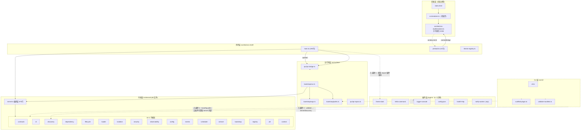
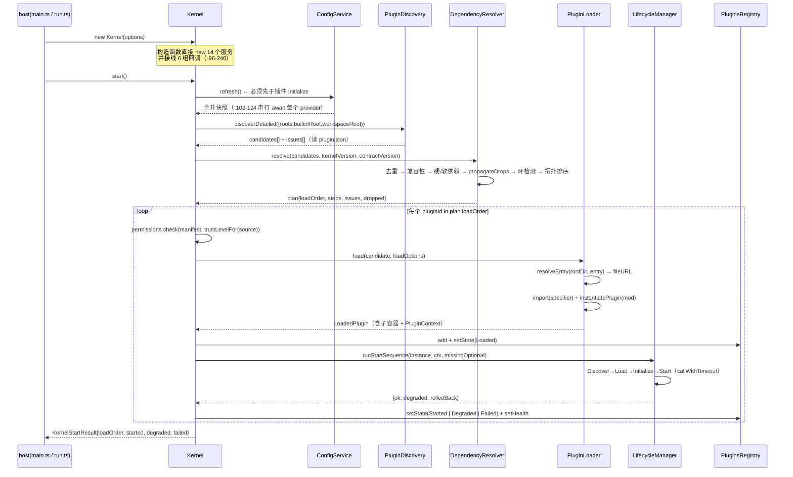
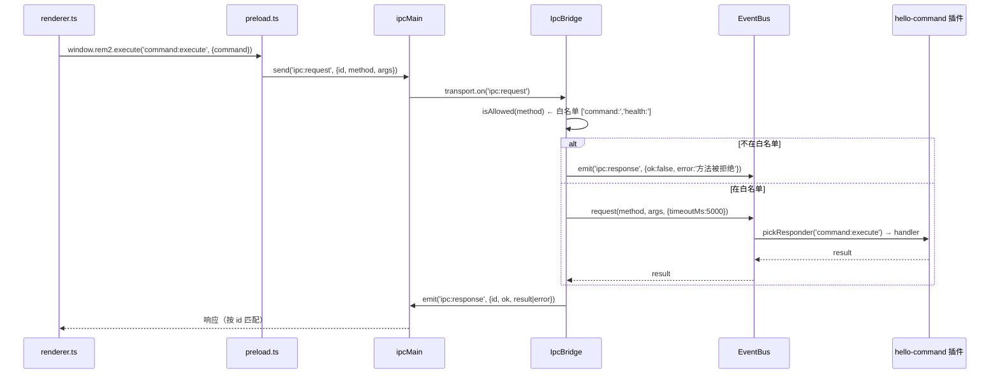
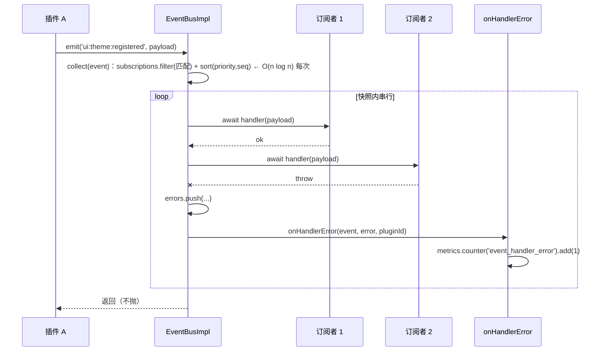
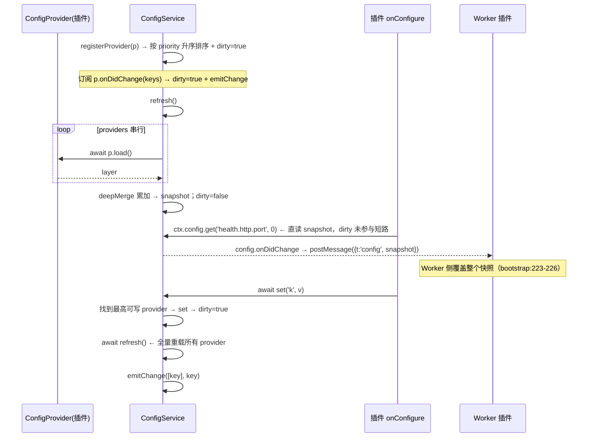
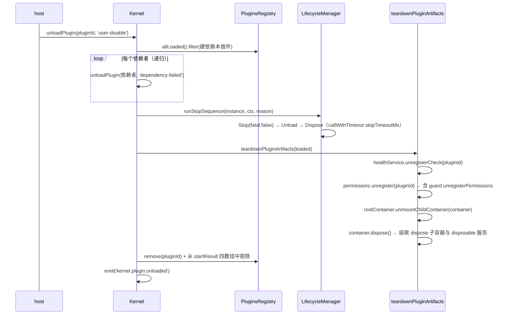

# 08 · 现状诊断

> 项目：`D:\projects\rem2` · 诊断基线：`src/` 85 个 `.ts` / 9173 行
> 结论摘要：**逻辑层质量可用（docs/07 已修 F1–F13），问题集中在「构建 / 分发 / 前端」三处**。本报告给出 24 条可优化项，其中 9 条 P0 全部落在构建与宿主边界上。

---

## 1. 整体分层与依赖方向

**箭头方向总结（现状）**

| 方向 | 合法性 | 说明 |
| --- | --- | --- |
| 外壳 → 内核 | ✅ 允许 | Electron/CLI 都以库的方式消费内核 |
| 内核 → 内核内部 | ✅ 允许 | 唯一实现细节 |
| 内核 → 外壳 / 前端 | ✅ 零依赖 | 硬红线，`tests/contract/kernel-deps.test.ts` 强制 |
| 内核 → 第三方 | ✅ 零依赖 | 硬红线，同上 |
| 外壳 → 插件源码 | ❌ **越界** | `electron-shell/main.ts:19` |
| 插件 → 内核公共出口 | ✅ 允许 | `import … from 'rem2-kernel'` |
| 插件 → 内核内部 | ❌ **潜在越界** | `tsconfig.json:26-29` 的 `paths` 把它映射到 `src/kernel/index.ts`，同时 `rem2-kernel/*` 通配把 `src/kernel/*` 全量暴露 |
| 前端 → 内核 | ❌ 不存在也不应存在 | 当前靠 `contextIsolation: true` 物理阻断，是正确设计 |

---

## 2. 内核模块职责表

| 子目录 | 文件 | 行数 | 职责 | 依赖了谁 | 被谁依赖 |
| --- | --- | --- | --- | --- | --- |
| `contracts/` | 16 | 811 | 插件可见的唯一语言：manifest / lifecycle / context / DI / event / config / logging / metrics / tracing / health / permission / plugins / service-token / kernel-tokens | 仅 node 内置无 | 全内核 + 插件（经出口） |
| `di/` | 4 | 434 | 容器（`Container`）、生命周期、注册表面 | contracts, errors, util | kernel, loader, context, bootstrap |
| `discovery/` | 3 | 564 | 扫描插件根、读 `plugin.json`、校验、候选排序 | contracts, version, errors | kernel, dependency, loader |
| `dependency/` | 4 | 787 | 依赖图 / 兼容性判定 / 环检测 / 确定性拓扑排序 | discovery, semver, contracts | kernel |
| `lifecycle/` | 3 | 359 | 7 阶段定义、阶段驱动、超时、回滚 | contracts, util, errors | kernel |
| `loader/` | 3 | 340 | `resolveEntry` + 动态 `import()` + `instantiatePlugin` + Worker 分支 | discovery, isolation, di, types, errors | kernel, isolation |
| `isolation/` | 3 | 681 | `WorkerPluginHost` / `WorkerPluginProxy` / eval bootstrap 源码串 | loader, contracts, observability | loader, kernel |
| `security/` | 3 | 301 | 权限管理器 / 能力代理 / 信任策略 | contracts, errors | kernel, context |
| `observability/` | 6 | 571 | log / metrics / tracing / health 四个服务 + 三个 sink | contracts, registry | kernel, config, isolation |
| `config/` | 2 | 258 | provider 分层、priority 合并、deepMerge、变更通知 | contracts, util, errors | kernel, isolation |
| `events/` | 3 | 351 | 事件总线（emit/on/request/respond）+ 模式匹配 + 优先级 | contracts, util, errors | kernel, config, isolation |
| `scheduler/` | 2 | 81 | `Scheduler` 契约 + `SerialScheduler` 默认实现 | — | kernel |
| `semver/` | 2 | 513 | 版本解析 + range 判定（自研，零依赖） | — | dependency, cli |
| `bootstrap/` | 2 | 176 | `KernelOptions` 默认值 + 14 个核心服务注册与能力门槛声明 | 全部内核子模块 | kernel |
| `registry/` | 1 | 98 | 已加载插件表 + 状态 + 健康 | contracts, types | kernel, observability |
| `util/` | 4 | 269 | deepMerge / disposable / id / timeout | — | config, events, lifecycle |
| `context/` | 2 | 187 | `createPluginContext` + `PluginApiImpl` | contracts, di, security, registry | kernel |
| 顶层 `kernel.ts` | 1 | 675 | **编排层**：构造 14 个服务、接线、start/reload/unload/shutdown/health | 全部 | host 层 |
| 顶层 `types.ts` | 1 | 129 | `PluginState` 枚举 + `LoadedPlugin` + `LoadedPluginBuilder` | contracts | loader, kernel, registry |
| 顶层 `topics.ts` | 1 | 32 | 13 个内核主题常量 | — | 全内核 |
| 顶层 `errors.ts` | 1 | 209 | 13 个错误类 | — | 全内核 |
| 顶层 `version.ts` | 1 | 22 | `KERNEL_VERSION` / `CONTRACT_VERSION` / `MANIFEST_FILENAME` | — | discovery, loader, bootstrap |
| 顶层 `index.ts` | 1 | 135 | 公共出口（**同时导出契约与 20+ 具体实现类**） | 全部 | 插件, host, tests |

---

## 3. 依赖矩阵与越界处

### 3.1 内核对内核（相对导入 `.js` → 实际 `.ts`）

全量扫描 `src/kernel` + `src/runtime`：**253 处** `from './x.js'` 形态的相对导入，实际文件全是 `.ts`。

| 子目录 | `.js` 后缀导入数 |
| --- | --- |
| `contracts/` | 37 |
| `context/` | 20 |
| `bootstrap/` | 16 |
| `loader/` | 15 |
| `isolation/` | 12 |
| `di/` | 11 |
| `dependency/` `lifecycle/` `observability/` | 各 10 |
| `security/` | 8 |
| `discovery/` | 7 |
| `config/` | 6 |
| `events/` | 5 |
| `registry/` `scheduler/` `semver/` `util/` | 各 1–3 |

这是**打包态的第一号断点**：Node ESM 严格解析，`dist/kernel/loader/loader.js` 里的 `./module-resolver.js` 只有在 `module-resolver.js` 真的以 `.js` 存在时才成立（`tsc` 转译后成立），但源码态由 tsx 兜住；一旦绕过 tsc（打包器内联源码）就全断。

### 3.2 越界处（4 处，全部有断言）

| # | 越界 | 位置 | 证据 | 后果 |
| --- | --- | --- | --- | --- |
| **X1** | 宿主 → 插件源码 | `src/electron-shell/main.ts:19` | `import { ThemeRegistryToken } from '../../plugins/theme-dark/src/index.js'` | ① 打包态该路径不存在于 asar（无 `extraResource`）；② 外壳与示例插件静态耦合，新增插件必须改外壳源码；③ 外壳的 typecheck 被迫覆盖插件源码 |
| **X2** | 插件 → 内核内部 | `tsconfig.json:26-29` | `paths: { "rem2-kernel": [...], "rem2-kernel/*": ["src/kernel/*"] }` | `rem2-kernel/kernel.js`、`rem2-kernel/di/container.js` 可被解析到实现内部。契约测试 `plugin-contract.test.ts:60-72` 只拦**字面量**含 `src/kernel` 的说明符，**拦不住 `rem2-kernel/*` 这种裸包名深链** |
| **X3** | CLI → 内核实现 / runtime | `src/cli/validate-manifest.ts:11`、`src/cli/cli.ts:17` | `from '../kernel/discovery/manifest-validator.js'`、`from '../runtime/bootstrap/paths.js'` | CLI 复用内核实现是好意图，但它让 `src/runtime/**` 被迫留在「零第三方」扫描范围内（`kernel-deps.test.ts:103`），一旦 runtime 引入 Electron 就连带破红线 |
| **X4** | 外壳 → devDependency | `src/electron-shell/main.ts:57-65, 71` | `registerTsLoader()` 动态 `import('tsx/esm/api')`，`tsx` 在 `devDependencies`（`package.json:65`） | 打包态 `tsx` 不存在；`main.ts:74` 自己 throw，但**用户看到的是「窗口没出现」**（`main.ts:160-161` 注释自述的静默失败教训） |

### 3.3 配置与构建的重复声明（3 处映射 + 1 处空壳）

| 声明内容 | `tsconfig.json` | `package.json` | `vitest.config.ts` | vite config |
| --- | --- | --- | --- | --- |
| `rem2-kernel` → 源码 | `:26-29` paths | `:29-31` imports | `:52-56` resolve.alias | ❌ 空壳 |
| renderer 入口 | `:37-46` exclude | — | — | ❌ 空壳 |
| main/preload 入口 | `:37-46` exclude | `:19` main | — | ❌ 空壳（`forge.config.mts:22-37` 指定） |
| Svelte | — | ❌ 未安装 | — | ❌ 空壳 |

---

## 4. 五条主链路数据流

### 链路 ① 启动（`Kernel.start()`，`kernel.ts:276-353`）

**关键观察**：配置刷新（步骤 0）在物理上早于一切，因为插件 `onConfigure` 要读配置；这与用户直觉的「配置是第 6 段」冲突——见 `03-target-architecture.md` §4 的两层模型。

### 链路 ② 命令（renderer → 内核 → 响应回传）

**关键观察**：白名单是前缀字符串匹配（`ipc-bridge.ts:80-82`），粒度极粗——`command:` 之后任何主题都放行，`health:` 同理。且 renderer **完全无法订阅插件面板/主题/健康状态**，只能被动收 `ipc:broadcast`。

### 链路 ③ 事件派发

**关键观察**：`collect()` 在**每次 emit** 都做全量 `filter + sort`（`event-bus.ts:195-199`），无按前缀/模式建立的索引；派发严格串行 `await`。插件数与订阅数上升后是明确的 CPU 热点。

### 链路 ④ 配置

**关键观察**：`get()` 直读 `snapshot`（`config-service.ts:132-136`），`dirty` 只是个从未被用于短路的标记（`:40, :69, :88, :123, :161, :177`）。`set()` 一次写入触发**全量 provider 重载 + 全量 deepMerge**（`:152-164`）。

### 链路 ⑤ 卸载

**关键观察**：回收逻辑是**内核强制**的，不依赖插件自觉 `api.unexport()`——这是现有实现里质量最高的一处设计，应在目标架构中保留并扩展到扩展点贡献的回收。

---

## 5. 可优化项清单（24 条）

> 每条含：位置证据 / 动因 / 影响范围 / 优先级 / 建议方向。P0 = 打包态不自洽，必须本轮修。

### 构建与分发（P0）

| # | 标题 | 位置 | 动因 | 影响范围 | 优先级 | 建议方向 |
| --- | --- | --- | --- | --- | --- | --- |
| **O1** | `Kernel` 构造器直接 `new` 14 个具体实现类 | `kernel.ts:96-240` | 无工厂/注册表注入 → 单元测试无法替身、无法替换实现、构造器承担全部接线 | 内核全部；`tests/fixtures/fake-kernel.ts` 只能整体伪造 | **P0** | 抽出 `composition.ts`，内核只依赖 `KernelDeps` 接口；`Kernel` 构造器接受部分注入用于测试 |
| **O2** | 外壳静态 import 示例插件源码 | `electron-shell/main.ts:19`；`theme-registry.ts:7-10` | 宿主与插件静态耦合；打包态路径不存在；每加一个 UI 插件都要改外壳 | 外壳构建、`extraResource` 设计、插件独立性 | **P0** | 删除该 import。`theme-registry` 移入 `src/host/electron/`；插件侧的 `ThemeRegistry` 类型上移到 `kernel/contracts/ui.ts`，两侧都只依赖契约 |
| **O3** | `exports` 直指 `.ts`、无 dist、无 build 脚本 | `package.json:25-28`、`:32-47`；PRD B1/B8 | 裸包名解析到 TS 源码，任何 Node 直跑场景（CLI、vitest、npm 分发）都必须靠转译器兜底 | 全部消费者 | **P0** | 新增 `tsconfig.build.json` 产出 `dist/kernel/**`；`exports` 条件化 `development` → `./src/kernel/index.ts` / `default` → `./dist/kernel/index.js`；新增 `build` 脚本 |
| **O4** | `entry` 扩展名补全优先 `.ts` | `loader/module-resolver.ts:56-65` | 产物形态与开发态纠缠：同一份 resolver 同时服务 `.ts` 与 `.js`，补全顺序让「源码优先」成为隐式策略 | 打包态装载、worker 装载 | **P0** | 单一产物入口：manifest `entry` 只允许指向构建产物；resolver 不再补全 `.ts`。开发态通过「先 build 再跑」收敛（见 `07-form-evaluation.md` §5） |
| **O5** | `registerTsLoader()` 依赖 devDependency `tsx` | `electron-shell/main.ts:57-65,71` | 打包态 `tsx` 不存在；失败表现为「窗口不出现」 | Electron 启动 | **P0** | 删除该函数与整条动态 import 链。插件入口改为预编译 JS，主进程不再需要 TS 运行时 |
| **O6** | `forge.config.mts` 无 `extraResource` | `forge.config.mts:11-13` | 插件与内核产物根本没进包；`packagerConfig` 只有 `asar: true` | 打包产物 | **P0** | 增加 `extraResource`，把插件产物放到 **asar 外**的 `resources/rem2-plugins/`（理由见 `10` §4.3 的 asar/ESM 约束）；同时带一份 `dist/kernel` 供 CLI/直跑 |
| **O7** | 三个 vite config 全为空壳 | `vite.main.config.mts`、`vite.preload.config.mts`、`vite.renderer.config.mts` 各 2 行 | 无 `alias` / `external` / `conditions` / `define` / `plugins` 策略，开发态与打包态解析行为不可控，构建期行为靠默认值碰运气 | 三个构建目标 | **P0** | 抽出共享 `vite.shared.mts`（alias + `resolve.conditions` + `.js→.ts` 解析插件），三个 config 各自只声明差异项 |
| **O8** | `pnpm-workspace.yaml` 无 `packages` 字段 | `pnpm-workspace.yaml`（只有 `allowBuilds`/`nodeLinker`/`minimumReleaseAgeExclude`） | 6 个插件不是 workspace 包：无各自 `package.json`、无独立 `tsconfig`、无独立构建 → 插件形态无法统一，「一切皆插件」在物理上不成立 | 插件工程化 | **P0** | 加 `packages: ['plugins/*']`；每个插件补 `package.json`（`type: module`、私有、`build` 脚本）+ `tsconfig.json`（仅类型路径指向内核源码） |

### 抽象边界（P0/P1）

| # | 标题 | 位置 | 动因 | 影响范围 | 优先级 | 建议方向 |
| --- | --- | --- | --- | --- | --- | --- |
| **O9** | 公共出口同时导出契约与 20+ 实现类 | `kernel/index.ts:102-135` 导出 `DiContainer`/`ConfigService`/`LogService`/`DependencyResolver`/`PluginDiscovery`/`PermissionManager`/`CapabilityGuard`/`SerialScheduler`… | 契约层与实现层边界模糊；插件可 `import { ConfigService } from 'rem2-kernel'` 拿到**类构造器**并 `new` 出一个假内核服务实例 | 隔离边界、`O2` 同类问题 | **P0** | 出口只保留：契约类型 + `ServiceToken` + `KernelTokens` + 错误类 + `definePlugin` + 版本常量。实现类移入 `rem2-kernel/testing` 子路径导出（仅测试与宿主用） |
| **O10** | 状态定义双源 | `types.ts:16-26` `enum PluginState` vs `contracts/plugins.ts:8-17` `type PublicPluginState` | 9 个字面量写两遍；`kernel.ts:656-666` 还用第三张 `Record<PluginState, LifecyclePhase>` 手工映射；改一个状态要改三处 | registry, kernel, host, 前端 DTO | **P1** | 单一来源：`contracts/state.ts` 定义 `PLUGIN_STATES` 常量数组 + `PluginStateT` 联合类型；`PluginState` 枚举删除（真 enum 还会给 bundle 引入运行期对象，见 `10` §3.3）；映射表改为 `satisfies Record<PluginStateT, LifecyclePhase>` 以获得编译期穷尽检查 |
| **O11** | `PluginApi.registerCapability(name, impl: unknown)` 无类型约束、无注册表 | `context/plugin-api.ts:65-67`；契约 `contracts/context.ts:37` | 能力发现退化为不可枚举的散装注册：`PluginApiImpl` 把能力存进**实例私有** `Map`（`:29`），内核与其他插件都读不到，`getCapability`/`listCapabilities` 只在实例内部可达 | 扩展点体系（本次核心） | **P1** | 取消 `registerCapability`。能力贡献统一走**扩展点注册表**（`kernel/extensions/`），内核可枚举、可回收、可裁决冲突 |
| **O12** | 扩展点没有显式注册表，能力只散落在 `manifest.capabilities` 字符串数组 | `contracts/manifest.ts:38`；`register-core-services.ts:52-99`；`observability/log-service.ts:86-93`（`addSink`） | 「一切皆插件」缺少唯一的挂载面：新增一类可插拔能力要改 3–4 处（manifest 能力串、容器注册、solver 接线、回收） | 全部扩展点 | **P1** | 新增 `kernel/extensions/`：`ExtensionPointRegistry` + 声明式 `definitions.ts`（单例/多贡献、宿主默认实现、冲突裁决规则），成为唯一挂载面 |
| **O13** | `Worker` 隔离用手写 eval bootstrap 字符串 | `isolation/worker-bootstrap.ts:15-239`（225 行字符串） | ① 无法类型检查；② 与 `plugin-factory.ts` 的 `instantiatePlugin`（`:16-42`，4 种猜测）**逻辑重复且不一致**（bootstrap `:170-175` 只处理 3 种）；③ 改协议要手改字符串 | worker 插件全部 | **P1** | bootstrap 改为 `isolation/worker-entry.js`（真实 `.js` 文件，可被 tsc 检查协议常量）；`instantiate` 逻辑与 `plugin-factory` 共享同一份产物（bundle 内联一个纯 JS 模块） |
| **O14** | Worker RPC 逐条 `postMessage`、无批量、无 trace 透传 | `worker-host.ts:361-384`；`:272-286` | 高频 `ctx.log.info` 每次一个来回；`dispatchCtx` 不注入 trace 上下文 | worker 插件性能与可观测性 | **P1** | 引入 `batch` 消息类型（合并同一 tick 的 ctx 调用）；`WorkerHostFacilities` 增加 `tracer`，`dispatchCtx` 包裹 span |
| **O15** | `health-http` 在内核外起 HTTP 服务，运行期新建 socket 无强制校验点 | `plugins/health-http/src/index.ts` `createServer`；`security/capability-guard.ts:47-59` 仅在 `ctx.services.resolve` / `api.useCapability` 生效 | `net.listen` 只在 `manifest.capabilities` 声明 + `PermissionManager.check` 里被**记录**（`permission-manager.ts:82-139`），但插件拿到 `node:http` 后**任何时候**都能 listen，没有强制点 | 安全边界完整性 | **P1** | 引入 `GuardedHostApi` 概念：需要 OS 级能力（`net.*` / `fs.*` / `process.*`）的插件必须声明 `isolation: 'worker'`，或在 manifest 增 `requiresHostGuard: true` 由内核在授予时显式登记审计事件。本轮只落登记与审计，不做强制拦截（超出骨架范围） |

### 性能（P1/P2）

| # | 标题 | 位置 | 动因 | 影响范围 | 优先级 | 建议方向 |
| --- | --- | --- | --- | --- | --- | --- |
| **O16** | `EventBus.emit` 每次 O(n) filter + sort，且串行 await | `events/event-bus.ts:86-107, 195-199` | 无按模式前缀建立的索引；sort 在每次 emit 重复做（priority/seq 在订阅时不变） | 插件数 × 订阅数增长后为热点 | **P1** | 订阅时插入按 pattern 首段的桶（`a.b.*` → 桶 `a.b`），`emit` 只扫相关桶；priority/seq 在插入时定序（有序数组 + 二分插入），`collect` 不再 sort。保留「串行 await + 错误隔离」语义不变 |
| **O17** | `discovery` 无缓存无 watch，`reload` 走全量重新发现 | `discovery/discovery.ts:58-100`；`kernel.ts:384-393` | 重载一个插件要重扫全部根目录、重新读全部 `plugin.json`、重跑解析器 | 重载延迟随插件数线性增长 | **P2** | discovery 结果按「根目录 + manifest mtime」缓存；`reload` 优先走 `resolveOne(pluginId)` 快路径 |
| **O18** | `ConfigService.get` 直读 snapshot，`dirty` 未用于短路 | `config/config-service.ts:40, 132-136, 177-179` | `dirty` 是死标记，读路径看不出「快照可能过期」 | 配置正确性表达 | **P2** | 明确二选一：要么删掉 `dirty`，要么让 `get` 在 `dirty` 时触发一次惰性 refresh（并暴露 `snapshotAgeMs`）。推荐后者（配置变更后插件读到旧值是真 bug） |
| **O19** | `ConfigService.set()` 一次写入触发全量 refresh + 全量 deepMerge | `config/config-service.ts:152-164` | 写放大；provider 越多越慢 | 配置写入路径 | **P2** | `set` 后只重算受影响的 key 路径（增量合并），全量 refresh 保留给显式 `refresh()` 调用 |

### 契约与形态（P1）

| # | 标题 | 位置 | 动因 | 影响范围 | 优先级 | 建议方向 |
| --- | --- | --- | --- | --- | --- | --- |
| **O20** | 契约测试的扫描路径硬编码 `src/kernel` + `src/runtime` | `tests/contract/kernel-deps.test.ts:102-103` | 目录重排后（`runtime` → `host/ipc`）测试**不会报错**，只会扫不到文件 → 红线静默失效 | 全部架构约束 | **P1** | 改为「扫描 `src/kernel/**` + `src/host/**` 中除 `src/host/electron/**` 外的全部文件」；并新增一条反向断言：`src/kernel/**` 不得 import `src/host/**`。同时新增「`plugins/*/dist/**` 不存在则跳过」的显式提示，避免误以为已扫描 |
| **O21** | 三处重复声明同一 `rem2-kernel` 映射 + 一处空壳 | `tsconfig.json:26-29`、`package.json:29-31`、`vitest.config.ts:52-56`、`vite.shared.mts`（待建） | 改一处忘三处 → 类型解析与运行期解析分叉 | 构建/测试/IDE 三方 | **P1** | 单一来源 `paths.shared.mts` 导出映射对象，`tsconfig` 无法 import 故保留字面量但加注释指向该文件；`vitest.config` 与三个 vite config 一律从 `vite.shared.mts` import |
| **O22** | 插件形态四种猜测（class / instance / named / 双层 default） | `loader/plugin-factory.ts:44-65` | 猜错时报错信息才暴露；且与 worker bootstrap 的三种猜测不一致（`worker-bootstrap.ts:170-175`） | 所有插件 | **P1** | 裁决为**唯一形态：`export default definePlugin(manifest, setup)` 工厂函数**（详见 `11` §3.3）。删除 `instantiatePlugin` 的猜测逻辑；loader 断言导出是函数，调用它拿到 `Plugin` |
| **O23** | `KernelOptions.bootstrap` 定义了但 `Kernel` 从不消费 | `bootstrap/options.ts:7-13, 68-70`；`kernel.ts` 全文无 `options.bootstrap` | 死配置：CLI 与 Electron 都不传，读代码的人以为有「引导插件先行加载」语义 | 文档可信度 | **P2** | 删除该字段。若确需「先行加载」语义，应由扩展点 `scheduler.replace` / `config.provider` 的加载优先级表达，不走独立字段 |
| **O24** | `LoadedPluginBuilder` 9 个 `withXxx` 只在一处调用；注释密度过高 | `types.ts:67-128`（唯一调用点 `loader/loader.ts:128-135`）；注释抽样：`contracts/event-bus.ts` 23/65 行、`di/container.ts` 74/350 行、`util/deep-merge.ts` 21/83 行 | ① 9 步链式 builder 表达一个 8 字段对象，纯样板；② 大量模块头 JSDoc 复述 `docs/02` 章节号，代码自解释力被淹没，架构变更后注释即 misinformation | 可读性；`docs/02` 已成为第二真相 | **P2** | 删 builder，`loader.ts` 直接构造对象字面量（`LoadedPlugin` 已是纯接口）。注释只保留「反直觉处」：容器 `PARENTS` WeakMap 的动机、bootstrap 字符串内联的原因、`moduleDir()` 判空顺序、Worker 只做故障隔离不是安全沙箱 |

---

## 6. 优化项优先级汇总

| 优先级 | 条目 | 数量 |
| --- | --- | --- |
| **P0** | O1 O2 O3 O4 O5 O6 O7 O8 O9 | 9 |
| **P1** | O10 O11 O12 O13 O14 O15 O16 O20 O21 O22 | 10 |
| **P2** | O17 O18 O19 O23 O24 | 5 |

**结构性结论**：9 条 P0 中 7 条（O3–O8 + O2）是「构建 / 分发」问题，2 条（O1 O9）是「抽象边界」问题。**逻辑层（contracts / di / dependency / semver / security / lifecycle）无需重构**，只需在扩展点体系（O11 O12）与形态收敛（O22）上接入。这与 docs/07 的结论一致。

---

## 7. 不清楚 / 需确认

1. **`docs/02` 是否继续作为真相源**：现有代码注释大量引用 `docs/02 §X.Y`。若 docs/02 保留，应加「已归档，最终架构见 docs/03」的横幅；若不保留，需批量清理引用（O24 的一部分）。
2. **`health-http` 的 `net.listen` 是否需要真正强制**：O15 给了「登记 + 审计」的轻量方案与「必须 worker 隔离」的彻底方案。彻底方案需要内核提供受控的 socket 代理服务，属于 P1-4 范围，本轮骨架不落。
3. **插件是否允许第三方携带依赖**：当前 `tests/contract/plugin-contract.test.ts:48-55` 禁止插件 import 任何非 `rem2-kernel`/node/相对路径的包，即插件**零第三方运行时依赖**。若未来要放开，需要额外决定依赖的分发方式（`extraResource` 带 `node_modules`？）。
4. **`notify-worker` 的 `.mjs` 入口**：6 个插件中它是唯一一个不走 TS 的（`plugin.json` entry = `src/index.mjs`），注释自述理由是「Worker 内没有 TS 编译管线」。目标形态下插件全部预编译，该特例消失——但需确认是否保留 `.mjs` 作为「worker 插件推荐形态」还是统一为 `.js`。