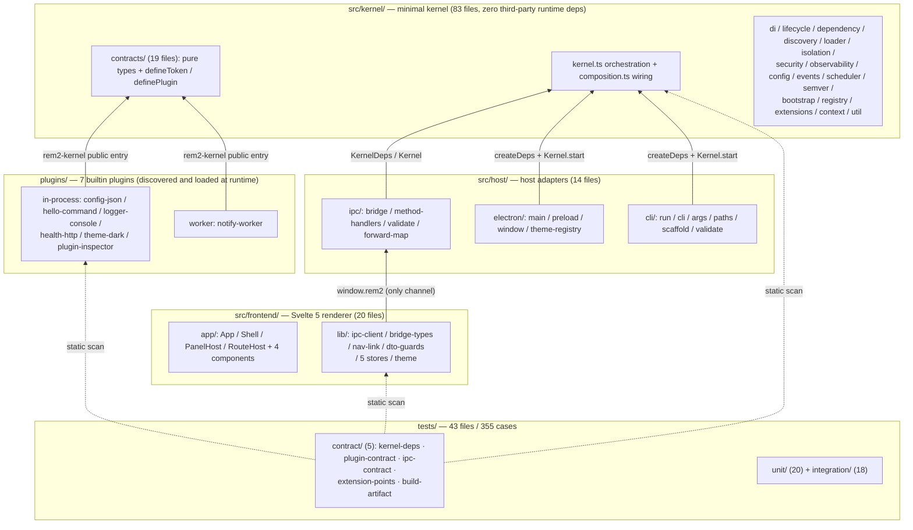
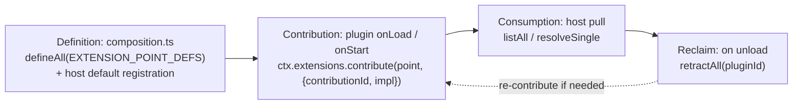
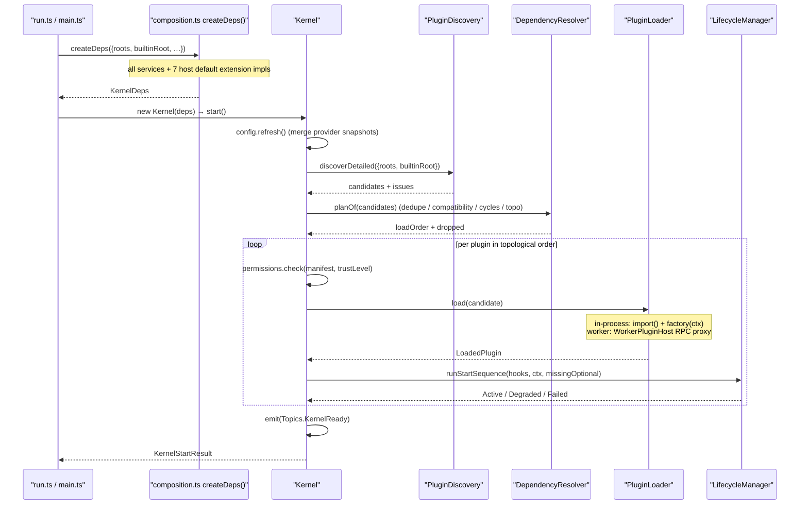

# 01 · Architecture Overview (Authoritative)

> This document describes the **actual behavior of the current code** and is the single authoritative source for architecture and boundaries. If code and this document conflict, the code wins — then fix the drift (update the doc or fix the code), never leave it silently.
>
> **Locating convention**: always cite `file.ts` → `symbol`; line numbers are omitted. Line numbers rot, symbol names do not.
>
> **Companion documents**:
>
> - [`02-plugin-api.md`](02-plugin-api.md) — every contract a plugin author needs
> - [`03-frontend-ipc.md`](03-frontend-ipc.md) — renderer, IPC allowlist, theme path
> - [`04-development-guide.md`](04-development-guide.md) — commands, build, verification, extension, troubleshooting
>
> 中文版：[`../01-architecture-overview.md`](../01-architecture-overview.md)

---

## 1. Layers and dependency direction



Dependencies are strictly one-way, **no reverse edges**:

```
frontend → (window.rem2) → host/ipc → kernel
plugins  → (rem2-kernel public entry) → kernel
host     → (relative imports) → kernel
```

| Layer                   | Hard constraint                                                                                 | Machine-checked by                                                                   |
| ----------------------- | ----------------------------------------------------------------------------------------------- | ------------------------------------------------------------------------------------ |
| kernel                  | zero third-party runtime deps; must not import `host` / `frontend` / `plugins`                  | `tests/contract/kernel-deps.test.ts` R1 / R2 (scanned-file count has a floor)        |
| host (except electron/) | also zero third-party deps (`host/electron/**` may import `electron`)                           | same R1, excluding `host/electron/**`                                                |
| frontend                | must not import kernel / host sources; the only channel is `window.rem2`                        | `tests/contract/plugin-contract.test.ts` R6; allowlist from `src/shared/` (see §7.1) |
| plugins                 | import only `rem2-kernel` / `node:*` / relative paths; manifest `entry` must be `.js` or `.mjs` | `tests/contract/plugin-contract.test.ts` R4 / R7                                     |
| `src/shared/**`         | zero imports (pure literals + pure types)                                                       | `tests/contract/ipc-contract.test.ts`                                                |

**One sentence**: the kernel (83 files) only orchestrates and defines contracts; the host (14 files) adapts Electron / CLI / IPC onto those contracts; the frontend (20 files) consumes 14 allowlisted methods and 5 allowlisted events through `window.rem2`; every business and ops capability (command, config, logging, health, theme, notification, inspector UI) is one of the 7 plugins under `plugins/`.

---

## 2. Directories and responsibilities

### 2.1 Full directory tree

The trailing comment on each line is that file's **sole responsibility**; ★ marks a contract anchor that must be updated together with its counterpart.

```
rem2-kernel/
├── src/
│   ├── main.ts                        # ★ Forge main entry forwarder: import './host/electron/main.js'
│   ├── preload.ts                     # ★ Forge preload entry forwarder: import './host/electron/preload.js'
│   ├── declarations.d.ts              # renderer-side global types for window.rem2
│   │
│   ├── kernel/                        # ═══ minimal kernel (zero third-party runtime deps) ═══
│   │   ├── index.ts                   # ★ the only public entry: contract types + defineToken / definePlugin + tokens + errors
│   │   ├── kernel.ts                  #   orchestration: start / reload / unloadPlugin / shutdown / health
│   │   ├── composition.ts             # ★ wiring: createDeps() builds services + registers host default extension impls
│   │   ├── define-plugin.ts           #   definePlugin(): the single plugin-shape factory
│   │   ├── state-machine.ts           #   logical state machine: TRANSITIONS table
│   │   ├── topics.ts                  #   semantic topic constants Topics / TopicValue
│   │   ├── errors.ts                  #   all error classes and stable codes
│   │   ├── version.ts                 #   KERNEL_VERSION / CONTRACT_VERSION / MANIFEST_FILENAME
│   │   │
│   │   ├── contracts/                 # ═══ the only language plugins may reference (pure types + pure functions) ═══
│   │   │   ├── index.ts               #   barrel, re-export only
│   │   │   ├── manifest.ts            #   PluginManifest / Compatibility / ManifestContribution
│   │   │   ├── plugin.ts              #   PluginFactory / PluginFactoryHooks / PLUGIN_HOOK_NAMES
│   │   │   ├── lifecycle.ts           #   LifecyclePhase / StopReason / PhaseOutcome
│   │   │   ├── context.ts             #   PluginContext / PluginApi / ServicesView
│   │   │   ├── extension-point.ts     #   ExtensionPointId / Def / Contribution / ContributorView
│   │   │   ├── service-token.ts       #   branded ServiceToken interface + defineToken()
│   │   │   ├── kernel-tokens.ts       #   KernelTokens: 16 kernel service tokens
│   │   │   ├── plugins.ts             #   PluginStateT / PLUGIN_STATES / TERMINAL_STATES / PluginInfo
│   │   │   ├── ui.ts                  #   ThemeDefinition / PanelContribution / RouteContribution / ThemeRegistry
│   │   │   └── event-bus · config · logging · metrics · tracing · health · permission · container · service
│   │   │
│   │   ├── extensions/                # ═══ the single mount surface for capabilities ═══
│   │   │   ├── definitions.ts         # ★ declarative table of the 12 extension points (order = list() order)
│   │   │   ├── registry.ts            # ★ ExtensionPointRegistry: define / contribute / enumerate / reclaim by pluginId
│   │   │   ├── command-dispatcher.ts  #   CommandDispatcher: the only dispatcher for command.execute (reads the command.provide slot directly)
│   │   │   ├── contrib-slot.ts        #   slot semantics for single and multi contributions
│   │   │   ├── ports.ts               #   port contracts for the three *.replace points and command.provide
│   │   │   └── ports-types.ts         #   port-side types (LoadedPlugin / PluginLoaderOptions)
│   │   │
│   │   ├── bootstrap/
│   │   │   ├── options.ts             #   KernelOptions + defaultKernelOptions()
│   │   │   └── register-core-services.ts # registers 15 KernelTokens into the root container + 8 capability gates
│   │   │
│   │   ├── lifecycle/
│   │   │   ├── phases.ts              #   mapping table of the 7 lifecycle phases to hooks
│   │   │   ├── pipeline.ts            # ★ physical pipeline (9 steps) expressed as data, so "order == contract" is assertable
│   │   │   ├── manager.ts             #   phase driver + timeout + fatal / non-fatal verdicts
│   │   │   └── rollback.ts            #   reverse rollback after a fatal failure
│   │   │
│   │   ├── di/                        #   Container implementation / lifetime normalization / ServiceRegistryFacade
│   │   ├── dependency/                #   dependency graph, cycle detection, stable topo sort, version compatibility
│   │   ├── discovery/                 #   root scan + manifest read/validate + mtime cache + JSON Schema
│   │   ├── loader/                    #   dynamic import() + entry sandbox + factory assertion + context assembly
│   │   ├── isolation/                 #   worker host / proxy / eval bootstrap / message protocol allowlist
│   │   ├── security/                  #   capability guard + permission manager + trust policy
│   │   ├── observability/             #   log / metrics / tracing / health services + sink bridge + no-op impls
│   │   ├── config/                    #   layered merge + snapshot + change notification + memory provider
│   │   ├── events/                    #   event bus (bucket index + priority ordering) + topic matching
│   │   ├── scheduler/                 #   scheduling port + serial default implementation
│   │   ├── semver/                    #   version parsing, comparison, range satisfaction
│   │   ├── registry/                  #   loaded plugin table + state + health (read-only outward view)
│   │   ├── context/                   #   PluginContext assembly + plugin API (export / useCapability)
│   │   └── util/                      #   deepMerge / disposable / id / timeout
│   │
│   ├── host/                          # ═══ host adapters ═══
│   │   ├── electron/
│   │   │   ├── main.ts                # ★ main process: createDeps() → Kernel → register allowlist tables → window
│   │   │   ├── preload.ts             # ★ the only contract boundary: contextBridge exposes window.rem2
│   │   │   ├── window.ts              #   createWindow(): contextIsolation + sandbox + CSP (renderer-level sandbox; the REM2_DISABLE_GPU=1 opt-in path additionally disables the process sandbox, see 04 §6)
│   │   │   └── theme-registry.ts      #   host-side theme table (depends only on kernel/contracts/ui, imports no plugin)
│   │   ├── ipc/
│   │   │   ├── bridge.ts              #   IpcBridge: narrows both directions + DTO reduction
│   │   │   ├── method-handlers.ts     # ★ Record<AllowedMethod, …> host implementation table (no electron import)
│   │   │   ├── validate.ts            #   runtime validation of IPC args (pure: panelIdOf / uiEventArgsOf / themeIdOf)
│   │   │   └── forward-map.ts         # ★ Record<AllowedEvent, …> kernel topic → external event reduction
│   │   └── cli/
│   │       ├── run.ts                 #   `pnpm dev`: args → KernelOptions → start → health report
│   │       ├── cli.ts                 #   `pnpm cli`: scaffold / validate / list / help
│   │       ├── args.ts                #   command-line argument parsing
│   │       ├── paths.ts               # ★ projectRoot() / builtinPluginsRoot(): path resolution for three run shapes
│   │       ├── scaffold-plugin.ts     #   plugin skeleton generation
│   │       └── validate-manifest.ts   #   manifest validation command
│   │
│   ├── frontend/                      # ═══ Svelte 5 frontend (see 03 for detail) ═══
│   │   ├── entry-client.ts            #   renderer entry: import global.css + mount(App)
│   │   ├── app/                       #   App / Shell / PanelHost / RouteHost / components / global.css
│   │   └── lib/                       #   ipc-client / bridge-types / nav-link / dto-guards / stores(.svelte.ts) / theme/vars.ts
│   │
│   └── shared/
│       └── ipc-contract.ts            # ★ method/event names shared by host and frontend (one copy, zero imports)
│
├── plugins/                           # plugin source units (7, each with 4 files: package.json / tsconfig.json / plugin.json / src)
├── plugins-dist/                      # plugin build output (goes into extraResource, git-ignored)
├── scripts/build-plugins.mjs          # esbuild bundling per plugin (build-time code, deliberately outside src/)
├── tests/{unit,integration,contract}  # 3 test layers + fixtures/ + helpers/
├── examples/config/app.config.json    # sample config for the config-json plugin
│
├── vite.shared.mts                    # ★ single source for alias / ssr.noExternal (conditions differ per target)
├── vite.main.config.mts               #   main process build (target node20)
├── vite.preload.config.mts            #   preload build (output must be named preload.cjs)
├── vite.renderer.config.mts           #   renderer build (the only config that mounts the svelte plugin)
├── vitest.config.ts                   #   node environment + limited concurrency
├── tsconfig.json                      #   baseline: kernel + host(cli/ipc) + plugins + tests
├── tsconfig.build.json                # ★ the only config with noEmit:false (kernel artifact)
├── tsconfig.electron.json             #   main + preload (DOM + node)
├── tsconfig.frontend.json             #   renderer (DOM only, types: [])
├── tsconfig.shell.json                #   forwarder (equivalent to tsconfig.electron.json)
└── forge.config.mts                   #   asar + extraResource: ['plugins-dist'] + Fuses
```

### 2.2 Kernel submodule responsibilities

> The "not responsible for" column matters more than the responsibility column — it is the negative space of the architecture.

| Module                                            | Responsibility                                                                                                                    | Key symbols                                                           | Not responsible for                                             |
| ------------------------------------------------- | --------------------------------------------------------------------------------------------------------------------------------- | --------------------------------------------------------------------- | --------------------------------------------------------------- |
| `contracts/`                                      | the whole language plugins see: pure types + 2 pure factories + 16 `KernelTokens`                                                 | `defineToken`, `KernelTokens`, `PluginManifest`                       | any implementation, IO, or side effect                          |
| `kernel.ts`                                       | orchestration: start / reload / unloadPlugin / shutdown / health                                                                  | `Kernel`, `applyPluginState`                                          | never `new`s an implementation (constructor takes `KernelDeps`) |
| `composition.ts`                                  | wiring: `createDeps()` builds services + registers host default extension impls                                                   | `createDeps`, `KernelDeps`, `CommandDispatcher`                       | makes no orchestration decisions                                |
| `extensions/`                                     | 12 extension point declarations + contribute / enumerate / force-reclaim + 3 `*.replace` ports + the single command dispatch path | `EXTENSION_POINT_DEFS`, `ExtensionPointRegistry`, `CommandDispatcher` | provides no extension implementation                            |
| `di/`                                             | `Container`: parent hidden in a module-private `WeakMap`, explicit `exported`, sibling access                                     | `Container`                                                           | does not judge capabilities (that is `security/`)               |
| `dependency/`                                     | version compatibility + dedupe + cycle detection + deterministic topo sort                                                        | `DependencyResolver`                                                  | loads no plugin code                                            |
| `discovery/`                                      | scan roots, read/validate `plugin.json`, mtime cache                                                                              | `PluginDiscovery`                                                     | never `import()`s an entry                                      |
| `lifecycle/`                                      | physical pipeline (data-driven step table) + phase driver + timeout + rollback                                                    | `START_PIPELINE` / `STOP_PIPELINE`, `LifecycleManager`                | does not decide load order (the resolver does)                  |
| `loader/`                                         | dynamic `import()` + factory call + container/context assembly + worker proxy                                                     | `PluginLoader`                                                        | does not discover or resolve                                    |
| `isolation/`                                      | worker host: RPC + lazy start + crash → Failed                                                                                    | `WorkerPluginHost`                                                    | **not a security sandbox** (see §9 D5)                          |
| `security/`                                       | capability guard + permission manager + trust policy                                                                              | `CapabilityGuard`, `PermissionManager`, `trustLevelFor`               | does no signature verification                                  |
| `observability/`                                  | log / metrics / tracing / health services + sink extension bridges                                                                | `LogService`, `registerHostSinks`                                     | does not implement concrete sinks (plugins contribute them)     |
| `config/`                                         | provider layering + merge + change notification, **no concrete config source built in**                                           | `ConfigService`                                                       | knows nothing about JSON / env / remote (those are plugins)     |
| `events/`                                         | event bus: bucket index, priority desc → seq asc, serial await                                                                    | `EventBusImpl`                                                        | knows no topic semantics                                        |
| `scheduler/` / `semver/`                          | scheduling port + serial impl; version parsing and range satisfaction                                                             | `SerialScheduler`, `satisfies`                                        | —                                                               |
| `bootstrap/`                                      | option normalization + register 15 tokens into root + set 8 capability gates                                                      | `registerCoreServices`, `defaultKernelOptions`                        | **injects no extension default implementation**                 |
| `registry/`                                       | loaded plugin table + state + health (read-only view)                                                                             | `PluginsRegistry`                                                     | —                                                               |
| `context/`                                        | assemble `PluginContext`; plugin API export and capability consumption                                                            | `createPluginContext`, `PluginApiImpl`                                | the plugin API holds no parent container reference              |
| `state-machine` / `topics` / `errors` / `version` | 12-state transition table / semantic topic constants / error classes / version constants                                          | `TRANSITIONS`, `Topics`, `KernelError`                                | `index.ts` exports no implementation class                      |

### 2.3 Host and frontend responsibilities

| Module                                           | Responsibility                                                                                                                            | Key symbols                                      | Not responsible for                                                                        |
| ------------------------------------------------ | ----------------------------------------------------------------------------------------------------------------------------------------- | ------------------------------------------------ | ------------------------------------------------------------------------------------------ |
| `host/electron/main.ts`                          | host entry: `createDeps` + `Kernel` + register implementation tables + window lifecycle                                                   | `startKernel`, `registerWhitelistedMethods`      | knows no plugin id; **contains no method-name string** (tables live in `host/ipc/`)        |
| `host/ipc/method-handlers.ts` + `forward-map.ts` | method implementation table (keys enforced complete by `Record`; args validated at runtime by `validate.ts`) + topic → external event map | `METHOD_FACTORIES`, `EVENT_FORWARD_MAP`          | does not import electron (so vitest can drive it directly)                                 |
| `host/ipc/bridge.ts` + `shared/ipc-contract.ts`  | the only renderer channel: exact allowlist match + DTO reduction                                                                          | `IpcBridge`, `channels` / `events`               | never exposes `bus.emit`, never forwards `bus.on('*')`                                     |
| `host/electron/preload.ts`                       | the only contract boundary: `contextBridge` exposes `{invoke, onEvent}`                                                                   | `Rem2Bridge`                                     | **does not judge the allowlist** (judgment must happen in main; renderer is untrusted)     |
| `host/electron/window.ts` / `theme-registry.ts`  | window creation (CSP / sandbox / dev-vs-prod); in-memory theme table                                                                      | `createWindow`, `ThemeRegistryImpl`              | theme-registry imports no plugin source                                                    |
| `host/cli/*`                                     | terminal kernel bootstrap (primary `pnpm dev` shape); three-form path resolution; scaffold/validate/list                                  | `run`, `builtinPluginsRoot`                      | does not depend on Electron (the kernel is a plain library; the shell is optional)         |
| `frontend/app/**`                                | shell layout + `PanelHost` / `RouteHost` slots + 4 chrome components                                                                      | `App.svelte`, `PanelShell.svelte`                | **contains no plugin id**; chrome is rendered by the host, plugins only supply descriptors |
| `frontend/lib/**`                                | typed wrapper around `window.rem2` + DTO projection and runtime validation (`dto-guards` / `nav-link`) + 5 runes stores                   | `ipc`, `bridge-types.ts`, `parsePanelData`       | imports no kernel/host source; allowlist comes from `src/shared/`                          |
| `plugins/**`                                     | every business and ops capability: command, config source, log sink, health endpoint, theme, notification, inspector panel                | each module's `export default definePlugin(...)` | imports no third-party package; never deep-links into kernel internals                     |

---

## 3. Lifecycle: logical state machine × physical pipeline

Two layers that do not conflict: **the state machine describes what a plugin observably is, the pipeline describes what the kernel actually does**.

### 3.1 Logical state machine (`state-machine.ts` → `TRANSITIONS`)

```
Registered → Resolved → Loaded → Initialized → Configured → Active ⇄ Degraded
     │           │         │          │             │            │
     ├→ Dropped  ├→ Failed ├→ Failed  ├→ Failed     ├→ Failed    ├→ Stopped
     └→ Failed   └→ Stopped└→ Stopped └→ Stopped    └→ Stopped   └→ Degraded

Failed → Stopped → Unloaded → Disposed
```

- Terminal states: `Dropped`, `Disposed` (`TERMINAL_STATES`); no transition out of them.
- An illegal transition throws `IllegalTransitionError` (`E_ILLEGAL_TRANSITION`) instead of being silently corrected.

### 3.2 Physical pipeline (`lifecycle/pipeline.ts` → `START_PIPELINE` / `STOP_PIPELINE`)

| Step | Action                                                                            | Transition                       | Failure semantics                      |
| ---- | --------------------------------------------------------------------------------- | -------------------------------- | -------------------------------------- |
| A    | `discover()` scans the roots                                                      | —                                | —                                      |
| B    | read and validate `plugin.json`                                                   | → `Registered`                   | non-fatal                              |
| C    | `DependencyResolver.resolve(all)` (**whole-graph batch computation**)             | `Registered → Resolved`          | non-fatal → Dropped                    |
| D    | permission check → entry resolution → `import()` → factory call → child container | `Resolved → Loaded`              | **fatal**                              |
| E    | `onDiscover` → `onLoad`                                                           | `Loaded → Initialized`           | fatal / non-fatal per hook             |
| F    | `onConfigure` (reads the config snapshot)                                         | `Initialized → Configured`       | **fatal**                              |
| G    | `onStart`                                                                         | `Configured → Active / Degraded` | **fatal**                              |
| H    | health summary + `KernelReady`                                                    | —                                | —                                      |
| I    | unload: dependents first → `onStop` → `onUnload` → `onDispose` → force reclaim    | step down to `Disposed`          | a failing hook does not block the rest |

**Key trade-off**: dependency resolution is step 5 in logical order (`Registered → Resolved` is one observable transition of a plugin) but step 2 physically (manifests must be read before a dependency graph exists). `pipeline.ts` expresses the order as **data**, and `tests/unit/lifecycle.test.ts` asserts "order == contract" directly, so the two layers can never silently drift apart.

Timeouts: `onStart` is bounded by `startTimeoutMs`, `onStop` by `stopTimeoutMs`; expiry throws `E_TIMEOUT` and is judged fatal or non-fatal. `rollback.ts` reverses the already-executed phases.

---

## 4. Extension point mechanism

Extension points are the only landing surface of "everything is a plugin": a plugin never calls another plugin directly and never registers a capability with the kernel; it **contributes an implementation into a slot**.

### 4.1 The 12 extension points (`extensions/definitions.ts` → `EXTENSION_POINT_DEFS`)

| #   | id                  | Contract type            | Slot   | Conflict    | capability         | Host default                                                                                        | Purpose                                                                                   |
| --- | ------------------- | ------------------------ | ------ | ----------- | ------------------ | --------------------------------------------------------------------------------------------------- | ----------------------------------------------------------------------------------------- |
| 1   | `log.sink`          | `LogSink`                | multi  | keep-first  | —                  | `NullLogSink` (`kernel.null`)                                                                       | log output destination                                                                    |
| 2   | `metrics.sink`      | `MetricSink`             | multi  | keep-first  | —                  | `NoopMetricSink` (`kernel.noop`)                                                                    | metrics export                                                                            |
| 3   | `trace.exporter`    | `TraceExporter`          | multi  | keep-first  | —                  | in-memory buffered exporter (`kernel.buffered`)                                                     | span export                                                                               |
| 4   | `config.provider`   | `ConfigProvider`         | multi  | keep-first  | `config.provide`   | `ReadOnlyMemoryConfigProvider` (`kernel.defaults`)                                                  | config layers (json / env / remote)                                                       |
| 5   | `command.provide`   | `CommandHandler`         | multi  | reject-new  | `command.provide`  | ❌                                                                                                  | business commands (consumed by the kernel `CommandDispatcher`, matched by contributionId) |
| 6   | `health.check`      | `HealthCheckFn`          | multi  | keep-first  | —                  | ❌                                                                                                  | plugin health self-check                                                                  |
| 7   | `ui.theme`          | `ThemeDefinition`        | multi  | reject-new  | `ui.theme`         | `ThemeRegistryImpl` (registered by the host, see §4.3)                                              | theme catalog (light/dark coexist)                                                        |
| 8   | `ui.panel`          | `PanelContribution`      | multi  | reject-new  | `ui.panel`         | ❌ (the slot is legitimately empty without a panel plugin; the shell shows an explicit empty state) | declarative panel descriptor                                                              |
| 9   | `ui.route`          | `RouteContribution`      | multi  | replace-old | `ui.route`         | ❌                                                                                                  | declarative routes                                                                        |
| 10  | `scheduler.replace` | `Scheduler`              | single | replace-old | `kernel.internals` | `SerialScheduler` (`kernel.serial`)                                                                 | replace the scheduler                                                                     |
| 11  | `resolver.replace`  | `DependencyResolverPort` | single | replace-old | `kernel.internals` | built-in `DependencyResolver` (`kernel.builtin`)                                                    | replace dependency resolution                                                             |
| 12  | `loader.replace`    | `PluginLoaderPort`       | single | replace-old | `kernel.internals` | built-in `PluginLoader` (`kernel.builtin`)                                                          | replace the loading mechanism                                                             |

`conflict` on single slots must be declared explicitly — the contract test checks it, and omitting it is a compile error (`ExtensionPointDef` fields are required).

### 4.2 Four phases



Three invariants (`extensions/registry.ts`):

1. Unknown point id → `UnknownExtensionPointError` (never silently ignored).
2. The point declares a `capability` the plugin was not granted → `CapabilityDeniedError` (**contribution itself is capability-gated**).
3. Slot conflicts follow the declared `conflict` strategy; a `keep-first` rejection is recorded in `issues` instead of throwing.

**Reclaim is enforced by the kernel**: `retractAll(pluginId)` runs unconditionally in the unload path. Even a plugin that never calls `retract` has all its contributions cleared — the same principle as `dispose` on the child container: **cleanup must not depend on plugin discipline**. That is why `MultiContributionSlot` keeps a `pluginId → contributions` reverse index; without it the mechanism could not exist.

### 4.3 Where host default implementations are injected

| Location                                    | Contents                                                                                                                                                                                         |
| ------------------------------------------- | ------------------------------------------------------------------------------------------------------------------------------------------------------------------------------------------------ |
| `composition.ts` → `registerHostDefaults()` | `extension-sinks.ts` supplies `log.sink` / `metrics.sink` / `trace.exporter` / `config.provider`; three more (`scheduler.replace` / `resolver.replace` / `loader.replace`) are registered inline |
| `host/electron/main.ts` → `startKernel()`   | `ui.theme`'s host implementation `ThemeRegistryImpl` (depends on Electron window lifecycle, so it cannot live in a zero-dependency kernel)                                                       |
| `bootstrap/register-core-services.ts`       | **injects no extension point**; only registers the 15 `KernelTokens` and the 8 capability gates                                                                                                  |

`KernelTokens` has 16 entries: 15 registered by the kernel (`bootstrap/register-core-services.ts`), `UiThemeRegistry` registered by the host in `host/electron/main.ts` → `startKernel()` via `registerInstance`.

### 4.4 What a worker plugin may contribute

`isolation/worker-protocol.ts` → `WORKER_ALLOWED_EXTENSION_POINTS` allows only `log.sink` / `metrics.sink` / `trace.exporter`, and the contributed value must be structured-cloneable. Contributing a UI extension point throws — the process boundary makes worker-side objects unusable by the renderer.

---

## 5. Isolation and permissions

| Layer            | Mechanism                                                                                     | Boundary                                                                                                     |
| ---------------- | --------------------------------------------------------------------------------------------- | ------------------------------------------------------------------------------------------------------------ |
| Process / worker | `worker_threads` separate thread + RPC proxy                                                  | crash / infinite loop / `process.exit()` never takes down the kernel. **Fault isolation, not a sandbox**     |
| Container        | one child `Container` per plugin; parent hidden in a module-private `WeakMap`; no root handle | can resolve only: its own registrations + sibling exports + parent entries that are `shareable` and exported |
| Capability       | `CapabilityGuard` + `PermissionManager` + `TrustPolicy`                                       | three stages: manifest `requires` → grant computed from `trustLevel` → checked on `resolve` / `contribute`   |

Trust levels: `builtin` = trusted, everything else = sandboxed (`security/trust-policy.ts` → `trustLevelFor`). Signature verification is explicitly out of scope.

**Available / unavailable inside a worker**:

| Facility                                                     | in-process | worker                                                                |
| ------------------------------------------------------------ | ---------- | --------------------------------------------------------------------- |
| `ctx.log` / `ctx.metrics`                                    | ✅         | ✅ RPC                                                                |
| `ctx.config`                                                 | ✅         | ✅ get / has over RPC; `onDidChange` replaced by full-snapshot pushes |
| `ctx.events` (emit / on / request)                           | ✅         | ✅ RPC (`respond` unavailable)                                        |
| `ctx.permissions`                                            | ✅         | ✅ real snapshot taken at init                                        |
| `ctx.resolvePath`                                            | ✅         | ✅                                                                    |
| `ctx.services` / `ctx.api` / `ctx.plugins` / `ctx.container` | ✅         | ❌ throws on call                                                     |
| `ctx.extensions`                                             | ✅         | ⚠️ only the three from §4.4                                           |

---

## 6. Call chains

### 6.1 Startup (identical shape for CLI and Electron)



### 6.2 Command (renderer → kernel → plugin → back)

```mermaid
sequenceDiagram
    participant UI as "CommandPrompt.svelte"
    participant Store as "command.svelte.ts"
    participant IPC as "ipc-client.ts"
    participant PRE as "preload.ts"
    participant MAIN as "ipcMain"
    participant BR as "IpcBridge.handleInvoke"
    participant BUS as "EventBus"
    participant CD as "CommandDispatcher (kernel)"
    participant EP as "command.provide slot"
    participant HP as "command plugin contribution"

    UI->>Store: execute(text)
    Store->>IPC: request(channels.commandExecute, {command, args})
    IPC->>PRE: window.rem2.invoke(method, args)
    Note over PRE: generates an id and pairs the reply by id
    PRE->>MAIN: send(Ipc.Invoke, {id, method, args})
    MAIN->>BR: handleInvoke(payload)
    Note over BR: exact allowlist; a miss replies with an error<br/>without ever entering the event bus
    BR->>BUS: request('command.execute', args, {timeoutMs})
    BUS->>CD: dispatch(payload) (the only responder, registered by start())
    CD->>EP: entries('command.provide'), match by contributionId === command
    EP-->>CD: entry.impl (CommandHandler)
    CD->>HP: impl(args)
    HP-->>CD: {ok, output} (returned as-is, never wrapped again)
    CD-->>BUS: result
    BUS-->>BR: result
    BR->>MAIN: reply({id, ok, result})
    MAIN->>PRE: Ipc.Invoke response
    PRE->>IPC: resolve(result)
    IPC-->>Store: CommandResultDto
    Store-->>UI: last = {...res, command}
```

The host **does not implement** `command.execute` (that key is `null` in `method-handlers.ts`): dispatch goes through exactly one place — the kernel `CommandDispatcher`, registered at the beginning of `start()` (before any plugin `onStart` responder, so `pickResponder` — earliest seq wins — deterministically shadows plugin-side responders). It reads the `command.provide` slot directly, so **recursion is structurally impossible**. **Plugins must not `respond` `Topics.CommandExecute` directly** (even if written, the dispatcher shadows them); contribute the command into the `command.provide` slot instead — see the example in [`02-plugin-api.md`](02-plugin-api.md) §8.

### 6.3 Events (plugin → bus → DTO reduction → renderer)

```mermaid
sequenceDiagram
    participant P as "plugin (bus.emit)"
    participant BUS as "EventBusImpl"
    participant BR as "IpcBridge + EVENT_FORWARD_MAP"
    participant WC as "webContents"
    participant PRE as "preload.onEvent"
    participant FE as "ipc.subscribe / store"

    P->>BUS: emit(topic, payload)
    Note over BUS: snapshot dispatch; priority desc → seq asc;<br/>serial await; subscriber errors isolated
    BUS->>BR: bus.on(topic) (only the 5 allowlisted topics)
    Note over BR: toDto projects only necessary fields
    BR->>WC: send(Ipc.Event, {event, payload})
    WC->>PRE: event channel
    PRE->>FE: handler(dto.payload)
```

### 6.4 Unload and cascade

```
unloadPlugin(pluginId)
  ├─ not loaded → idempotent return
  ├─ plugins that hard-depend on it → recursive unload (reason: 'dependency-failed')
  ├─ runStopSequence: onStop → onUnload → onDispose (idempotent; one failing hook does not block the rest)
  ├─ extensions.retractAll(pluginId)
  ├─ health.unregisterCheck + permissions.unregister
  ├─ rootContainer.unmountChildContainer(child) → child.dispose()
  ├─ applyPluginState('Stopped') → emit(Topics.PluginStateChanged, {pluginId, state})
  │    (contributions are reclaimed first: when the frontend receives the event and
  │     re-pulls, it necessarily sees the post-reclaim list — no race)
  ├─ registry.remove(pluginId)
  └─ emit(Topics.PluginUnloaded, {pluginId, reason})
```

---

## 7. Data paths

### 7.1 Four kinds of data

| Data        | Produced by                                                                                                                                        | Flows through                                                                                                                                          | Consumed by                                                                                                                                        |
| ----------- | -------------------------------------------------------------------------------------------------------------------------------------------------- | ------------------------------------------------------------------------------------------------------------------------------------------------------ | -------------------------------------------------------------------------------------------------------------------------------------------------- |
| **Config**  | `config-json` plugin (`JsonConfigProvider`, priority 10) + read-only kernel defaults `{app:{name:'rem2-kernel'}}` + writable `initialConfig` layer | `ConfigService.refresh()` deep-merges by ascending priority into a snapshot; `get()` refreshes lazily                                                  | plugins read `ctx.config.get(…)` in `onConfigure`; worker plugins get the init snapshot plus change pushes. **Config never leaks to the renderer** |
| **Command** | input in `CommandPrompt.svelte`                                                                                                                    | store → `ipc.request` → preload → `IpcBridge` (allowlist) → `bus.request(Topics.CommandExecute)`                                                       | kernel `CommandDispatcher` reads the `command.provide` slot → command plugin handler → `{ok, output}` back through the same path                   |
| **Event**   | plugin `bus.emit`                                                                                                                                  | `EventBusImpl` → `EVENT_FORWARD_MAP` (5 allowlisted topics) → `toDto` → `Ipc.Event`                                                                    | renderer `ipc.subscribe`                                                                                                                           |
| **Theme**   | `theme-dark` plugin contributes `ui.theme` (light / dark token sets)                                                                               | extension slot → (`method-handlers.ts` → `syncThemeFromExtension()` **pull sync**) → host `ThemeRegistryImpl` (catalog + active) → `ui.theme.list/set` | renderer `theme` store → `theme/vars.ts` → CSS variables + `color-scheme`                                                                          |

The `initialConfig` memory layer has priority 1000, higher than every plugin provider — a plugin's `set()` always writes the memory layer. That is the intended "host config wins" semantics.

### 7.2 IPC boundary: DTO reduction

Kernel `PluginInfo` / `LoadedPlugin` / `HealthReport` carry container handles, permissions and absolute paths; passing them through would leak internal structure and host filesystem paths to an untrusted renderer. So the kernel → host direction is an **explicit projection**:

- Every entry of `EVENT_FORWARD_MAP` carries a `toDto` that keeps only necessary fields (e.g. `plugin.state-changed` projects `{pluginId, state}`).
- `health.report` is trimmed by hand in `method-handlers.ts` to `{status, plugins:[{id,state,status,message?}]}`.
- Frontend `bridge-types.ts` is the explicit whitelist of DTOs.

Cost: every method and event needs a hand-written projection, and new kernel fields do not propagate automatically. Benefit: the leak surface is exactly **15 methods + 5 events**, two enumerable sets anchored to the real `Topics` values by contract tests. See [`03-frontend-ipc.md`](03-frontend-ipc.md) §3 for the lists.

### 7.3 Single source of IPC contract

```
src/shared/ipc-contract.ts        ← the only copy of the strings (channels / events, semantic name → external name)
        │
        ├─ host/ipc/method-handlers.ts   Record<AllowedMethod, MethodFactory | null>   keys = [channels.x]
        ├─ host/ipc/forward-map.ts       Record<AllowedEvent, {topic: TopicValue, toDto}>  keys = [events.x]
        ├─ host/electron/preload.ts      channel constants Ipc.Invoke / Ipc.Event
        └─ frontend/lib/ipc-client.ts    parameter types are AllowedMethod / AllowedEvent
```

- `src/shared/` is a **neutral layer**: zero imports, depended on by both host and frontend, which never depend on each other. So the renderer cannot reach Node / Electron code through it.
- "Forgot to copy a method" = a missing `Record` key = **compile error**, not a silent runtime failure.
- What types cannot catch (whether key sets equal the allowlist exactly, whether topics are real `Topics` values, duplicates) is asserted by `tests/contract/ipc-contract.test.ts` and `plugin-contract.test.ts`.

---

## 8. Build and artifacts

### 8.1 Three production lines

| Line    | Input                                                             | Command                                    | Output                                                                                     |
| ------- | ----------------------------------------------------------------- | ------------------------------------------ | ------------------------------------------------------------------------------------------ |
| Kernel  | `src/kernel/**`                                                   | `tsc -p tsconfig.build.json`               | `dist/kernel/**` (`.js` + `.d.ts` + `.map`); `exports["."]` points here                    |
| Plugins | `plugins/<id>/src/index.ts`                                       | `node scripts/build-plugins.mjs` (esbuild) | `plugins-dist/<id>/dist/index.js` (ESM bundle, node20) + `plugin.json` + `package.json`    |
| Shell   | `src/main.ts` / `src/preload.ts` / `src/frontend/entry-client.ts` | `electron-forge` (VitePlugin)              | `.vite/build/main.cjs`, `.vite/build/preload.cjs`, `.vite/renderer/main_window/index.html` |

`pnpm build` = `build:kernel` + `build:plugins`; both `predev` and `premake` run it.

### 8.2 How plugins enter the package and are located at runtime

```
plugins-dist/ ──extraResource──▶ resources/plugins-dist/ (outside the asar)
                                        │
                        builtinPluginsRoot()  ← host/cli/paths.ts
                                        │
                    KernelOptions.builtinRoot → discovery scan → loader import()
```

- asar stays `true`; plugins live **outside** the asar, so `import()` only needs a normal file path.
- `extraResource` takes a list of directories and derives the target name from the last path segment ⇒ the result is `resources/plugins-dist/`, not `rem2-plugins/`.
- `builtinPluginsRoot()` prefers `plugins-dist/` (built) and falls back to `plugins/` (manual source debugging). **The manifest `entry` is always `dist/index.js`**, so pointing the root at the wrong directory makes every plugin fail with "module resolution failed" — an error far from the real cause.
- `paths.ts` → `moduleDir()` tries `__dirname` (CJS) → `import.meta.url` (ESM, null-checked) → `process.cwd()`: Forge bundles the main process as CJS, where `import.meta.url` is `undefined`; without the null check the app crashes at startup.

### 8.3 dev vs prod

| Dimension      | dev (`pnpm dev` / `electron-forge start`)                                        | prod (`pnpm make`)                                                                                    |
| -------------- | -------------------------------------------------------------------------------- | ----------------------------------------------------------------------------------------------------- |
| Kernel runtime | `tsx` runs TS directly (`predev` still builds first)                             | fully precompiled (`premake` guarantees it)                                                           |
| Plugin root    | `plugins-dist/` (falls back to `plugins/`)                                       | `resources/plugins-dist/`                                                                             |
| renderer load  | Vite dev server (`MAIN_WINDOW_VITE_DEV_SERVER_URL`)                              | `loadFile(.vite/renderer/main_window/index.html)`                                                     |
| Resolve conds  | Node side `['node','import','module']`; renderer `['browser','import','module']` | same                                                                                                  |
| Security       | relaxed in dev                                                                   | Fuses disable RunAsNode / EnableNodeOptionsEnvironmentVariable / NodeCliInspect / OnlyLoadAppFromAsar |

`MAIN_WINDOW_VITE_DEV_SERVER_URL` / `MAIN_WINDOW_VITE_NAME` are **bare identifiers** injected by Forge through Vite `define`. Prefixing them with `process.env.` breaks the substitution, leaving them `undefined` at runtime so the window always takes the `file://` branch. The constant names are the renderer process name uppercased (`main_window` here); renaming the renderer process requires renaming both constants.

---

## 9. Key design decisions

**D1 · The kernel does exactly 7 things**
Bootstrap / Discovery / Load·Unload / Lifecycle orchestration / Dependency resolution / Core contracts / Minimal shared facilities. Acceptance criterion: **adding any capability must not require touching `src/kernel/**`**. Even the scheduler, the dependency resolver and the loader themselves can be replaced by plugins.
Cost: all the DI + lifecycle + extension infrastructure complexity sits in the kernel; plugin-to-plugin collaboration must be explicit (events or `api.export`), with no implicit globals.

**D2 · Plugins are precompiled; no runtime transpilation**
Once the Fuses close the `NODE_OPTIONS=--import=tsx` channel, runtime transpilation is dead code in the packaged app; `entry` always points at `dist/index.js`, so dev and prod share one shape. Cost: rebuild after editing plugin source.

**D3 · A single `definePlugin(manifest, setup)` shape**
Class exports, pre-instantiated singletons and named exports each have hard problems (tree-shaking, loader assertions, ESM alignment). The inline manifest is attached to the factory purely for drift detection against `plugin.json` (`ManifestMismatchError`); `plugin.json` is always authoritative.
Order matters: `defineProperty` must run before `Object.freeze`; reversed, it throws "object is not extensible" only when the kernel actually loads a plugin.

**D4 · `ServiceToken` is a branded interface + pure-function factory**
A class would drag a prototype chain into the bundle and `static create` would depend on module-level state; a branded interface makes any copy of the token behave identically. Cost: no runtime instanceof protection; forgery prevention is compile-time only.

**D5 · Worker isolation is fault isolation, not a security sandbox**
`worker_threads` provides no V8 sandbox; worker code still has full Node capability. Narrowing the goal to "one plugin's failure cannot take down the kernel" is the honest framing. The real security boundary is the kernel-side `CapabilityGuard` plus the RPC allowlist.

**D6 · Exact IPC allowlist matching**
15 methods + 5 events enumerated as `Set<string>` (prefix matching would hand over an entire namespace). Judgment happens in the main process; preload only forwards. Cost: adding an IPC method touches two files (contract + implementation table), and forgetting one is a compile error.

**D7 · DTO reduction instead of passing kernel objects through**
The leak surface shrinks to two enumerable sets; the cost is hand-written projections and no automatic propagation of new kernel fields.

**D8 · Two-layer lifecycle model**
Logical state machine × physical pipeline, see §3. Cost: two tables must stay in sync, guarded by tests.

**D9 · DI parent reference hidden in a module-private `WeakMap`**
TS `private` is compile-time only; runtime fields are enumerable and writable, so a plugin could reach the root container via `(ctx.container as any).parentContainer` and bypass capability guards. Making the cross-boundary access runtime-unreachable instead of type-promised is the only real defense.

---

## 10. Extension flow

### 10.1 Adding a plugin

| Step | Action                                | Location                                                                  |
| ---- | ------------------------------------- | ------------------------------------------------------------------------- |
| 1    | generate a skeleton                   | `pnpm cli scaffold <plugin-id>`                                           |
| 2    | write `definePlugin(manifest, setup)` | `plugins/<id>/src/index.ts`                                               |
| 3    | declare dependencies                  | `plugin.json` → `dependencies` (hard) / `optionalDependencies` (soft)     |
| 4    | declare capabilities                  | `plugin.json` → `requires`                                                |
| 5    | declare contributions                 | `plugin.json` → `contributes` (static, aligned with runtime `contribute`) |
| 6    | build and validate                    | `pnpm build:plugins` → `pnpm cli validate plugins/<id>/plugin.json`       |

**No kernel, host or frontend file changes.** If a change seems necessary, the capability was not modeled as an extension point.

### 10.2 Adding an extension point

| Step | Action                                                                                                                                                    |
| ---- | --------------------------------------------------------------------------------------------------------------------------------------------------------- |
| 1    | `contracts/extension-point.ts` → add a literal to the `ExtensionPointId` union                                                                            |
| 2    | add an `ExtensionPointDef` to `extensions/definitions.ts` (all of `multi` / `hasHostDefault` / `conflict` / `capability` are required)                    |
| 3    | if a new port is needed: add the interface to `extensions/ports.ts`                                                                                       |
| 4    | if `hasHostDefault`: `composition.ts` → `registerHostDefault`                                                                                             |
| 5    | if a capability is needed: constant in `contracts/permission.ts` + handling per trust level in `security/trust-policy.ts`                                 |
| 6    | **update `EXPECTED_IDS` in `tests/contract/extension-points.test.ts`** (the expectation is a hardcoded literal array; not updating it turns the test red) |

### 10.3 Adding an IPC method

1. `src/shared/ipc-contract.ts` → add one entry to `channels` (the only copy of the string).
2. `host/ipc/method-handlers.ts` → add the implementation (**omitting it is a compile error**).
3. If adding an event: add one entry to `events` + one entry in `host/ipc/forward-map.ts` (**omitting it is a compile error**).
4. The frontend method union picks up the new literal automatically; a typo at the call site is a compile error.

Command-style methods must be implemented as `null` (plugins respond the topic directly), otherwise the host competes with the plugin for the same topic.

---

## 11. Known limitations and unwired surface

| #   | Symptom                                                                                                                                                      | Nature                                                                                                                                                        |
| --- | ------------------------------------------------------------------------------------------------------------------------------------------------------------ | ------------------------------------------------------------------------------------------------------------------------------------------------------------- |
| L1  | The three `*.replace` points only support startup-time replacement                                                                                           | Runtime replacement would drop `SerialScheduler` in-flight tasks; undesigned                                                                                  |
| L2  | On Windows only the squirrel maker is usable (verified: produces a `Setup.exe` carrying `resources/plugins-dist/`); the deb/rpm makers need Linux toolchains | Platform limit; if `out/` holds files locked by another process the packager's cleanup is aborted by this machine's safe-delete shim — clear `out/` and retry |

---

## 12. Contract tests: the machine-checkable boundary

| File                                      | Assertions                                                                                                                                                                                                          |
| ----------------------------------------- | ------------------------------------------------------------------------------------------------------------------------------------------------------------------------------------------------------------------- |
| `tests/contract/kernel-deps.test.ts`      | R1 kernel and host (minus electron) have zero third-party imports; R2 the kernel imports nothing upward; R5 `dependencies` stays `{}`; includes extractor self-checks (so "no violations" cannot be vacuously true) |
| `tests/contract/plugin-contract.test.ts`  | R4 plugins import only `rem2-kernel` / `node:*` / relative paths; R6 frontend touches neither kernel nor host source; R7 `entry` ends with `.js` / `.mjs`; IPC event names are real `Topics` values                 |
| `tests/contract/ipc-contract.test.ts`     | `src/shared` has zero imports; method and event key sets equal the allowlists exactly; no duplicates                                                                                                                |
| `tests/contract/extension-points.test.ts` | the 12 ids match the hardcoded `EXPECTED_IDS` one by one; single slots must declare `conflict`                                                                                                                      |
| `tests/contract/build-artifact.test.ts`   | the renderer artifact is the browser build of svelte (sourcemap contains `index-client.js`, not `index-server.js`)                                                                                                  |

Two requirements when writing contract tests:

1. **The assertion must be able to fail.** "No violations" also holds when the extractor is broken, so pair it with a meta-test proving the extractor can extract from a known input.
2. **Reproduce the precondition.** If registration order or load order is not part of the test, the guard cannot catch the real defect.
