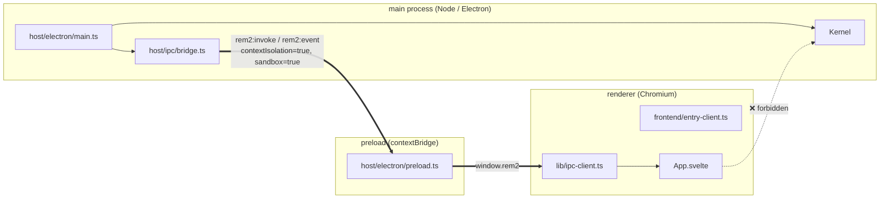
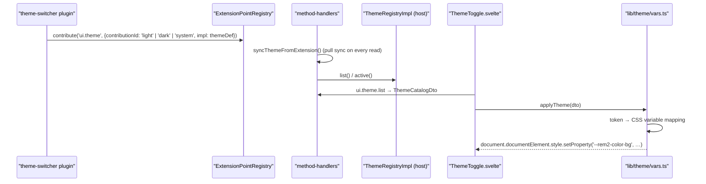

# 03 · Frontend and IPC Contract

> The renderer is the only place Svelte runs and **must not import kernel or host sources**; its only channel to the kernel is `window.rem2`.
>
> Companions: [`01-architecture-overview.md`](01-architecture-overview.md) §7 (data paths and DTO reduction), [`04-development-guide.md`](04-development-guide.md) (build and debugging).
>
> 中文版：[`../03-frontend-ipc.md`](../03-frontend-ipc.md)

---

## 1. Process and build boundaries



| Rule | Content                                                      | Enforcement                                                                                                              |
| ---- | ------------------------------------------------------------ | ------------------------------------------------------------------------------------------------------------------------ |
| B1   | the renderer is the **only** place Svelte runs               | only `vite.renderer.config.mts` mounts `@sveltejs/vite-plugin-svelte`                                                    |
| B2   | preload is the **only** contract boundary                    | `contextIsolation: true` + `sandbox: true`; `window.rem2` is the only global the renderer sees                           |
| B3   | the renderer **must not** import the kernel                  | `tests/contract/plugin-contract.test.ts` R6 scans `src/frontend/**`; `rem2-kernel` or `src/kernel` fails it              |
| B4   | the main process is the kernel's **host**, not the authority | host defaults are registered only through extension points; `main.ts` imports no plugin source and contains no plugin id |

`window.rem2` (`preload.ts` → `Rem2Bridge`) has exactly two methods:

```ts
interface Rem2Bridge {
  invoke(method: string, args?: unknown): Promise<unknown>
  onEvent(event: string, handler: (payload: unknown) => void): () => void
}
```

---

## 2. Frontend layout and responsibilities

```
src/frontend/
├── entry-client.ts              # renderer entry: import './app/global.css' + mount(App); mounting only
├── app/
│   ├── App.svelte               # first paint: four stores load in parallel, subscribes to theme + plugin-state events; $effect resolves the active panel
│   ├── Shell.svelte             # layout: left nav (RouteHost) + main area (PanelHost) + bottom bar (HealthBadge)
│   ├── PanelHost.svelte         # ★ ui.panel slot: renders the panel list, owns the active panel (explicit error / notice / loading priority)
│   ├── RouteHost.svelte         # ★ ui.route slot: derives nav entries from route declarations (explicit error line on top)
│   ├── components/
│   │   ├── PanelShell.svelte    # single-panel chrome: table / JSON rendering + refresh (notify plugin + local re-fetch + consume push)
│   │   ├── ThemeToggle.svelte   # light/dark switch: renders only when the catalog holds both modes, sends ui.theme.set
│   │   ├── HealthBadge.svelte   # health badge reading the health report
│   │   ├── PluginManager.svelte # host-owned plugin management: list / detail / install / enable / disable / uninstall
│   │   └── CommandPrompt.svelte # command input and result display
│   └── global.css               # global styles + fallback values for theme variables
└── lib/
    ├── ipc-client.ts            # the only typed wrapper around window.rem2 (method/event params are allowlist unions)
    ├── bridge-types.ts          # DTOs: Panel / Route / PanelTable / Theme / ThemeCatalog / Health / CommandResult / PluginStateChanged
    ├── nav-link.ts              # pure function: route + panels + panelsReady → active-panel resolution (with notice)
    ├── dto-guards.ts            # pure functions: runtime validation of panel/route lists + panel data classification (table / form / json / empty / invalid)
    ├── stores/                  # Svelte 5 runes; file names must end with .svelte.ts
    │   └── panels · routes · theme · health · command · plugins (one .svelte.ts each)
    └── theme/vars.ts            # ThemeDto → CSS variables (--rem2-*)
```

**Why stores must be `.svelte.ts`**: `$state` / `$derived` require the compiler to recognize them. Inside a plain `.ts` the code is syntactically legal but silently loses reactivity — no error, just no updates.

**Slot semantics**: `PanelHost` / `RouteHost` contain **no plugin id**. Everything is driven by the data contributed to `ui.panel` / `ui.route`: the frontend is written once, plugins decide the content.

**`index.html` must carry no inline styles.** `<body style="background:…">` outranks `global.css`'s `body { background: var(--rem2-color-background) }`, which shows up as "text and borders follow the theme, the background does not" — visible only with multiple themes.

---

## 3. IPC contract

### 3.1 Channels

```ts
// src/shared/ipc-contract.ts
export const Ipc = {
  Invoke: 'rem2:invoke', // renderer → main: request (carries an id; main replies by id)
  Event: 'rem2:event', // main → renderer: event push (no id)
} as const
```

Responses and events live on separate channels so the frontend `subscribe` only listens to one. Request/response pairing still uses ids (done inside preload) rather than relying on `ipcRenderer.invoke` pairing.

### 3.2 Method allowlist (20, exhaustive)

| #   | method (`channels.*`)      | payload                         | Response                                  | Host implementation                                                                                                                                          |
| --- | -------------------------- | ------------------------------- | ----------------------------------------- | ------------------------------------------------------------------------------------------------------------------------------------------------------------ |
| 1   | `ui.panel.list`            | —                               | `PanelDto[]`                              | `kernel.extensions.listAll('ui.panel')`                                                                                                                      |
| 2   | `ui.panel.data`            | `{ panelId }`                   | `unknown` (plugin-defined)                | `bus.request` using the panel's declared `command`                                                                                                           |
| 3   | `ui.route.list`            | —                               | `RouteDto[]`                              | `kernel.extensions.listAll('ui.route')`                                                                                                                      |
| 4   | `ui.theme.list`            | —                               | `ThemeCatalogDto` (`{themes, activeId?}`) | `ThemeRegistry.list()` + `.active()` (pull-syncs the slot before reading)                                                                                    |
| 5   | `ui.theme.set`             | `{ themeId }`                   | `{ ok }`                                  | `ThemeRegistry.activate()`; emits **only when the active theme really changes**                                                                              |
| 6   | `ui.event`                 | `{ panelId, kind, payload? }`   | `{ ok }`                                  | routes to the panel's declared `command`                                                                                                                     |
| 7   | `command.execute`          | `{ command, args? }`            | `CommandResultDto`                        | **`null`** — dispatch lives in the kernel `CommandDispatcher` (reads the `command.provide` slot); the host does not implement it                             |
| 8   | `health.report`            | —                               | `HealthDto`                               | `kernel.health()` + trimming                                                                                                                                 |
| 9   | `plugin.list`              | —                               | `PluginListDto`                           | scans installed dirs + runtime state + disabled intent                                                                                                       |
| 10  | `plugin.detail`            | `{ pluginId }`                  | `PluginDetailDto`                         | `LocalPluginManager.detail()` (includes `origin`)                                                                                                            |
| 11  | `plugin.install.directory` | —                               | `PluginOperationResultDto`                | native directory chooser → validate → staging copy → atomic commit; disabled by default                                                                      |
| 12  | `plugin.enable`            | `{ pluginId }`                  | `PluginOperationResultDto`                | persist intent, including the installed hard-dependency closure → `Kernel.enablePlugin()` with dependency ordering                                           |
| 13  | `plugin.disable`           | `{ pluginId }`                  | `PluginOperationResultDto`                | cascade-disable loaded dependents → persist disabled intent; a live plugin stops on the next plugin-service restart                                          |
| 14  | `plugin.uninstall`         | `{ pluginId }`                  | `PluginOperationResultDto`                | user source only; stop, preserve config/data, exact-directory delete                                                                                         |
| 15  | `plugin.restart`           | —                               | `PluginOperationResultDto`                | `Kernel.restartPlugins()`: stop all plugins, rediscover/resolve/start with the disabled set; kernel and host stay alive                                      |
| 16  | `plugin.remote.inspect`    | `{ url, operationId? }`         | `PluginRemoteInspectionDto`               | resolve release metadata → download (cancellable + progress) → digest check → temp extract → manifest/dependency preflight; **never writes the plugin root** |
| 17  | `plugin.install.remote`    | `{ operationId, url, sha256? }` | `PluginOperationResultDto`                | reuse the inspected package → trusted digest → staging → atomic rename → disabled intent + provenance                                                        |
| 18  | `plugin.download.cancel`   | `{ operationId }`               | `{ ok: true, cancelled }`                 | aborts the matching `AbortController`; repeated cancels are idempotent                                                                                       |
| 19  | `plugin.update.check`      | `{ pluginId? }`                 | `PluginUpdateCheckDto`                    | resolves the latest release from the recorded provenance and compares versions; `hasUpdate: false` means up to date                                          |
| 20  | `plugin.update.install`    | `{ operationId, pluginId }`     | `PluginOperationResultDto`                | download/verify/extract → dependency preflight → backup → install → preserve config/data → optional restart; rolls back on failure                           |

### 3.3 Event allowlist (6)

| #   | event (`events.*`)         | topic (kernel `Topics`)         | payload                                               | Purpose                                                                |
| --- | -------------------------- | ------------------------------- | ----------------------------------------------------- | ---------------------------------------------------------------------- |
| 1   | `ui.theme.changed`         | `Topics.UiThemeChanged`         | `ThemeDto`                                            | recompute CSS variables                                                |
| 2   | `plugin.state-changed`     | `Topics.PluginStateChanged`     | `{ pluginId, state }`                                 | reflect plugin start/stop                                              |
| 3   | `panel.data-changed`       | `Topics.PanelDataChanged`       | `{ panelId, data }`                                   | plugin-pushed panel refresh                                            |
| 4   | `command.result`           | `Topics.CommandResult`          | `CommandResultDto`                                    | command result                                                         |
| 5   | `kernel.ready`             | `Topics.KernelReady`            | `{ loadOrder, started, degraded, failed }`            | first-paint availability                                               |
| 6   | `plugin.download.progress` | `Topics.PluginDownloadProgress` | `{ operationId, phase, receivedBytes?, totalBytes? }` | remote download/verify progress; the renderer filters by `operationId` |

### 3.4 Explicitly forbidden

| Forbidden                                                      | Reason                                                                                                                         |
| -------------------------------------------------------------- | ------------------------------------------------------------------------------------------------------------------------------ |
| any `bus.request(method)` passthrough                          | prefix matching would hand over a whole namespace; judgment must be an exact set of 20 names                                   |
| reading config (any `config.*`)                                | config may hold sensitive values; when a panel needs config, the plugin decides what to expose in its `ui.panel.data` response |
| reading kernel services (`services.*` / `kernel.*`)            | the renderer deals in DTOs, not in the kernel object graph                                                                     |
| arbitrary lifecycle calls (`plugin.start` / `stop` / `unload`) | lifecycle is a kernel/host privilege; only the guarded management methods in §3.2 are allowed                                  |
| subscribing to arbitrary kernel events                         | only the 6 in §3.3; other topics (e.g. `config.changed`) carry internal state                                                  |
| receiving raw plugin events (e.g. `ui.theme.registered`)       | only DTO-ized semantic events are exposed                                                                                      |

**Enforcement point**: `IpcBridge.handleInvoke` checks `allowedMethods.has(method)` (exact `Set` match) **before** `bus.request`. Not in the set → replies `{ok:false,error}` immediately, **never entering the event bus**.

### 3.5 DTOs

```ts
// src/frontend/lib/bridge-types.ts — each type comment names the kernel contract it projects from
interface PanelDto {
  panelId
  title
  icon
  region: 'main' | 'side'
  order: number
  command: string
}
interface RouteDto {
  path
  title
  panelId
  commandPrefix: string
  order: number
}
interface PanelTableDto {
  kind: 'table'
  columns: string[]
  rows: Array<Array<string | number>>
}
interface ThemeDto {
  id
  mode: 'light' | 'dark'
  colors
  fonts
  spacing
}
interface ThemeCatalogDto {
  themes: ThemeDto[]
  activeId?: string
}
interface HealthDto {
  status: 'healthy' | 'degraded' | 'unhealthy'
  plugins: Array<{ id; state; status; message? }>
}
interface CommandResultDto {
  command: string
  ok: boolean
  output?: string
  error?: string
}
interface PluginDetailDto {
  id
  name
  version
  description?
  source: 'builtin' | 'user' | 'workspace'
  state: PluginRuntimeStateDto // includes the management state 'Disabled'
  enabled: boolean
  builtin: boolean
  error?
  entry
  author?
  homepage?
  tags: string[]
  dependencies: Record<string, string>
  optionalDependencies: Record<string, string>
  requires: string[]
  compatibility: { minKernel; maxKernel?; contractVersion }
  canUninstall: boolean
  restartRequired: boolean
  origin?: { kind: 'directory' | 'remote'; url?; sha256?; publishedAt? }
}
interface PluginRemoteInspectionDto {
  url
  downloadUrl
  id
  name
  version
  description?
  requires: string[]
  dependencies: Record<string, string>
  optionalDependencies: Record<string, string>
  compatibility: { minKernel; maxKernel?; contractVersion }
  publishedAt?
  notes?
  sha256? // from release metadata only, never computed from the download
  size?
}
interface PluginUpdateDto {
  pluginId
  currentVersion
  latestVersion
  hasUpdate: boolean
  url
  publishedAt?
  notes?
  sha256?
}
interface PluginUpdateCheckDto {
  updates: PluginUpdateDto[]
}
interface PluginDownloadProgressDto {
  operationId
  phase: 'downloading' | 'verifying' | 'extracting' | 'installing'
  receivedBytes?
  totalBytes?
}
interface PluginListDto {
  plugins: PluginDetailDto[]
  issues: string[]
}
interface PluginOperationResultDto {
  ok: true
  changed: boolean
  restartRequired: boolean
  plugin?: PluginDetailDto
  message?: string
}
```

Plugin management DTOs **never** include `rootDir`, absolute paths, container, permissions or the raw manifest; the renderer re-validates every payload with `parsePluginList` / `parsePluginOperation` / `parsePluginInspection` / `parsePluginUpdateCheck` / `parseDownloadProgress`. `origin`, inspections and update entries are strict objects: a bad field drops the list entry (into issues) or throws for single objects, so a half-valid preview is never rendered. Management errors carry a stable `errorCode` in `IpcResponse`; preload attaches it to `Error.code`. Remote operations use a renderer-generated `operationId`: progress events are filtered by it and cancellation targets it.

A DTO is an **explicit projection whitelist**, not a rename of a kernel type. `CommandResultDto` field names must match what command plugins actually return: `IpcBridge` puts the plugin's return value into `reply.result` unchanged, preload unwraps `payload.result`, so the frontend `invoke` receives the plugin's original object (`{ok, output}`). A wrong field name produces no type error, a blank UI and a clean console — the most typical silent-defect shape in this project.

The `command` field is filled in by the frontend store (`command.svelte.ts` → `{...res, command}`); plugins are not required to return it.

**Panel data contract**: `PanelTableDto` / `PanelFormDto` are the two structured shapes (`dto-guards.ts` → `parsePanelData` classifies and validates at runtime on the renderer side): table → table; form → `select` / `color` fields whose changes go back through `ui.event {kind:'change', payload:{fieldId,value}}`; `undefined` / `null` → empty; anything else → pretty-printed JSON; serialization over **32KB** → `invalid` with an explicit error; declared `kind` with a malformed shape → `invalid` naming the reason. A plugin's `{ok:false,error}` reply reaches `PanelShell` unchanged instead of being rewritten as success. List payloads (`ui.panel.list` / `ui.route.list`) are validated entry by entry as well: bad entries are dropped and counted in `panels.issues`; a non-array payload throws into the store's error state.

---

## 4. store ↔ event bridge

| Direction             | Allowed                                          | Implementation                                                                                         |
| --------------------- | ------------------------------------------------ | ------------------------------------------------------------------------------------------------------ |
| kernel → renderer     | ✅ one-way push, only the 6 events in §3.3       | `IpcBridge` subscribes the topic → `toDto` → `Ipc.Event`                                               |
| renderer → kernel     | ✅ one-way requests, only the 20 methods in §3.2 | `ipc.request`                                                                                          |
| renderer ↔ kernel bus | ❌ **never proxied**                             | proxying the bus would let the renderer `emit` / subscribe any topic, defeating every capability guard |

Two red lines:

1. Never expose `bus.emit` to the renderer — the event bus is a plugin-to-plugin channel and the renderer is not a plugin.
2. Never forward `bus.on('*')` — that leaks every internal topic.

### 4.1 Subscription lifetime

`ipc.subscribe` returns an unsubscribe function that must be returned from `onMount` / `$effect`. `ipc-client.ts` keeps an active-subscription counter (`subscriptionCount()`) so a component destroyed before cleanup does not leak the `rem2:event` listener.

### 4.2 First-paint pattern

```svelte
onMount(() => {
  void panels.load()
  void routes.load()
  void theme.load()
  void health.load()

  const offTheme = ipc.subscribe(events.themeChanged, (p) => theme.applyRemote(p as ThemeDto))
  // Any plugin state change may add contributions (Active) or reclaim them
  // (Stopped / Failed): re-pull unconditionally, because filtering by state
  // set would miss a late-arriving Active.
  const offPluginState = ipc.subscribe(events.pluginStateChanged, () => {
    void panels.load()
    void routes.load()
    void health.load()
  })
  return () => { offTheme(); offPluginState() }
})

// The route is the single source of truth for the active panel; the four loads
// land in parallel, so whichever arrives later re-triggers the resolution.
$effect(() => {
  const res = resolveActivePanel(routes.active, panels.items, !panels.loading)
  panels.applyResolution(res)
})
```

The four data sets load **in parallel and each degrades to empty**: no failure blocks rendering, and each store records its own error. `resolveActivePanel` (`lib/nav-link.ts`, a pure function) makes the route → panel resolution explicit: a route with no panel association → notice; panel missing while the list is still in flight → silent wait (no flash); panel missing with the list ready → notice.

**Panel data refresh has three paths** (`PanelShell.svelte`): ① the refresh button notifies the plugin via `ui.event` (failure silent) and immediately re-fetches locally; ② the plugin emits `panel.data-changed`, and `PanelShell` updates in place after matching the panelId; ③ switching panels re-fetches from the `$effect`.

---

## 5. Theme path



Three invariants:

1. **`ui.theme` is a multi slot = a theme catalog**, not "one active theme". `ThemeDefinition` carries `mode: 'light' | 'dark' | 'system'`; a `followSystem` entry is materialized by the host from the current OS palette while `system` remains the active id.
2. **The active theme belongs to the host** (`ThemeRegistryImpl.active()`). `ui.theme.list` returns `{themes, activeId}` — catalog and selection together, because deriving the selection twice (both sides guessing) makes the applied theme depend on who guessed last.
3. **`ui.theme.set` emits only on a real change.** Otherwise the frontend `setActive` (apply locally, then request) triggers `set → emit → set` forever.

**Pull model**: the extension slot is the single source of truth and `ThemeRegistry` degrades to a cache that syncs on every read. On unload the kernel force-reclaims contributions by `pluginId`, so the next pull is naturally empty — no unload listener needed.

**Themes pushed by the host go through `applyRemote()` and never write back**: it only updates local state and CSS variables.

### 5.1 token → CSS variable

```ts
// lib/theme/vars.ts
const COLOR_KEYS = [
  'background',
  'surface',
  'text',
  'textMuted',
  'accent',
  'border',
] as const
const FONT_KEYS = ['ui', 'mono'] as const
const SPACING_KEYS = ['xs', 'sm', 'md', 'lg'] as const
// → [['--rem2-color-background', '#0f1115'], ['--rem2-font-ui', '…'], ['--rem2-space-md', '16px'], …]
```

`global.css` declares a fallback for every variable (a compile-time constant), so the page stays readable before any variable is injected.

---

## 6. Build configuration

### 6.1 `vite.shared.mts`: what is shared and what is not

| Item              | Value                                              | Reason                                                                                                                                                                        |
| ----------------- | -------------------------------------------------- | ----------------------------------------------------------------------------------------------------------------------------------------------------------------------------- |
| `resolve.alias`   | `{ 'rem2-kernel': <abs>/src/kernel/index.ts }`     | lets Vite treat the kernel as source; `.js` → `.ts` falls back automatically                                                                                                  |
| `ssr.noExternal`  | `['rem2-kernel']`                                  | **critical**. By default the bare name is externalized, leaving `require('rem2-kernel')` in the main bundle, which resolves to the `.ts` entry in a packaged app and explodes |
| `build.target`    | `node20` (main / preload) · `chrome120` (renderer) | aligned with `engines.node` and Electron 44's Chromium                                                                                                                        |
| `build.sourcemap` | `true`                                             | matches `tsconfig.json` `sourceMap`; the contract test uses the sourcemap to prove the artifact is the browser build                                                          |

**`resolve.conditions` must not be shared — it differs per target**:

| Target         | `resolve.conditions`              |
| -------------- | --------------------------------- |
| main / preload | `['node', 'import', 'module']`    |
| renderer       | `['browser', 'import', 'module']` |

Reason: Vite 8 **replaces** the default condition set rather than merging it. svelte's `exports["."]` is `{ worker: index-server, browser: index-client, default: index-server }` — `worker` precedes `browser`, and under Node semantics the `node` condition implies `worker`. Putting `['node', …]` in the shared block makes the renderer lose `browser`, hit `worker` → `index-server.js` → `mount()` throws `lifecycle_function_unavailable` → **build succeeds, page is blank**.

This class of defect lives only at the "browser condition × bundled artifact" intersection: `tsc` sees nothing and vitest (`environment: 'node'`) is right too. The criterion must be a **module-graph fact**: `tests/contract/build-artifact.test.ts` asserts the sourcemap contains `index-client.js` and not `index-server.js`.

### 6.2 Required settings per config

| Config                     | Required                                                                                                                |
| -------------------------- | ----------------------------------------------------------------------------------------------------------------------- |
| `vite.main.config.mts`     | `external: ['electron']`; shared alias / `ssr.noExternal`; no extra `define` (forge injects them)                       |
| `vite.preload.config.mts`  | `external: ['electron']`; `target: node20`; **CJS** output named exactly `preload.cjs` (hardcoded in the main process)  |
| `vite.renderer.config.mts` | `plugins: [svelte()]` (the only config mounting svelte); `conditions` explicitly include `browser`; `input: index.html` |

### 6.3 Compile-time constants injected by Forge

| Constant                          | Use                                                                 |
| --------------------------------- | ------------------------------------------------------------------- |
| `MAIN_WINDOW_VITE_DEV_SERVER_URL` | dev branch loads the Vite dev server                                |
| `MAIN_WINDOW_VITE_NAME`           | prod branch `path.join(__dirname, '../renderer/<name>/index.html')` |

Both are **bare-identifier substitutions**: writing `process.env.MAIN_WINDOW_…` is never replaced, so it stays `undefined` at runtime and the window always takes the `file://` branch. The names come from uppercasing the renderer process name (`main_window` here); renaming the renderer process requires renaming both.

---

## 7. CSP

`index.html` CSP (meta form):

```
script-src 'self';                      ← no 'unsafe-eval'
style-src  'self' 'unsafe-inline';
connect-src 'self' ws://localhost:* ws://127.0.0.1:* http://localhost:* http://127.0.0.1:*;
object-src 'none'; base-uri 'none';
```

| Operation                             | Blocked?   | Notes                                                                                   |
| ------------------------------------- | ---------- | --------------------------------------------------------------------------------------- |
| `style.setProperty('--x', v)` (CSSOM) | ✅ no      | CSP governs `<style>` blocks and inline `style` attribute parsing, not CSSOM            |
| Svelte compiled output                | ✅ allowed | a component's scoped `<style>` compiles into a CSS file loaded via `<link>` (`'self'`)  |
| `$state` / `$derived`                 | ✅ allowed | compiled to plain JS, **no `eval` needed**                                              |
| HMR WebSocket                         | ✅ allowed | `connect-src` lists `ws://localhost:*` explicitly (CSP `'self'` does not cover `ws://`) |

`style-src` needs `'unsafe-inline'`; `script-src` must not add `'unsafe-eval'` — adding it makes Electron print an "Insecure Content-Security-Policy" warning, and that warning is not just noise. In meta form `frame-ancestors` / `form-action` are ignored; do not bother writing them.

---

## 8. Known limitations

| #   | Limitation                                                                                 | Impact                                                                                                               |
| --- | ------------------------------------------------------------------------------------------ | -------------------------------------------------------------------------------------------------------------------- |
| F1  | ~~`ui.panel.data` shape is plugin-defined and unvalidated by the kernel~~ **formalized**   | `dto-guards.ts` → `parsePanelData`: table / form / json / empty / invalid classification + a 32KB cap                |
| F2  | `bridge-types.ts` DTOs are hand-written, so kernel changes do not break the frontend build | mitigated by source comments plus type alignment at assignment sites; `ui.*` `impl` types come from kernel contracts |
| F3  | `preload.cjs` filename is an implicit contract (hardcoded in main)                         | renaming it fails as "preload script failed to load" with no hint about the filename                                 |
| F4  | Runes in a plain `.ts` silently do nothing                                                 | only the `.svelte.ts` naming convention catches it                                                                   |
| F5  | ~~No builtin plugin contributes `ui.panel` / `ui.route`~~ **resolved**                     | `plugin-inspector` contributes the `/plugins` route + the inspector panel                                            |
| F6  | Installs provide no security sandbox, only path/dependency/lifecycle guards                | only install trusted plugins; see `05-plugin-management.md`                                                          |
| F7  | Multiple windows do not share catalog-change events                                        | lifecycle uses the existing state events; install/uninstall requires a manual Refresh per window                     |
| F8  | Remote install accepts only HTTPS ZIP assets from an allowlisted host                      | no registry, no tar.gz, no signature verification; SHA-256 proves integrity, not who published it                    |
| F9  | Update checks hit the release API on every click, with no cache or throttling              | unauthenticated GitHub requests are rate-limited; checking many plugins from one source stacks requests              |
